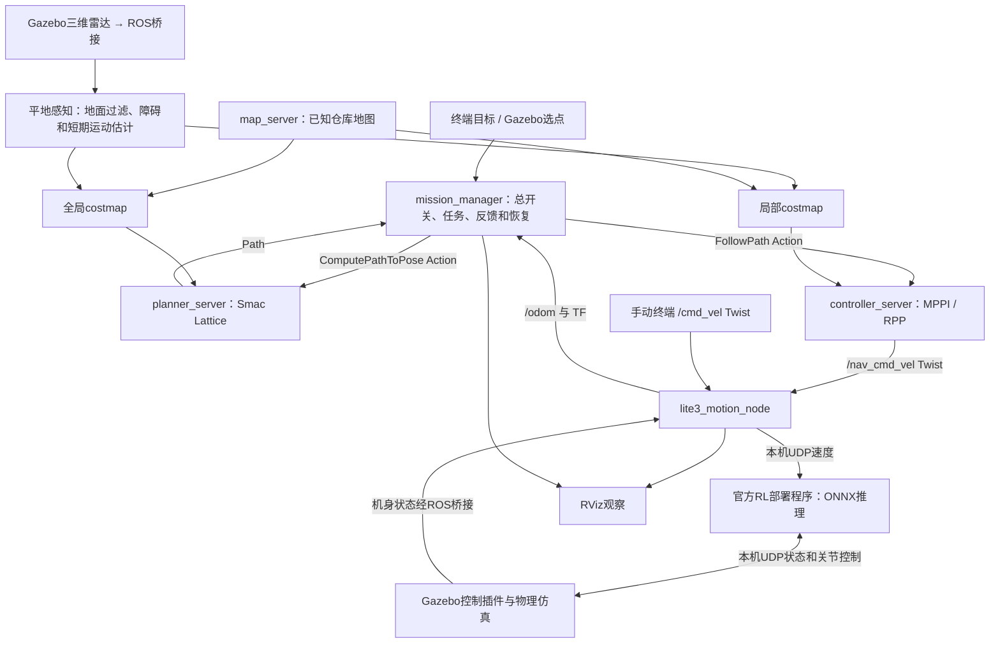

# Lite3 ROS2 Navigation Simulation

基于 **Ubuntu 24.04、ROS2 Jazzy、Gazebo Harmonic、RViz2** 的 Lite3 四足机器人导航仿真课程项目。
使用 DeepRobotics / DeepRoboticsLab 的模型和预训练运动策略：RL负责关节运动，Nav2负责路线与局部避让。
演示运行策略推理，不现场训练；Gazebo与MuJoCo不需要同时运行。

**当前检查点：2026-10-17。** 本页说明当前成果；旧版首页原样保存在
[历史README](docs/development_history/README_BEFORE_SYNC_2026-10-17.md)。
后续AI先阅读[AGENTS.md](AGENTS.md)和[SESSION_HANDOFF](docs/SESSION_HANDOFF.md)。

## 已经完成

- 官方Lite3 URDF/STL整理、ROS2模型包、Gazebo和RViz显示，实际关节与机身姿态同步。
- `bringup.launch.py`统一启动仿真、桥接、运动、感知、地图、Nav2、已有RL及任务管理；日常一般两个终端。
- 手动`/cmd_vel`和导航`/nav_cmd_vel`互斥、停止锁定、速度超时归零，`/odom`和TF反馈。
- 配套仓库世界和静态地图；目前使用Gazebo真值定位，不依赖SLAM或AMCL。
- 终端目标或Gazebo选点导航，导航总开关、任务反馈、取消、结果分类、最后结果查询。
- 三维雷达、平地地面/自身过滤、二维障碍投影，全局与局部costmap融合静态图和实测障碍。
- 紧凑雷达物体的短期运动估计及独立过期预测层，MPPI途中避让、RPP最终接近。
- 受阻暂停、等待与有限重规划；Lattice规划时检查矩形朝向，近期失败路段软偏好、必要时后退。
- RViz显示当前执行路线和任务状态，结束/恢复时清除旧执行路线，减少误判“仍在卡住”。

**最新实际验证：** 仓库目标(4,3.5,0°)到达；途中加入并持续横穿的箱子避让到达，追加90°目标也到达。
后者主任务重规划5次、机器人与箱子接触记录0，接触数据正常。
这是有限场景的实际证据，不是任意环境零碰撞保证；最终结果与迭代失败均见
[本轮证据](docs/development_history/evidence/footprint_replanning_2026-10-17/README.md)。

## 系统如何运作



包、节点和插件不是同一概念。六个package并不等于六个运行节点。
应用主体是任务、运动、感知三个自定义节点，复用地图/规划/控制、桥接、模型状态发布、TF和RViz。
Nav2内部还有costmap节点，启动有短时辅助节点；RL和Gazebo插件不是额外ROS2节点。
此次优化没有增加常驻节点，原整体分工不变。

|包|项目中的作用|
|---|---|
|lite3_description|URDF、必需STL、RViz模型配置|
|lite3_gazebo|仓库/测试世界、地图、仿真启动、Gazebo选点和测试箱子插件|
|lite3_control|Gazebo关节接口插件；ROS速度互斥、停止、UDP及里程计/TF|
|lite3_interfaces|NavigateTask Action消息定义，不是独立运行节点|
|lite3_navigation|统一bringup、任务节点、导航CLI、Lattice/MPPI/RPP配置和控制器适配|
|lite3_perception|点云过滤节点；体素、短期预测和失败路段偏好costmap插件|

主要接口：

|接口|类型|作用|
|---|---|---|
|/navigate_task|lite3_interfaces/action/NavigateTask|用户目标、进度和最终结果|
|/compute_path_to_pose|nav2_msgs/action/ComputePathToPose|任务节点请求全局路线|
|/follow_path|nav2_msgs/action/FollowPath|任务节点请求执行完整路线|
|/cmd_vel / /nav_cmd_vel|geometry_msgs/msg/Twist|手动/导航速度，m/s及rad/s|
|/odom|nav_msgs/msg/Odometry|当前仿真里程计，由真值状态换算|
|/lite3/lidar/points|sensor_msgs/msg/PointCloud2|原始三维雷达|
|/scan|sensor_msgs/msg/LaserScan|过滤后的二维障碍投影，不是完整三维点云|
|/lite3/perception/forecast|sensor_msgs/msg/PointCloud2|估计的短期未来区域，不是实测回波|
|/lite3/set_navigation_enabled|std_srvs/srv/SetBool|导航总开关，启动默认关闭|
|/lite3/get_navigation_state|std_srvs/srv/Trigger|只读查询阶段及最后结果|
|/lite3/navigation_path|nav_msgs/msg/Path|当前接受执行的路线，结束清空|
|/lite3/navigation_marker|visualization_msgs/msg/Marker|RViz任务状态文字|

完整发布/订阅关系、模式、取消和单位见[终端手册](docs/TERMINAL_COMMANDS.md)。

## 实际目录

完整文件清单与SHA256在[SNAPSHOT_MANIFEST](docs/SNAPSHOT_MANIFEST.json)，本次扫描见[SYNC_AUDIT](docs/SYNC_AUDIT.md)。
下面是按当前实际文件生成的主要目录概要，并非仅上传这些列举项：

```text
lite3_ws/
├── .gitignore
├── AGENTS.md
├── README.md
├── CHANGELOG.md
├── THIRD_PARTY_NOTICES.md
├── src/
│   ├── lite3_description/    # launch、urdf、meshes、rviz
│   ├── lite3_gazebo/         # launch、worlds、maps、config、gui、src、test
│   ├── lite3_control/        # src、test
│   ├── lite3_interfaces/     # action
│   ├── lite3_navigation/     # launch、scripts、src、config、rviz、test
│   └── lite3_perception/     # scripts、src、config、test
├── external/lite3_rl_deploy/ # 策略、六份源码快照、恢复补丁、版本及许可
└── docs/                    # 操作、接续、设计、开发时间线和测试证据
```

本地build/install/log和Python缓存不提交。STL、三份URDF、世界、地图和配置均保留。
外部原始仓库`/home/ma/deep_robotics_model`不整体上传。

## 新电脑恢复

前提：Ubuntu24.04和ROS2 Jazzy已安装，能够source `/opt/ros/jazzy/setup.bash`。
仓库为private，需要GitHub访问权限。以下适用于用户名ma且两个目标目录尚不存在的电脑；
其他用户名需一致修改路径和`rl_dir`，不要覆盖已有项目。

```bash
git clone https://github.com/STAR-626/lite3_ros2_navigation.git /home/ma/lite3_ws
source /opt/ros/jazzy/setup.bash
cd /home/ma/lite3_ws
sudo apt-get install python3-colcon-common-extensions python3-rosdep \
  ros-jazzy-ros-gz ros-jazzy-rviz2 ros-jazzy-joint-state-publisher-gui \
  ros-jazzy-nav2-smac-planner ros-jazzy-nav2-mppi-controller
# rosdep尚未初始化的电脑先执行sudo rosdep init（只做一次）
rosdep update
rosdep install --from-paths src --ignore-src --rosdistro jazzy -r -y
colcon build
source /home/ma/lite3_ws/install/setup.bash
```

还必须按照[外部RL恢复说明](external/lite3_rl_deploy/README.md)获取指定官方版本、
应用本仓库补丁、校验策略并重新编译到`/home/ma/Lite3_rl_deploy/build/rl_deploy`。
六份快照不是独立可编译的整个官方项目；无需再训练，也不复制本机虚拟环境或build。

## 日常使用：两个终端

终端1保持运行：

```bash
source /opt/ros/jazzy/setup.bash
source /home/ma/lite3_ws/install/setup.bash
ros2 launch lite3_navigation bringup.launch.py
```

等待READY后，终端2：

```bash
source /opt/ros/jazzy/setup.bash
source /home/ma/lite3_ws/install/setup.bash
ros2 service call /lite3/get_navigation_state std_srvs/srv/Trigger '{}'
ros2 service call /lite3/set_navigation_enabled std_srvs/srv/SetBool '{data: true}'
ros2 run lite3_navigation navigate 4.0 3.5 0
```

CLI的x/y单位米、角度默认度数；直接Action的goal_yaw使用弧度。
总开关开启后也可用Gazebo面板新选点导航。忙碌时不覆盖当前任务，旧点击不重放。
失败关闭入口并保持停止锁定，修正原因后显式重开；退出在终端1按Ctrl+C。
修改源码后先退出旧系统再构建，不能覆盖正在加载的插件，也不要并行启动MuJoCo或第二套RL。

原(4,4,0°)在一次实时雷达图中完整轮廓触边，不能保证仍可停靠；需要留出身体及朝向的空间。
默认Lattice+MPPI；`planner:=navfn`可对比旧规划器，`controller:=rpp`保留原控制器回退。

只看模型可用`ros2 launch lite3_description display.launch.py`。
完整bringup会处理模型与插件资源路径；手动Gazebo调试需要时可设置：

```bash
export GZ_SIM_RESOURCE_PATH=/home/ma/lite3_ws/install/lite3_description/share:${GZ_SIM_RESOURCE_PATH:-}
```

这是让Gazebo找到安装后的package网格资源；ROS2运行入口优先使用install/share，
源码目录中的资源必须经CMake安装后才能在其他电脑按相同规则查找。

## 当前限制与后续计划

- 当前为平地版：固定地面高度过滤，不能声称已解决起伏/崎岖地形或楼梯通行。
- 已知静态地图与Gazebo真值定位保留；后续计划加入SLAM实时建图及相应定位/地图切换。
- 动态避让为有限场景验证；短期匀速估计受遮挡、视角变化、突然转向和多物体影响。
- 20cm内切半径对应0.84×0.40m矩形，站姿侧向余量较小，不能保证完整足端外摆。
- 离散轮廓规划成功不等于真实必过。重规划仍有次数/时间上限；终点受阻可返回INVALID_GOAL。
- 尚无专门跌倒检测/自主起身/完整自训练流程；MOTION_FAILED接口常量不代表已具备跌倒识别。

下一步先复核原受阻场景，继续扩大动态避让验收，再按原计划推进SLAM。
不改变原[ARCHITECTURE](docs/ARCHITECTURE.md)和[ROADMAP](docs/ROADMAP.md)，其中早期“当前状态”按其日期阅读。

## 开发记录与常见问题

- [CHANGELOG](CHANGELOG.md)：最近bug、原因、修改、复测和保留的失败。
- [终端交互手册](docs/TERMINAL_COMMANDS.md)：所有日常命令、参数、状态及错误解释。
- [完整轮廓优化](docs/FOOTPRINT_REPLANNING.md)、[持续避让](docs/CONTINUOUS_AVOIDANCE.md)。
- [接续记录](docs/SESSION_HANDOFF.md)、[运行手册](docs/RUNBOOK.md)、[开发时间线](docs/development_history/TIMELINE.md)。
- [课程汇报素材](docs/PROGRESS_REPORT.md)。

robot_description为空或RViz模型不显示时检查URDF读取、robot_state_publisher和显示订阅；
Gazebo有实体却无网格时检查资源安装和GZ_SIM_RESOURCE_PATH；先source Jazzy再调用gz。
端口占用/窗口闪烁时检查是否重复启动，不能再启动一套来掩盖旧进程问题。
定位/速度异常时先查TF、RL实际模式、停止锁和输入超时，不通过关闭碰撞检查强行运动。
详细步骤见终端手册，本文不把尚未实际复测的新电脑恢复过程写成已验收。

## 资源来源与许可

Lite3 robot model resources originate from DeepRobotics / DeepRoboticsLab.
模型、预训练策略/部署程序、仓库地图各自的许可及版本见[THIRD_PARTY_NOTICES](THIRD_PARTY_NOTICES.md)。
BSD/MIT等原版权和许可原文均保留，不使用第三方名称作背书；第三方依赖按版本另行安装。
仓库保持private；未来公开前应再次核查模型、策略权重补充条款及原两个包中的许可证TODO。
