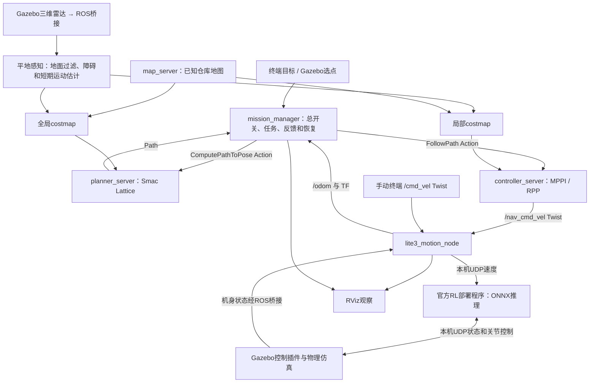

# Lite3 ROS2 Navigation Simulation

2026-10-20同步：新增[AI工具任务闭环](docs/AI_TOOL_AGENT.md)、[环境语义](docs/ENVIRONMENT_SEMANTICS.md)、[物体接近导航](docs/OBJECT_APPROACH.md)与[课程Word报告](docs/reports/README.md)。用户确认本仓库保持公开；配置密钥仍保存在仓库外。详见[同步审计](docs/SYNC_AUDIT.md)。

## 2026-10-20：DeepSeek原生工具闭环（当前默认）

用户要求模型依据环境理解完整指令、组合后台能力，不再靠扩充别名/整句规则。新增原生function calling适配器、
工具清单及异步执行循环。bringup在language_mode=deepseek时默认agent_tools=true；旧JSON解析用agent_tools=false回退，rules及非AI原入口保持。
模型读取完整原句、含实时位置的环境目录及近3轮真实工具结果，可查询环境/状态、串行接近多个物体、导航地点、返回本轮出发处、管理地点。
程序不执行模型shell，不暴露项目读写或自动解锁；导航仍需用户本地明确开启，覆盖确认不交给模型。

工具用现有ROS/几何接口执行，运动Action确认成功才继续；停止/断线作废网络和后续步骤。
运动失败先停止清理，再反馈给模型，本轮只允许查询解释；即使模型继续发运动也拒绝。
多步示例“先去东墙，再去货架1，最后回来”已在真实Gazebo＋Smac隔离链路验证；不是新增中文墙体别名匹配规则。
支持按真实地点列表批量删除，不删除物体或启动原点。临时目标不持久化；记忆仅内存近3轮，长轮次压缩保留工具/参数/结果。
每组24次运动/32模型轮/64工具/20实际分钟上限；单HTTP30秒期限。模型API会发送环境位置、机器人位置和近期工具记录，未上传原始SDF/地图/点云或密钥。

已构建安装：89项单元、工具协议8项、真实Gazebo/Smac多腿3项、原JSON13项/规则13项/接近11项回归通过。
模型和运动是替身，真实规划用合成TF/静态地图、仅静态/膨胀层；未读用户密钥、未调用真实API、未启动机器狗/RL。
真实DeepSeek措辞与正常全感知系统行走待用户验收。操作见[工具入口](docs/AI_TOOL_AGENT.md)。未提交/推送Git。

## 2026-10-20：货架自动编号标注

默认shelf_1～shelf_17显示为货架1～货架17，提供“1号货架/一号货架/货架一/第1号货架”等编号别名。
已将当前场景17个货架编号持久保存至地图绑定语义文件，已有自定义旧名称作为别名尽量保留；其他地点/用途不改。
新环境也可由模型名提供默认编号，无需用户逐个标注。Gazebo内部模型名和SDF/PGM不变，避免破坏几何关联。
已构建安装，17个货架编号与中文/数字别名逐项回读验证，原79项单元检查通过。启动后可直接说“去三号货架旁边”。
未进行本轮机器狗实走或API调用；未提交/推送Git。

## 2026-10-20：按物体生成临时安全接近点

在语义目录之上接入单物体approach任务：读取原world中固定刚性模型的碰撞几何，结合实时物体位置、
实际全局costmap保护轮廓和完整地图筛选最多12个侧面候选，再由原Smac Lattice验证首个可达位置。
可指定地图东南西北和0.15～1.5m保护边缘间距，默认0.4m另留5cm离散余量。
选出的坐标只交原NavigateTask，不存Places/语义文件，不改地图或Nav2/RL参数。

规则/DeepSeek入口支持“去货架A旁边”“去一号货架南侧 距离=0.5”；模型可输出approach对象/方位/距离，
坐标由本机计算。导航必须已显式开启；停止/断线/超时/迟到结果隔离，计算或执行中物体移位/失效会拒绝或停止。
本版先支持原场景固定货架等已知基本碰撞几何，拒绝运行时新增/动态/关节/mesh，暂非多物体巡检或视觉检测。
默认Lattice之外的旧navfn导航仍保留，但此新功能要求完整轮廓规划，不降级猜坐标。

构建安装及79项离线单元通过，真实Gazebo+Smac/costmap隔离4项、模拟接近协议11项通过，
原语义10项/模型13项/规则13项回归通过。真实规划测试使用合成map/TF、静态/膨胀层及替身NavigateTask，
没有机器狗/RL运动或真实API；正常全系统实走与在线措辞待用户验收。
操作见[临时物体接近说明](docs/OBJECT_APPROACH.md)。未提交/推送Git。

## 2026-10-20：环境语义目录第一步

交互后台新增只读Gazebo场景/位姿辅助进程，读取17货架/4墙和运行时新增模型，过滤地面、机器人与展示标记。
按模型/已保存地点关联中文名、别名、类别、用途；本机标注以地图和world内容指纹绑定的600权限JSON原子持久化。
实时模型坐标不当作永久地点保存；删除显示不存在、场景不可用隐藏旧位姿。原Places格式及所有非AI导航方式保持。

rules/deepseek两种入口均支持“列出环境”“列出类别 货架”“查询物体 shelf_1”和明确标注；
DeepSeek正式请求附带有界语义目录、可返回env_list/env_show/env_label，由本机核实执行。
模型默认不收到物体坐标，位置查询本地完成；用户原句/澄清文本含坐标时仍按原协议发送。
普通地点别名可解析回原地点；有体积物体尚未配置安全接近点，明确拒绝导航到物体中心。
没有新增ROS节点（辅助进程非ROS），未修改Nav2/RL/感知/停止规则，未实现自动巡检或感知识别。

构建安装、67项离线单元、10项真实Gazebo/后台隔离检查、原13项模型入口和13项规则协议回归通过。
未读取密钥/调用真实API，未启动机器狗/RL，真实模型措辞与整机导航仍待用户验收。
启动命令不变；操作见[环境语义说明](docs/ENVIRONMENT_SEMANTICS.md)。未提交/推送Git。

## 2026-10-20：永久移除仓库旧目标标记与三个小箱子

按用户要求从默认 `src/lite3_gazebo/worlds/large_warehouse.sdf` 删除
`destination_marker_1`、`destination_marker_2`、`box_obstacle_1`～`box_obstacle_3`。
保留黄色 `spawn_marker`、墙壁、货架和其余模型；整体导航/AI架构及控制参数不变。

核对原二维静态地图：两标记包围框各225格、三小箱子包围框各12格均已为254（空闲），
因此无需擦除地图，PGM/YAML逐字节不变，地点文件的地图指纹保持兼容。
重启整套系统后感知/costmap重新建立，不会从旧运行缓存恢复这五个模型的障碍记录。
场景已构建安装；SDF原生校验和独立Gazebo scene服务加载检查通过，未启动机器狗/RL或验证导航实走。
默认启动命令不变，使用自定义world参数的场景不在本次修改范围。
验证与本地备份路径见 `docs/development_history/evidence/warehouse_cleanup_2026-10-20/result.json`。
未提交或推送Git。

## 2026-10-20：DeepSeek多轮澄清与交互修正

用户截图暴露接入缺口：模型每次只收到单句，虽然询问补充，却无法理解后续“保存为”“1”；目标已解析时导航状态拒绝也被混成一句。新增最多3轮/90实际秒的待澄清上下文，包含用户原话和模型问题，完成操作、停止、退出或失效清空，不保存完整聊天。明确当前位置无需再索要坐标，保留名“家/原点”不能普通覆盖。

DeepSeek模式下数字/中文数字引用可匹配已有点名，精确同名优先，不凭空创建别名；新存点不被本地悄悄重命名，同名覆盖仍需明确确认。导航拒绝按关闭、忙碌、切换、故障分别提示，不自动开启或补发目标。结果显示改为易读动作说明，终端减少重复输入提示。独立preview也支持短期澄清。

51项单元、13项模拟模型执行、13项规则回归通过；[证据](docs/development_history/evidence/deepseek_dialogue_2026-10-20/README.md)。

操作仍见[DeepSeek执行说明](docs/DEEPSEEK_EXECUTION.md)。本轮只作离线单元与模拟模型执行验证，未读取密钥或发真实API请求，真实措辞需用户复试；RL、感知和Nav2不变，未提交/推送Git。


## 2026-10-20同日后续：DeepSeek正式交互入口

用户已确认真实API预览、缺参数和不支持任务测试正常。新增`language_mode:=deepseek`把模型白名单JSON接入原地点/顺序任务执行；默认仍为rules。网络请求在后台有界守护线程处理，ROS线程消费并重新校验，停止/心跳/约定查询不等待模型。请求绑定会话、停止代际、30秒期限与地点快照，失效或迟到结果不执行；覆盖确认只能由用户明确输入。

正式启动：`ros2 launch lite3_navigation bringup.launch.py ai_control:=true language_mode:=deepseek`，另一个终端仍运行`ros2 run lite3_navigation ai_console`。正式控制区别于独立预览：解析通过后会执行。密钥沿用仓库外600权限文件，本轮未读取或发起实际API调用；执行链路使用模拟模型/ROS任务隔离验证，完整真实模型＋机器狗实走待用户验收。没有新增节点或修改RL/Nav2/感知。

验证：35项离线单元、10项模拟模型执行协议、13项原规则入口回归通过；[证据](docs/development_history/evidence/deepseek_execution_2026-10-20/README.md)。

操作与边界见[DeepSeek执行入口](docs/DEEPSEEK_EXECUTION.md)。未提交/推送Git。


## 2026-10-20：DeepSeek独立解析预览工具

在规则交互已由用户实测通过后，新增deepseek_setup.py、deepseek_parser.py和deepseek_preview.py。用户在本机TTY隐藏输入密钥，600权限存储于仓库外配置目录；工具固定请求DeepSeek官方HTTPS端点，输出白名单JSON并本地校验。独立预览无ROS/执行路径，不修改运行中的规则后台，不发导航任务。当前未接通执行、未读取真实密钥、未作实际付费调用；16项离线检查通过，不能当作模型在线验证。

操作见[DeepSeek预览](docs/DEEPSEEK_PREVIEW.md)。先由用户运行密钥配置和真实解析测试，再接执行；下一阶段网络请求必须与心跳/停止解耦。未提交/推送Git。


## 2026-10-20：规则交互入口、命名地点与顺序任务

新增可选`ai_control:=true`启动后台`lite3_interaction`，READY后另一个终端运行`ros2 run lite3_navigation ai_console`。本版未调用大模型/API，使用明确的规则句式，不执行任意shell命令；既有导航默认启动行为保持。

支持开启/关闭导航、停止、状态、保存/查询/删除地点、同名覆盖确认、当前位姿存点、命名地点导航及最多12步顺序任务。地点按地图指纹原子持久化；原点自动记录本次首次有效位姿。整组开始前检查点名并固定坐标；每一步Action成功才进入下一步，失败或断线取消后续任务。2.5实际秒心跳超时、显式退出、迟到接受均有停止/取消处理。

Gazebo圆环、点名和箭头使用GUI-only Marker，无碰撞体或world模型；Ogre2不支持原生TEXT，因此用Qt字形轮廓绘制地面平行标签。刷新与删除同步，标记传输进程不是ROS节点。后台和打开的console各新增1个节点，原RL/Nav2接口不变。

验证：16项规则/存储单元、13项后台/终端协议、5项真实Gazebo GUI/雷达检查通过；证据见[交互验证](docs/development_history/evidence/interaction_2026-10-20/README.md)。

操作与协议见[规则交互说明](docs/NATURAL_LANGUAGE_CONTROL.md)。隔离协议及真实GUI/雷达检查不能替代机器狗＋RL完整队列实走验收；后续再接模型映射与扩展措辞。未提交/推送Git。


## 2026-10-20：移动视角下旧障碍的清除确认

针对一种已复现的障碍边沿闪烁机制增加保护：同一扫描方向存在更近实测回波时，保留被遮挡/边界不确定的旧高度体素；原生射线确实扫过且没有近处回波妨碍判断时，需要3个不同时间戳的空闲扫描确认才清除。重复使用同一帧不累计。

真实Gazebo GPU雷达＋实际位姿TF＋感知＋原生双costmap隔离测试中，旧版25个绕箱视角的24个旧边沿格最低剩17个，新版全部保留。箱子移走但被挡住时24格保留，解除遮挡并换到射线能穿过旧高度的视角后约0.43实际秒清除。原移箱七项回归、原生可见性七项、28项感知单元及9项角度/高度判定检查通过。

没有增加节点、修改RL、控制器或后台换路阈值。测试没有加载机器狗或RL，尚不能据此宣称用户完整导航中所有反复换路均已修复。扫描线间隙、盲区及保守边界仍可能保留旧格，需要可靠的新视角；不按超时盲删。

说明与复测：[障碍遮挡清除说明](docs/OBSTACLE_VISIBILITY.md)。

## Gazebo图形化动态障碍操作（2026-10-18）

原“Lite3目标选点”面板已扩展为“Lite3 导航与动态障碍”：导航目标页保留原操作；
动态箱子页支持尺寸/速度设置、点击地面放置、WASD或方向按钮按住移动、松开停止及移除。
不新增ROS2节点，不控制机器狗速度。界面和独立Gazebo物理验证通过，完整动态导航仍需现场验收。
详细操作见[双用途面板说明](docs/GAZEBO_DUAL_PANEL.md)。


## 最新导航更新：旧障碍清除与行走中路线优化（2026-10-18）

已补齐“确认箱子移走→清除costmap→后台规划→明显缩短时交接新路线”的链路。
约每2秒检查，至少缩短0.5米且15%才更新，接近终点不切换，不主动暂停当前控制。
原取消/停止/有限恢复规则保留，没有增加节点。真实雷达/双costmap/Smac/MPPI隔离链路通过，
测试路线约3.45m→2.33m；尚未进行本版本完整机器狗＋RL实走验收。
详见[路线优化说明](docs/ROUTE_REFRESH.md)。


## 最新感知修复：移走箱子后的地图清除（2026-10-18）

已补充Gazebo三维雷达有效无命中射线的清除信息，修复一种高箱子移走后两张costmap残留问题。
28项单元与七项真实雷达/双地图隔离验证通过，静态障碍及被遮挡旧记录保留。
该清除修复的隔离测试未包含RL/机器狗实走；后台路线优化随后已接入，见上节。
详见[感知说明](src/lite3_perception/README.md)及[证据](docs/development_history/evidence/obstacle_clearing_2026-10-18/README.md)。


基于 **Ubuntu 24.04、ROS2 Jazzy、Gazebo Harmonic、RViz2** 的 Lite3 四足机器人导航仿真课程项目。
使用 DeepRobotics / DeepRoboticsLab 的模型和预训练运动策略：RL负责关节运动，Nav2负责路线与局部避让。
演示运行策略推理，不现场训练；Gazebo与MuJoCo不需要同时运行。

**当前检查点：2026-10-20。** 本页说明当前成果；旧版首页原样保存在
[历史README](docs/development_history/README_BEFORE_SYNC_2026-10-17.md)。
后续AI先阅读[AGENTS.md](AGENTS.md)和[SESSION_HANDOFF](docs/SESSION_HANDOFF.md)。

## 安全缓冲候选修复：需要重新实走验收

2026-10-18新增实际速度停止预测与缓冲限速；导航保护外沿调整为0.94×0.50m。
本版本仅临时副本编译、14项数值及合成Nav2数据验证，尚无新配置Gazebo/RL实走结果。
下面历史实走通过记录属于此前配置，不能冒充本候选已经通过。
完整应用、参数含义、测试与限制见[安全缓冲手册](docs/SAFETY_BUFFER.md)。
没有新增节点或改RL；仍未保证长距离后退、路线偏离、全部卡住问题已解决。

## 已经完成

- 官方Lite3 URDF/STL整理、ROS2模型包、Gazebo和RViz显示，实际关节与机身姿态同步。
- `bringup.launch.py`统一启动仿真、桥接、运动、感知、地图、Nav2、已有RL及任务管理；日常一般两个终端。
- 手动`/cmd_vel`和导航`/nav_cmd_vel`互斥、停止锁定、速度超时归零，`/odom`和TF反馈。
- 配套仓库世界和静态地图；目前使用Gazebo真值定位，不依赖SLAM或AMCL。
- 终端目标或Gazebo选点导航，导航总开关、任务反馈、取消、结果分类、最后结果查询。
- 三维雷达、平地地面/自身过滤、二维障碍投影，全局与局部costmap融合静态图和实测障碍。
- 紧凑雷达物体的短期运动估计及独立过期预测层，MPPI途中避让、RPP最终接近。
- 受阻暂停、等待与有限重规划；Lattice规划时检查矩形朝向，近期失败路段软偏好、必要时后退和横移。
- RViz显示当前执行路线和任务状态，结束/恢复时清除旧执行路线，减少误判“仍在卡住”。

**本轮修复：** 默认规划/控制匹配横移能力；平地拟合、连续回波确认与远距贴地不确定带；
竖向体素调整及明确ground清除标记；最终实际速度另做1秒完整轮廓前视检查。
103本地路径失效可有限重新规划，TF等系统错误仍区别处理。没有缩小机器人轮廓或改RL策略。

**2026-10-18较早配置的实际验证（不是随后安全缓冲和GUI版本的完整验收）：** 原仓库中途加入1m箱，目标(4,3.5,0°)到达、重规划1次；
持续横穿箱子及追加90°目标均到达，主任务重规划5次。两场测试箱接触均为0，接触数据正常。
低箱标记/移除清除、高处过滤、20项感知单元、16项任务协议和4项原生体素检查通过。
移动场景已用满5次恢复，仍有低速响应、遮挡和窄处受阻限制，不能宣称所有卡住问题解决。
低速评分试验未通过物理回归，代码保留但默认禁用；失败和成功都见
[2026-10-18证据](docs/development_history/evidence/obstacle_reliability_2026-10-18/README.md)。
2026-10-19统一保存这些后续修改；各开发证据中的“未提交”描述保留为当时记录。

## 系统如何运作



包、节点和插件不是同一概念。六个package并不等于六个运行节点。
应用主体是任务、运动、感知三个自定义节点，复用地图/规划/控制、桥接、模型状态发布、TF和RViz。
Nav2内部还有costmap节点，启动有短时辅助节点；RL和Gazebo插件不是额外ROS2节点。
可选规则交互模式新增1个常驻后台节点，打开console时再有1个临时节点；原导航、运动、感知分工保持。

|包|项目中的作用|
|---|---|
|lite3_description|URDF、必需STL、RViz模型配置|
|lite3_gazebo|仓库/测试世界、地图、仿真启动、Gazebo选点和测试箱子插件|
|lite3_control|Gazebo关节接口插件；ROS速度互斥、停止、UDP及里程计/TF|
|lite3_interfaces|NavigateTask Action消息定义，不是独立运行节点|
|lite3_navigation|统一bringup、任务节点、导航CLI、Lattice/MPPI/RPP配置和控制器适配|
|lite3_perception|点云过滤节点；体素、短期预测和失败路段偏好costmap插件|

主要接口：

|接口|类型|作用|
|---|---|---|
|/navigate_task|lite3_interfaces/action/NavigateTask|用户目标、进度和最终结果|
|/compute_path_to_pose|nav2_msgs/action/ComputePathToPose|任务节点请求全局路线|
|/follow_path|nav2_msgs/action/FollowPath|任务节点请求执行完整路线|
|/cmd_vel / /nav_cmd_vel|geometry_msgs/msg/Twist|手动/导航速度，m/s及rad/s|
|/odom|nav_msgs/msg/Odometry|当前仿真里程计，由真值状态换算|
|/lite3/lidar/points|sensor_msgs/msg/PointCloud2|原始三维雷达|
|/scan|sensor_msgs/msg/LaserScan|过滤后的二维障碍投影，不是完整三维点云|
|/lite3/perception/forecast|sensor_msgs/msg/PointCloud2|估计的短期未来区域，不是实测回波|
|/lite3/set_navigation_enabled|std_srvs/srv/SetBool|导航总开关，启动默认关闭|
|/lite3/get_navigation_state|std_srvs/srv/Trigger|只读查询阶段及最后结果|
|/lite3/navigation_path|nav_msgs/msg/Path|当前接受执行的路线，结束清空|
|/lite3/navigation_marker|visualization_msgs/msg/Marker|RViz任务状态文字|

完整发布/订阅关系、模式、取消和单位见[终端手册](docs/TERMINAL_COMMANDS.md)。

## 实际目录

2026-10-19同步的完整文件清单与SHA256在[SNAPSHOT_MANIFEST](docs/SNAPSHOT_MANIFEST.json)，本次检查见[SYNC_AUDIT](docs/SYNC_AUDIT.md)。各次开发证据保留当时配置及验证范围，不能替代当前完整系统验收。
下面是按当前实际文件生成的主要目录概要，并非仅上传这些列举项：

```text
lite3_ws/
├── .gitignore
├── AGENTS.md
├── README.md
├── CHANGELOG.md
├── THIRD_PARTY_NOTICES.md
├── src/
│   ├── lite3_description/    # launch、urdf、meshes、rviz
│   ├── lite3_gazebo/         # launch、worlds、maps、config、gui、src、test
│   ├── lite3_control/        # src、test
│   ├── lite3_interfaces/     # action
│   ├── lite3_navigation/     # launch、scripts、src、config、rviz、test
│   └── lite3_perception/     # scripts、src、config、test
├── external/lite3_rl_deploy/ # 策略、六份源码快照、恢复补丁、版本及许可
└── docs/                    # 操作、接续、设计、开发时间线和测试证据
```

本地build/install/log和Python缓存不提交。STL、三份URDF、世界、地图和配置均保留。
外部原始仓库`/home/ma/deep_robotics_model`不整体上传。

## 新电脑恢复

前提：Ubuntu24.04和ROS2 Jazzy已安装，能够source `/opt/ros/jazzy/setup.bash`。
仓库为private，需要GitHub访问权限。以下适用于用户名ma且两个目标目录尚不存在的电脑；
其他用户名需一致修改路径和`rl_dir`，不要覆盖已有项目。

```bash
git clone https://github.com/STAR-626/lite3_ros2_navigation.git /home/ma/lite3_ws
source /opt/ros/jazzy/setup.bash
cd /home/ma/lite3_ws
sudo apt-get install python3-colcon-common-extensions python3-rosdep \
  ros-jazzy-ros-gz ros-jazzy-rviz2 ros-jazzy-joint-state-publisher-gui \
  ros-jazzy-nav2-smac-planner ros-jazzy-nav2-mppi-controller \
  ros-jazzy-nav2-rotation-shim-controller
# rosdep尚未初始化的电脑先执行sudo rosdep init（只做一次）
rosdep update
rosdep install --from-paths src --ignore-src --rosdistro jazzy -r -y
colcon build
source /home/ma/lite3_ws/install/setup.bash
```

还必须按照[外部RL恢复说明](external/lite3_rl_deploy/README.md)获取指定官方版本、
应用本仓库补丁、校验策略并重新编译到`/home/ma/Lite3_rl_deploy/build/rl_deploy`。
六份快照不是独立可编译的整个官方项目；无需再训练，也不复制本机虚拟环境或build。

## 日常使用：两个终端

终端1保持运行：

```bash
source /opt/ros/jazzy/setup.bash
source /home/ma/lite3_ws/install/setup.bash
ros2 launch lite3_navigation bringup.launch.py
```

等待READY后，终端2：

```bash
source /opt/ros/jazzy/setup.bash
source /home/ma/lite3_ws/install/setup.bash
ros2 service call /lite3/get_navigation_state std_srvs/srv/Trigger '{}'
ros2 service call /lite3/set_navigation_enabled std_srvs/srv/SetBool '{data: true}'
ros2 run lite3_navigation navigate 4.0 3.5 0
```

CLI的x/y单位米、角度默认度数；直接Action的goal_yaw使用弧度。
总开关开启后也可用Gazebo面板新选点导航。忙碌时不覆盖当前任务，旧点击不重放。
失败关闭入口并保持停止锁定，修正原因后显式重开；退出在终端1按Ctrl+C。
修改源码后先退出旧系统再构建，不能覆盖正在加载的插件，也不要并行启动MuJoCo或第二套RL。

原(4,4,0°)在一次实时雷达图中完整轮廓触边，不能保证仍可停靠；需要留出身体及朝向的空间。
默认Lattice+MPPI；`planner:=navfn`可对比旧规划器，`controller:=rpp`保留原控制器回退。

只看模型可用`ros2 launch lite3_description display.launch.py`。
完整bringup会处理模型与插件资源路径；手动Gazebo调试需要时可设置：

```bash
export GZ_SIM_RESOURCE_PATH=/home/ma/lite3_ws/install/lite3_description/share:${GZ_SIM_RESOURCE_PATH:-}
```

这是让Gazebo找到安装后的package网格资源；ROS2运行入口优先使用install/share，
源码目录中的资源必须经CMake安装后才能在其他电脑按相同规则查找。

## 当前限制与后续计划

- 当前为平地版：固定地面高度过滤，不能声称已解决起伏/崎岖地形或楼梯通行。
- 已知静态地图与Gazebo真值定位保留；后续计划加入SLAM实时建图及相应定位/地图切换。
- 动态避让为有限场景验证；短期匀速估计受遮挡、视角变化、突然转向和多物体影响。
- 20cm内切半径对应0.84×0.40m矩形，站姿侧向余量较小，不能保证完整足端外摆。
- 离散轮廓规划成功不等于真实必过。重规划仍有次数/时间上限；终点受阻可返回INVALID_GOAL。
- 尚无专门跌倒检测/自主起身/完整自训练流程；MOTION_FAILED接口常量不代表已具备跌倒识别。

下一步先复核原受阻场景，继续扩大动态避让验收，再按原计划推进SLAM。
不改变原[ARCHITECTURE](docs/ARCHITECTURE.md)和[ROADMAP](docs/ROADMAP.md)，其中早期“当前状态”按其日期阅读。

## 开发记录与常见问题

- [CHANGELOG](CHANGELOG.md)：最近bug、原因、修改、复测和保留的失败。
- [终端交互手册](docs/TERMINAL_COMMANDS.md)：所有日常命令、参数、状态及错误解释。
- [完整轮廓优化](docs/FOOTPRINT_REPLANNING.md)、[持续避让](docs/CONTINUOUS_AVOIDANCE.md)。
- [接续记录](docs/SESSION_HANDOFF.md)、[运行手册](docs/RUNBOOK.md)、[开发时间线](docs/development_history/TIMELINE.md)。
- [课程汇报素材](docs/PROGRESS_REPORT.md)。

robot_description为空或RViz模型不显示时检查URDF读取、robot_state_publisher和显示订阅；
Gazebo有实体却无网格时检查资源安装和GZ_SIM_RESOURCE_PATH；先source Jazzy再调用gz。
端口占用/窗口闪烁时检查是否重复启动，不能再启动一套来掩盖旧进程问题。
定位/速度异常时先查TF、RL实际模式、停止锁和输入超时，不通过关闭碰撞检查强行运动。
详细步骤见终端手册，本文不把尚未实际复测的新电脑恢复过程写成已验收。

## 资源来源与许可

Lite3 robot model resources originate from DeepRobotics / DeepRoboticsLab.
模型、预训练策略/部署程序、仓库地图各自的许可及版本见[THIRD_PARTY_NOTICES](THIRD_PARTY_NOTICES.md)。
BSD/MIT等原版权和许可原文均保留，不使用第三方名称作背书；第三方依赖按版本另行安装。
仓库保持private；未来公开前应再次核查模型、策略权重补充条款及原两个包中的许可证TODO。
