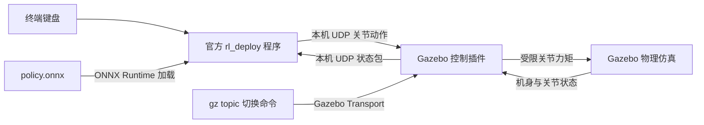

# Lite3 ROS2 Navigation Simulation

基于 Ubuntu 24.04、ROS2 Jazzy、Gazebo Harmonic、RViz2 和 DeepRobotics Lite3 的机器人操作系统课程项目。最终目标是在车间通道中从实际当前位置 A 到目标 B，完成已知障碍的全局规划、临时障碍检测与局部避障、必要时重新规划，并返回成功或具体失败结果。

**2026-10-04 当前进度：统一启动、固定站立和预训练 RL 的 Gazebo 平地运动链路已实现并做过后台测试；ROS2 `/cmd_vel`、`/odom`、`/scan` 和 Nav2 尚未实现。** 本次保存开发状态，不继续开发新功能。

## 整体规划保持不变

- 最终演示使用 Gazebo，同时打开 RViz 观察地图、激光、模型和路径。
- 所有用户指令通过终端发送；根据 Gazebo 场景提前制作地图。
- 第一版使用 Gazebo 实际位姿，不先加入 SLAM 或 AMCL；之后有余力再考虑自主建图/定位。
- 复用开源 RL 成果负责基础运动，演示时运行策略推理，不进行现场训练。
- 地面可以有轻度起伏，但必须实测能通行；台阶和危险地形能力不预先承诺。
- 精简方案约 9 个 ROS2 节点；必要时恢复现成地图/启动管理节点，使用原有约 11 节点备用方案。
- 任务入口、手动/导航/停止互斥、无路/受阻/取消等不同结果定义保持原设计。

原规划文档 [ARCHITECTURE.md](docs/ARCHITECTURE.md) 与 [ROADMAP.md](docs/ROADMAP.md) 保留 2026-10-01 原文，**其中当时的“当前状态”是历史记录**。最新进度及下一次对话的接续依据见 [SESSION_HANDOFF.md](docs/SESSION_HANDOFF.md)。

## 已完成、进行中与未完成

### 已实现

- `lite3_description` 安装 URDF、四个必需 STL、RViz 配置和展示 launch；保留 `Lite3.urdf`、`Lite3_original.urdf` 和新增 `Lite3_gazebo.urdf`。
- 模型展示启动 `robot_state_publisher`、`joint_state_publisher_gui` 和 RViz。
- `lite3_gazebo` 安装 world/launch；世界显式配置 Physics、UserCommands、SceneBroadcaster。
- `simulation.launch.py` 同时启动 Gazebo、生成 Lite3、启动 RViz；自动设置模型资源和插件搜索路径。Gazebo 初始暂停，生成高度 0.36 米。
- `lite3_control` 插件识别 12 个关节、初始化固定站姿、施加受限力矩，读取身体姿态和关节状态。
- 插件以本机 UDP 与官方 `rl_deploy` 交换状态和动作；默认 `stand`，明确切换 `external` 后才由 RL 接管。
- 指令失联超过 250 毫秒、错误格式或 NaN 时回退固定站姿；髋关节限 ±24 N·m、膝关节 ±36 N·m。
- 保存工作空间之外的三份 RL 修改、恢复补丁、准确上游版本、许可和当前 `policy.onnx`，见 [外部 RL 保存说明](external/lite3_rl_deploy/README.md)。

### 实际验证和限制

用户已确认 Gazebo/RViz 能加载模型、固定站立和读取机身/关节状态。2026-10-04 独立后台 Gazebo 平地测试验证了 UDP 状态格式、控制切换、断线回退、NaN 拒绝，以及现有 RL 的站立、前进和空格停车；一次前进约 2.15 米，无 NaN 或姿态保护触发。

这些结果不代表转向、台阶、起伏地形或长期稳定性已经验收。固定站姿不是自主起身算法。先前 MuJoCo 中能平地运动，但遇台阶曾跌倒，不能声称已完成台阶通行。

### 尚未完成

- 自研 ROS2 `lite3_motion_node` 及 `/cmd_vel` 输入、速度指令超时停车。
- `/odom`、导航 TF、仿真时钟桥接、真实关节状态同步、LiDAR `/scan`。
- 场景对应地图、Nav2、`mission_manager`、A→B、避障/重规划与任务结果。
- 自主训练完整流程、SLAM、危险地形识别和移动障碍扩展。

RViz 当前仍使用 GUI 的展示关节状态，没有同步 Gazebo 的真实运动。配置中有 2D Goal 按钮，不代表已完成导航。

## 当前运动架构与 ROS2 的关系



Gazebo 不直接读取 ONNX；`rl_deploy` 读取并执行策略。MuJoCo 是之前用于独立验证的另一个仿真器，当前 Gazebo 运动时不需要运行 MuJoCo。它们不互相通信。

当前持续运行的 ROS2 节点主要是展示用的 `robot_state_publisher`、`joint_state_publisher_gui` 和 `rviz2`；`ros_gz_sim/create` 生成模型后退出。Gazebo 插件与 `rl_deploy` 不是另外的 ROS2 节点，`/lite3/control_mode` 当前是 Gazebo 话题。它们是未来 `lite3_motion_node` 的基础，不改变既定节点规划。

## 实际保存的结构

```text
lite3_ws/
├── .gitignore
├── README.md
├── THIRD_PARTY_NOTICES.md
├── docs/
│   ├── ARCHITECTURE.md            原整体设计，原文保留
│   ├── ROADMAP.md                 原开发路线，原文保留
│   ├── SESSION_HANDOFF.md         最新进度与接续开发说明
│   └── SYNC_AUDIT.md              本次文件清单、忽略与检查结果
├── external/lite3_rl_deploy/
│   ├── README.md
│   ├── UPSTREAM.json
│   ├── LICENSE.DeepRoboticsLab.txt
│   ├── requirements-mujoco.txt
│   ├── patches/local-simulation-fixes.patch
│   ├── policy/ppo/policy.onnx
│   └── snapshots/                 三份外部修改源码的完整副本
├── src/
│   ├── lite3_description/
│   │   ├── CMakeLists.txt
│   │   ├── package.xml
│   │   ├── LICENSE.DeepRoboticsLab.txt
│   │   ├── launch/display.launch.py
│   │   ├── meshes/{hip,shank,thigh,torso}.STL
│   │   ├── rviz/lite3.rviz
│   │   └── urdf/{Lite3,Lite3_original,Lite3_gazebo}.urdf
│   ├── lite3_gazebo/
│   │   ├── CMakeLists.txt
│   │   ├── package.xml
│   │   ├── launch/simulation.launch.py
│   │   └── worlds/lite3_empty.sdf
│   └── lite3_control/
│       ├── CMakeLists.txt
│       ├── package.xml
│       ├── LICENSE
│       ├── README.md
│       └── src/lite3_gazebo_interface.cpp
├── build/                         本地生成，不提交
├── install/                       本地生成，不提交
└── log/                           本地生成，不提交
```

空的 include/src 目录仍在本地保留；Git 不保存空目录。完整实际文件清单见同步审计。

## 全新 Ubuntu + ROS2 Jazzy 恢复

先按 [ROS2 Jazzy 官方安装说明](https://docs.ros.org/en/jazzy/Installation/Ubuntu-Install-Debs.html) 配置 ROS 软件源。以下路径使用本机用户名 `ma`，其他用户名需要替换 `/home/ma`。

```bash
sudo apt update
sudo apt install git build-essential cmake python3-colcon-common-extensions python3-rosdep ros-jazzy-desktop ros-jazzy-joint-state-publisher-gui ros-jazzy-ros-gz ros-jazzy-ament-cmake ros-jazzy-ament-lint-auto ros-jazzy-ament-lint-common ros-jazzy-gz-sim-vendor ros-jazzy-gz-plugin-vendor ros-jazzy-gz-transport-vendor ros-jazzy-gz-msgs-vendor
```

仓库为 private，需要先具备 GitHub 访问权限和身份验证。目录不存在时执行：

```bash
git clone https://github.com/STAR-626/lite3_ros2_navigation.git /home/ma/lite3_ws
source /opt/ros/jazzy/setup.bash
cd /home/ma/lite3_ws
colcon build
source /home/ma/lite3_ws/install/setup.bash
```

每个新终端重新 source。build/install/log 由本机生成，不能代替源码同步。也可在 rosdep 已初始化时运行 `rosdep install --from-paths /home/ma/lite3_ws/src --ignore-src -r -y` 检查依赖。

## Gazebo + RViz 与 RL 使用

先关闭此前启动的 Gazebo/控制进程再构建，避免覆盖正在加载的动态库。终端 1：

```bash
source /opt/ros/jazzy/setup.bash
cd /home/ma/lite3_ws
colcon build --packages-select lite3_description lite3_control lite3_gazebo
source /home/ma/lite3_ws/install/setup.bash
ros2 launch lite3_gazebo simulation.launch.py
```

Gazebo 初始暂停；点击播放，确认机器人固定站立。只想展示模型时，可单独运行 `ros2 launch lite3_description display.launch.py`。

全新机器先按 [RL 恢复说明](external/lite3_rl_deploy/README.md) 获取指定版本、应用补丁并编译。终端 2：

```bash
cd /home/ma/Lite3_rl_deploy/build
./rl_deploy
```

按 `z`，至少等待 4 秒，再按 `c`。确认进入 `rl_control` 和 `PolicyRunner entered`。此时插件仍为固定站立。终端 3：

```bash
source /opt/ros/jazzy/setup.bash
gz topic -t /lite3/control_mode -m gz.msgs.StringMsg -p 'data: "external"'
```

Gazebo 终端打印 `Mode: external` 后，回终端 2 连续按两三次 `w` 尝试前进；按空格停车。`w/s` 调整前后速度，`a/d` 调整侧向速度，`q/e` 调整转动速度；松开按键不会自动归零。`z/c` 是模式按键，不要连续乱按。退出前先在终端 3 执行：

```bash
gz topic -t /lite3/control_mode -m gz.msgs.StringMsg -p 'data: "stand"'
```

再在终端 2 按 Ctrl+C。插件操作细节和协议见 [lite3_control/README.md](src/lite3_control/README.md)。

### 资源路径为什么需要设置

统一 launch 已自动设置 `GZ_SIM_RESOURCE_PATH` 和 `GZ_SIM_SYSTEM_PLUGIN_PATH`。
前者让 Gazebo 查找 `package://lite3_description/meshes/*.STL`，后者查找本项目的 `.so` 控制插件。ROS package 的安装索引和 Gazebo 的资源搜索不是同一套机制。

手动启动时需在启动 Gazebo 的同一终端先设置（统一 launch 不需要重复执行）：

```bash
source /opt/ros/jazzy/setup.bash
source /home/ma/lite3_ws/install/setup.bash
export GZ_SIM_RESOURCE_PATH="/home/ma/lite3_ws/install/lite3_description/share${GZ_SIM_RESOURCE_PATH:+:$GZ_SIM_RESOURCE_PATH}"
export GZ_SIM_SYSTEM_PLUGIN_PATH="/home/ma/lite3_ws/install/lite3_control/lib${GZ_SIM_SYSTEM_PLUGIN_PATH:+:$GZ_SIM_SYSTEM_PLUGIN_PATH}"
gz sim -v 3 /home/ma/lite3_ws/install/lite3_gazebo/share/lite3_gazebo/worlds/lite3_empty.sdf
```

另一个已 source 的终端可手动 Spawn（不要和统一 launch 重复生成）：

```bash
ros2 run ros_gz_sim create -world lite3_world -file /home/ma/lite3_ws/install/lite3_description/share/lite3_description/urdf/Lite3_gazebo.urdf -name Lite3 -z 0.36
```

## 排错

- **robot_description 为空**：先 build 并 source；launch 从 install/share 读 URDF，源码修改后必须重新构建。
- **RViz 不显示**：RobotModel 使用 `/robot_description`，展示阶段 Fixed Frame 为 `TORSO`；核查 `/joint_states`。晚订阅拿不到描述时检查 Transient Local 或重启展示 launch。
- **找不到 gz**：新终端先 source Jazzy，`gz sim --versions` 查看版本。
- **有 Entity 但 mesh 缺失**：检查安装后的 STL 与资源路径；只在另一终端改变量不会更新已启动的 Gazebo。
- **world 或插件找不到**：重新构建三个包、source overlay；本项目现在已经安装 worlds/launch，并显式配置世界插件。
- **Error binding socket**：检查 `ss -lunp 'sport = :20001 or sport = :30010'`。只运行一套仿真和一个 rl_deploy，不同时启动 MuJoCo。确认占用进程后正常退出，不猜测 PID 批量杀进程。
- **运行 rl_deploy 找不到策略**：必须从其 build 目录执行；上游使用相对路径 `../policy/ppo/policy.onnx`。
- **切换 external 被拒绝**：Gazebo 必须播放且收到新鲜有效指令，控制程序先 `z` 等待再 `c`。
- **NaN 或控制断线**：插件回退 stand；检查官方程序状态，修复后重新显式切换。固定站立不是跌倒恢复，不能保证从任意摔倒姿势站起。
- **松开键仍走**：官方键盘输入累加速度，空格停车；ROS2 速度超时保护尚未实现。
- **RViz 模型不随 Gazebo 运动**：目前是两套关节状态来源，真实状态同步属于后续工作。

## 下一步（本次暂停在这里）

下一步仍为 M2：接入 ROS2 `/cmd_vel`，把现有 RL 运动能力纳入规划中的 `lite3_motion_node`，实现速度输入和超时归零，并验证前进、转向、停车。保留手动 `/cmd_vel` 与未来导航 `/nav_cmd_vel` 的互斥设计。

随后按既定顺序完成 `/odom`/TF/真实关节/激光 → 预制地图与 Nav2 → 终端任务与结果 → 演示场景。M2 未完成前不把 Nav2 或 A→B 宣称为已实现；自训练、SLAM 和危险地形扩展仍在原规划中。

## 来源与许可

Lite3 robot model resources originate from DeepRobotics / DeepRoboticsLab.
预训练策略和部署源码同样来自 DeepRoboticsLab。保留模型和部署项目原始 BSD 3-Clause 许可，详见 [THIRD_PARTY_NOTICES.md](THIRD_PARTY_NOTICES.md)。仓库保持 private。

第三方许可证不自动覆盖独立项目代码；`lite3_control` 有自己的 BSD-3-Clause LICENSE，另外两个 package 的原有 License TODO 仍保留，未替用户擅自选择项目统一许可证。外部原始模型/部署仓库、凭据、虚拟环境和生成日志不整体上传。
