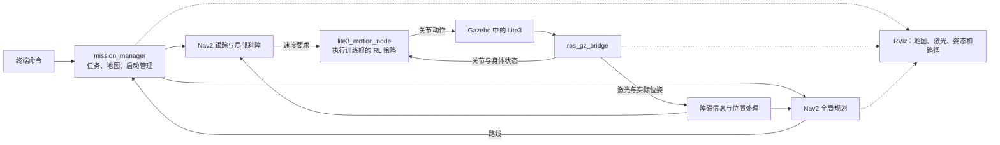

# Lite3 ROS2 Navigation Simulation

基于 Ubuntu 24.04、ROS2 Jazzy、Gazebo Harmonic 与 RViz2 的 DeepRobotics Lite3 四足机器人课程结课项目。当前仓库保存模型、可视化启动与基础仿真世界；目标是在车间通道中实现 A → B 导航、障碍物检测、局部避障、全局规划与必要时重新规划，并扩展动态障碍场景。

项目计划复用官方开源 RL 训练与部署成果，演示前训练或验证基础移动策略，演示时执行训练好的策略；不从零开发步态算法或新的 RL 算法。**当前模型尚不具备已实现的速度控制或自主导航能力，仓库也尚未包含 RL 策略或导航实现。**

## 第一版方案与整体架构

已确定使用 Gazebo 演示、RViz 观察，所有用户指令通过终端发送。地图根据 Gazebo 场景提前制作，第一版采用仿真实际位姿定位，后续再考虑 SLAM。地面允许平缓坡面和小幅起伏，但必须实际验证 RL 策略在 Gazebo 中能够稳定通行。

导航包含已知障碍的全局绕行、激光检测临时新增障碍、局部避障、必要时重新规划，以及成功/无有效路径/执行受阻等不同结果。第一版不承诺实时识别陡坡、台阶和深坑，也不把新增静止障碍等同于移动障碍。

- [整体架构、约 9 个节点、终端接口与结果定义](docs/ARCHITECTURE.md)
- [开发路线、演示场景与后续扩展](docs/ROADMAP.md)

以下是计划架构，**不是当前已经运行的节点图**。



精简目标为约 **9 个节点（包含 RViz）**：`mission_manager`、`lite3_motion_node`、`ros_gz_bridge`、`robot_state_publisher`、`planner_server`、`global_costmap`、`controller_server`、`local_costmap`、`rviz2`。图中的“障碍信息与位置处理”是功能概括，不是额外节点。

任务节点合并地图发布和启动管理，移动节点合并策略执行、位姿整理和手动/导航/停止模式。合并需要实现原来现成节点提供的必要功能；若复杂度影响可靠性，可恢复 `map_server` 与 `lifecycle_manager`，采用约 11 节点备用方案。关节执行方式和辅助程序也可能影响最终数量。

## 当前状态

### 已在源码中完成

- `lite3_description`：ament_cmake 包，安装 URDF、mesh、launch 与 RViz 配置。
- `Lite3.urdf`：17 个 link、16 个 joint，visual mesh 使用 `package://lite3_description/meshes/`；保留上游 `Lite3_original.urdf` 供追溯，不作为默认运行模型。
- 四个必需 STL：torso、hip、thigh、shank。
- `display.launch.py` 从已安装的 URDF 读取非空 `robot_description`，启动 `robot_state_publisher`、`joint_state_publisher_gui` 与 RViz2；用于 `/joint_states` 与 TF 可视化。
- `lite3.rviz` 保存 RobotModel，订阅 `/robot_description`，Fixed Frame 为 `TORSO`。
- `lite3_gazebo`：ament_cmake 包与自建 `lite3_empty.sdf`；世界名 `lite3_world`，包含重力、定向光与 20 × 20 米地面。

### 正在进行 / 当前限制

- Gazebo 的手动启动、模型 Spawn 与 mesh 资源解析流程。源文件已具备，用户此前报告已加载成功；本次整理不把文件存在等同于 GUI 和物理仿真已经重新验证。
- `lite3_gazebo/CMakeLists.txt` 尚未安装 `worlds/`，因此下文使用源码路径启动世界。
- 两个 `package.xml` 仍含 description/license TODO，尚未声明 launch 所用运行时依赖；仅依靠 `rosdep` 不能完整安装当前运行依赖，需执行下文显式安装命令。
- 当前 world 没有显式声明 Gazebo system plugins，运行依赖 Gazebo 默认服务器配置；Spawn 服务不可用时见排错章节。
- 四足模型存在并不意味着能站稳或行走；未实现姿态稳定控制。仿真暂停时可检查外观，开始物理仿真后模型可能倒下。

### 尚未完成

RL 策略训练/加载及 Gazebo 关节执行接口、`/cmd_vel` 移动、`/odom` 与导航坐标关系、LiDAR 与 `/scan`、ROS/Gazebo bridge、预制地图、Nav2、终端任务入口、A → B、避障、重新规划与结果返回均未实现。SLAM、危险地形识别和移动障碍物是后续扩展。RViz 的 2D Goal 工具只是配置项，不能证明导航功能已实现。

目前 `display.launch.py` 启动 `robot_state_publisher`、`joint_state_publisher_gui` 和 `rviz2` 三个主要节点。未来导航演示应改用仿真实际关节状态，停用关节滑块节点，避免两者发布冲突状态。

## 实际目录

以下来自本地文件系统扫描；`include/` 与两个包各自的 `src/` 当前为空。Git 不保存空目录，clone 后这些空目录不会自动出现；其中没有源码需要补传。

```text
lite3_ws/
├── .gitignore
├── README.md
├── THIRD_PARTY_NOTICES.md
├── docs/
│   ├── ARCHITECTURE.md
│   └── ROADMAP.md
├── src/
│   ├── lite3_description/
│   │   ├── CMakeLists.txt
│   │   ├── package.xml
│   │   ├── LICENSE.DeepRoboticsLab.txt
│   │   ├── include/lite3_description/  (空)
│   │   ├── src/                        (空)
│   │   ├── launch/display.launch.py
│   │   ├── meshes/
│   │   │   ├── hip.STL
│   │   │   ├── shank.STL
│   │   │   ├── thigh.STL
│   │   │   └── torso.STL
│   │   ├── rviz/lite3.rviz
│   │   └── urdf/
│   │       ├── Lite3.urdf
│   │       └── Lite3_original.urdf
│   └── lite3_gazebo/
│       ├── CMakeLists.txt
│       ├── package.xml
│       ├── include/lite3_gazebo/       (空)
│       ├── src/                       (空)
│       └── worlds/lite3_empty.sdf
├── build/                             (忽略)
├── install/                           (忽略)
└── log/                               (忽略)
```

当前目录仍没有控制/导航/接口 package、策略文件、导航 YAML、maps 或 Xacro。架构文档中的未来 package 和接口仅为规划，尚未创建。后续新增有效项目文件应正常提交。

## 环境和依赖

本地检查确认 Ubuntu 24.04、ROS2 Jazzy、Gazebo Sim 8.15.0（Harmonic），已安装 `ros-jazzy-desktop`、`ros-jazzy-joint-state-publisher-gui` 和 `ros-jazzy-ros-gz`，colcon 的多个组件也已安装。

全新电脑先按 [ROS2 Jazzy Ubuntu 安装文档](https://docs.ros.org/en/jazzy/Installation/Ubuntu-Install-Debs.html) 配置 ROS apt 软件源并安装 Jazzy。Jazzy 对应的 Gazebo 通过 `ros-jazzy-ros-gz` 安装，参见 [Gazebo 官方说明](https://gazebosim.org/docs/harmonic/ros_installation/)。以下是恢复项目所需的命令，不表示本机安装过全部这些聚合包：

```bash
sudo apt update
sudo apt install git python3-colcon-common-extensions   ros-jazzy-desktop ros-jazzy-ament-cmake   ros-jazzy-ament-lint-auto ros-jazzy-ament-lint-common   ros-jazzy-ament-index-python ros-jazzy-launch ros-jazzy-launch-ros   ros-jazzy-robot-state-publisher ros-jazzy-joint-state-publisher-gui   ros-jazzy-rviz2 ros-jazzy-ros-gz
```

不需要 clone 整个上游模型仓库，也不需要安装 Nav2 才能运行当前可视化。Nav2 是后续阶段。

## Clone 与编译

GitHub 仓库为 [STAR-626/lite3_ros2_navigation](https://github.com/STAR-626/lite3_ros2_navigation)，设为 private，需先获得该仓库访问权限并配置 GitHub 身份验证。

```bash
git clone https://github.com/STAR-626/lite3_ros2_navigation.git ~/lite3_ws
cd ~/lite3_ws
source /opt/ros/jazzy/setup.bash
colcon build
source install/setup.bash
```

不要把 `build/`、`install/`、`log/` 从另一台电脑复制回来；它们由本机重新编译生成。每个新终端都需重新 source Jazzy 与 workspace。

## RViz 使用

```bash
source /opt/ros/jazzy/setup.bash
source ~/lite3_ws/install/setup.bash
ros2 launch lite3_description display.launch.py
```

当前只做模型显示，使用 joint_state_publisher_gui 调整关节；RViz RobotModel 应使用 `/robot_description`，Fixed Frame 设为 `TORSO`。未来导航演示会显示地图、激光和路线，切换到地图参考坐标并读取真实仿真关节状态。可用以下命令核查运行状态：

```bash
ros2 param get /robot_state_publisher robot_description
ros2 topic list
ros2 topic echo /joint_states --once
```

## Gazebo 使用与 mesh 资源路径

终端 A（资源路径必须在启动 Gazebo 服务器之前设置）：

```bash
source /opt/ros/jazzy/setup.bash
source ~/lite3_ws/install/setup.bash
export GZ_SIM_RESOURCE_PATH="$HOME/lite3_ws/install/lite3_description/share${GZ_SIM_RESOURCE_PATH:+:$GZ_SIM_RESOURCE_PATH}"
gz sim -v 4 "$HOME/lite3_ws/src/lite3_gazebo/worlds/lite3_empty.sdf"
```

这个路径包含 `lite3_description` 的父目录，使 Gazebo 能解析 URDF 中 `package://lite3_description/meshes/*.STL`。ROS 的 ament package 索引可以被 launch/RViz 使用，但 Gazebo 仍需可查找的资源路径。上述写法保留已有资源路径，并避免原变量为空时追加空条目。

终端 B，等待世界启动后按本地 `ros_gz_sim create` 帮助的参数手动 Spawn：

```bash
source /opt/ros/jazzy/setup.bash
source ~/lite3_ws/install/setup.bash
ros2 run ros_gz_sim create   -world lite3_world   -file "$HOME/lite3_ws/install/lite3_description/share/lite3_description/urdf/Lite3.urdf"   -name Lite3 -z 0.6
```

这是从当前文件和本地工具帮助整理的恢复步骤；本次未重新验证 GUI 中的 Spawn 或物理表现。模型名已存在时先检查 Entity 列表，避免重复生成。默认先暂停检查模型与 mesh，再按需开始仿真。

## Troubleshooting

- **robot_description 为空**：确认已经成功编译并 source workspace；launch 读取的是 install 中的 `Lite3.urdf`。检查上面的参数查询，以及 install 文件是否为空或过期。
- **RViz RobotModel 不显示**：Description Source 选 Topic、Topic 选 `/robot_description`，Fixed Frame 选 `TORSO`。检查节点与 `/joint_states`。当前保存的 Description Topic Durability 为 Volatile；晚启动 RViz 收不到已经发布的描述时，可在 RViz 中改成 Transient Local，或重新启动整套 launch。本次保留原配置。
- **安装后找不到 gz/ROS 包**：新终端先 `source /opt/ros/jazzy/setup.bash`，再 source workspace；可用 `gz sim --versions` 检查版本。
- **Gazebo 有 Lite3 Entity，但找不到 mesh**：在终端 A 设置 `GZ_SIM_RESOURCE_PATH` 后重新启动 Gazebo。只在 Spawn 终端设置变量不会更新已运行服务器的环境。确认 install 中四个 STL 存在。
- **找不到 world**：当前 `lite3_gazebo` 没有安装 worlds，使用 `src/lite3_gazebo/worlds/lite3_empty.sdf`，不要假定它已出现在 install。
- **Spawn 等待服务或失败**：检查 `gz service -l` 是否包含 `/world/lite3_world/create`。当前 SDF 未显式声明 UserCommands/SceneBroadcaster/Physics 插件；若默认服务器配置未加载它们，后续应在 world 中显式配置。这次未改写 world 或个人 Gazebo 配置。
- **实体倒下或不能移动**：当前没有站立/移动控制器，也没有 `/cmd_vel` 的实现；模型导入与 mesh 显示只是导航平台的前置工作。

## Roadmap 与下一步开发入口

1. **统一启动**：从 `src/lite3_gazebo/CMakeLists.txt` 开始补充 worlds 安装、Gazebo 必需插件、Spawn launch 和两个 package.xml 的运行依赖。
2. **RL 基础移动**：核实官方开源策略与许可，单独训练/验证，再适配 Gazebo 关节接口。验收站立、前进、转向、停止，以及轻度起伏地面。
3. **传感器与位置**：桥接实际关节、IMU、位姿、仿真时钟与激光；建立 `/odom` 和导航坐标关系。第一版使用仿真实际位姿，暂不加入自主定位。
4. **地图与 Nav2**：制作与场景对应的地图，配置全局/局部障碍信息和规划/控制，使用机器狗实际当前位置作为起点。
5. **终端任务闭环**：开发任务 Action、反馈、取消/停止、模式互斥、重新规划、超时和不同结果码；用户给定起点不一致时明确拒绝。
6. **演示验收**：已知障碍绕行、途中新增障碍、执行中封路、初始无路、取消/异常，以及轻度起伏通行。

有余力再扩展 SLAM 实时建图、静态地图标注危险地形、三维感知判断地形可通行性和移动障碍物。二维激光不能保证识别深坑；RL 训练也不能替代地形规划和 Gazebo 实测。

详细阶段与验收要求见 [docs/ROADMAP.md](docs/ROADMAP.md)。官方候选为 [rl_training](https://github.com/DeepRoboticsLab/rl_training) 与 [Lite3_rl_deploy](https://github.com/DeepRoboticsLab/Lite3_rl_deploy)，不是已完成集成的依赖；训练/部署环境与 Gazebo 的迁移差异见 [docs/ARCHITECTURE.md](docs/ARCHITECTURE.md)。

资源路径计划在未来统一 launch 中自动设置。当前可运行命令仍是上面的模型显示与手动 Spawn；文档中的导航接口示例尚不可运行。

## 第三方资源与许可证

Lite3 robot model resources originate from DeepRobotics / DeepRoboticsLab.

来源：[DeepRoboticsLab/deep_robotics_model](https://github.com/DeepRoboticsLab/deep_robotics_model)，本地来源版本、原始路径和资源核验详见 [THIRD_PARTY_NOTICES.md](THIRD_PARTY_NOTICES.md)。模型遵循 BSD 3-Clause，完整原始许可位于 [LICENSE.DeepRoboticsLab.txt](src/lite3_description/LICENSE.DeepRoboticsLab.txt)。重新分发时保留版权、许可条件和免责声明，不能暗示上游为本项目背书。

本仓库只包含项目已有的 Lite3 模型资源及所需许可，不包含整个上游仓库。本项目自行编写部分尚未选定许可证，package.xml 中的 License TODO 也不构成授权；上游许可证仅说明第三方模型的许可，不自动覆盖本项目全部文件。仓库本次保存为 private。
