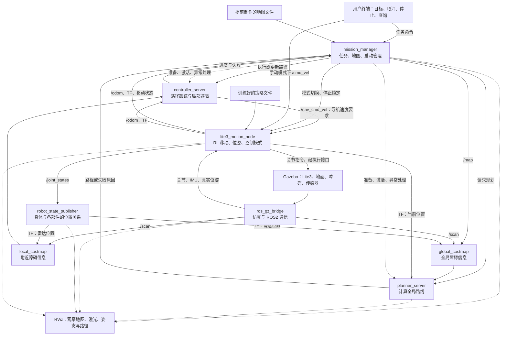
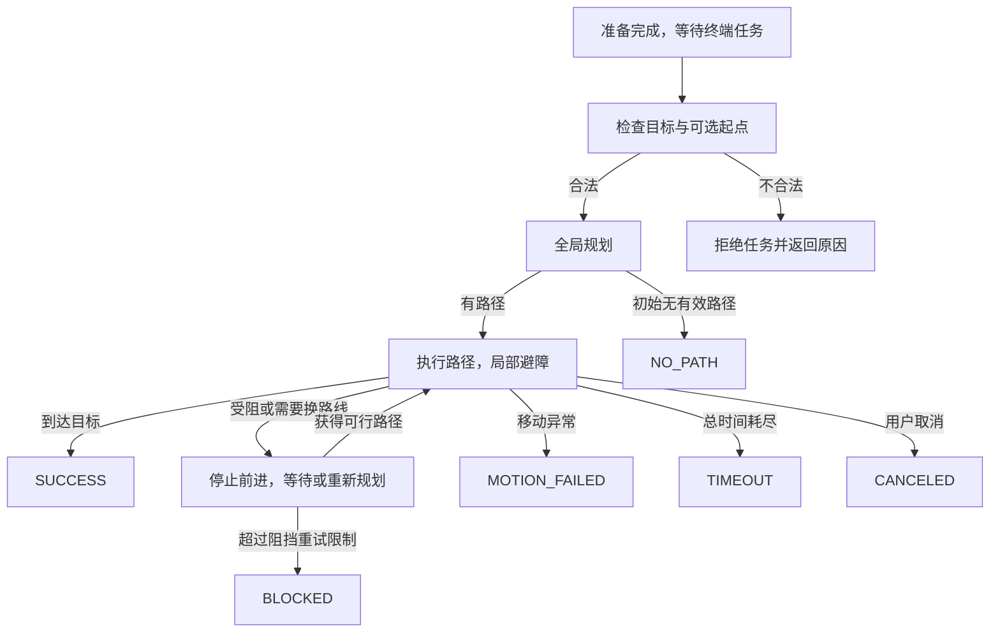

# 项目整体架构：Lite3 ROS2 导航仿真

## 当前阅读入口（2026-10-19）

下文保留2026-10-01整体设计和里程碑原文，其中“待开发/只有两个包”属于当时状态。
实际已经实现的六包系统、通信与策略见[当前架构](CURRENT_ARCHITECTURE.md)，
近期成果见[进度报告](PROGRESS_REPORT.md)，待解决问题见[已知问题](KNOWN_ISSUES.md)。
后续自然语言任务入口、SLAM等计划不改变原导航/运动分工，尚未实现。

> 本文是第一版的设计，不表示相关功能已经实现。当前只有两个模型/仿真包、模型资源、RViz 启动文件与基础 SDF 世界。更新日期：2026-10-01。

## 1. 第一版要完成什么

在 Gazebo Harmonic 中，让 Lite3 在轻度起伏、已经验证可通行的地面上，从实际当前位置走到指定目标；绕过地图中已知障碍，检测临时新增障碍，局部绕行或重新规划，最终通过终端返回成功或具体失败原因。演示同时打开 RViz，展示地图、激光与路径。

所有用户指令从终端发送。地图根据固定 Gazebo 场景提前制作，Gazebo 的真实位姿作为第一版定位来源。暂不运行 SLAM 或 AMCL；这属于仿真简化，不代表完成了自主定位。RL 在演示前训练，演示时加载已训练策略执行基础移动。

## 2. 整体数据流

图中实线为主要数据流，虚线为观察或管理关系；所有新增接口都是拟定接口。



Gazebo 执行接口是否经过桥接，取决于选定的关节控制插件。图不表示向 Gazebo 发送整体速度就能自动获得四足步态；必须完成 RL 输出到关节执行的闭环。

## 3. 约 9 个节点的精简方案

| # | 节点 | 用通俗语言描述其职责 | 实现方式 |
|---|---|---|---|
| 1 | `mission_manager` | 接收终端任务，提供地图，等系统准备好，组织规划和执行，重试并返回结果 | 自行开发 |
| 2 | `lite3_motion_node` | 把速度要求变成四条腿动作；整理位置和速度，处理手动/导航/停止模式及移动异常 | 适配官方策略并开发接口 |
| 3 | `ros_gz_bridge` | 在 Gazebo 和 ROS2 之间传递传感器、位姿、时钟等数据 | 现成节点 + 配置 |
| 4 | `robot_state_publisher` | 根据实际关节状态，说明身体、腿、雷达之间的位置关系 | 已有节点，后续接实际状态 |
| 5 | `planner_server` | 根据全局障碍信息计算路线 | Nav2 现成节点 |
| 6 | `global_costmap` | 整理整个区域的已知/新发现障碍，并考虑机器狗尺寸和安全距离 | 规划服务器内部创建 |
| 7 | `controller_server` | 跟随路线、局部绕行，计算当前移动速度 | Nav2 现成节点 |
| 8 | `local_costmap` | 根据激光不断更新附近障碍信息 | 控制服务器内部创建 |
| 9 | `rviz2` | 给人看地图、激光、机器人位置和路径 | 已有工具，配置需扩展 |

这是功能设计的约数，不是对 `ros2 node list` 行数的硬性承诺。Gazebo 插件、TF 辅助程序或选用 ros2_control 都可能增加节点；多个节点放进同一进程也不会使它们变成一个节点。

### 合并了什么，以及必须补上的工作

- `mission_manager` 合并原先 `map_server` 的地图发布职责，以及 `lifecycle_manager` 的启动管理职责。没有额外的终端输入节点，ROS2 CLI 直接调用接口。
- 地图加载需读取图像与 YAML，正确处理分辨率、原点、占据/空闲/未知格子，并以 `nav_msgs/OccupancyGrid` 发布 `/map`；使用支持晚订阅者获取地图的持久发布方式（Transient Local）。静态地图层的订阅设置须与之匹配。
- 启动管理需等待地图、传感器、TF 与仿真时钟，按顺序配置并激活 Nav2 服务器，检查服务状态。省去现成生命周期管理器后，还需明确 Nav2 bond 心跳配置：提供相应机制，或在允许的配置下关闭对外部管理器的 bond 并由任务节点监测故障，不能忽略该依赖。
- `lite3_motion_node` 合并策略推理、输入模式选择、停止锁定、仿真位姿整理与移动状态报告。但推理和关节控制循环不能被地图加载、服务等待或日志阻塞；合并节点不等于所有工作串行执行。
- 保留 Nav2 的规划、控制和两个 costmap，不为压缩数量改写其内部架构。
- 若地图/启动管理的合并成本明显过高，可以恢复现成 `map_server` 与 `lifecycle_manager`，变为约 11 个节点；这是备用实施方案，不是第一版首选。

## 4. 终端命令和结果

### 导航任务：一个长期执行的请求

拟定自定义 Action：`/navigate_task`，类型 `lite3_interfaces/action/NavigateTask`。Action 允许终端收到过程反馈、最终结果，并取消尚未完成的任务。

- 目标：`goal_x`、`goal_y`、`goal_yaw`（地图坐标，米/弧度）；可选 `check_start` 与起点位置/方向用于一致性检查。
- 反馈：阶段、当前位置、剩余距离、重新规划次数。
- 结果：`result_code`、`message`、最终位置和重试次数。
- 超时、容许位置偏差、目标到达范围、重试次数等作为配置参数，验证后确定数值。

**以下仅为未来接口示例；当前没有这些 package、Action 或节点，命令暂时不可运行。**

```bash
ros2 action send_goal /navigate_task \
  lite3_interfaces/action/NavigateTask \
  '{goal_x: 8.0, goal_y: 3.0, goal_yaw: 0.0}' \
  --feedback
```

默认从真实当前位置开始；不要求用户手填 A。需要固定 A → B 演示时，先将机器人生成/重置到 A，清理上次任务与障碍缓存，等待姿态/位置稳定，再发目标 B。重置过程中停止控制，避免位置跳变时仍执行旧路径。

若用户启用起点检查，而填写的 A 与实际位置超出允许偏差，返回 `START_MISMATCH`。不要把用户输入的 A 直接写成定位结果；不承诺错误初始位置会自行纠正。

### 其他拟定接口

| 用途 | 接收方 | 设计 |
|---|---|---|
| 导航与取消 | `mission_manager` | 自定义 Action 的目标与标准取消机制 |
| 停止 | `mission_manager` + `lite3_motion_node` | `/stop_task` 服务：取消路径并锁定移动节点停止状态；具体服务类型待实现 |
| 查询任务状态 | `mission_manager` | `/task_status` 状态发布或查询服务，字段待定义 |
| 切换手动/导航模式 | `lite3_motion_node`，由任务节点协调 | 模式服务，拒绝相冲突的输入 |
| 手动速度 | `lite3_motion_node` | `/cmd_vel`，第一版拟使用 `geometry_msgs/Twist`，只在手动模式接受 |
| 导航速度 | `lite3_motion_node` | 将 Nav2 输出重映射至 `/nav_cmd_vel`，只在导航模式接受 |

同一时刻只执行一个任务；忙碌时拒绝新任务或先取消旧任务，规则需固定。第一版采用拒绝新任务，避免任务悄悄互相覆盖。

### 为什么要区分手动与导航速度

手动终端与 Nav2 不能同时争夺运动控制。输入选择逻辑放在移动节点，不增加独立的命令选择节点。停止指令优先级最高；锁定期间拒绝后续速度，直到显式恢复且状态正常。停止不只是某个发布者发一次零速度，还要取消正在执行的路径。

速度指令超时、传感器失效或策略异常时进入停止/故障状态。对四足平台，“停止平移”不等于关闭所有关节力矩；仍需保持稳定姿态或进入经验证的故障处置状态。

## 5. 地图、定位和障碍

### 地图与定位分开

- **地图**：根据 Gazebo 场景预先制作的二维可通行/占据地图；SDF 不会自动成为 `/map`。
- **定位**：第一版使用 Gazebo 实际位姿，由移动节点整理；不运行 AMCL 或自主定位。
- **实时感知**：使用 Gazebo 激光传感器，经桥接获得 `/scan`。有地图仍需要感知新障碍。
- **建图**：第一版不做；以后可以添加 SLAM，自主更新地图，并更换对应的定位来源。

导航需要一致的地图、仿真世界和机器人坐标。拟定关系：

```text
map → odom → base_footprint → TORSO → 雷达及其他机器人部件
```

`base_footprint` 表示地面上的导航参考位置，`TORSO` 继续表示实际身体。保留身体的高度、侧倾和俯仰，避免把机器狗在坡面上的姿态误作纯平面姿态。`map → odom`、`odom → base_footprint` 和导航参考到身体的关系由位姿整理功能统一负责；`TORSO` 以下由 robot_state_publisher 发布，不能由两个程序重复发布同一坐标关系。

固定世界与地图原点一致时，可以采用固定的 `map → odom` 关系；若存在偏移，必须明确换算。此链是设计要求，当前 URDF 尚未新增导航参考坐标。桥接只是传数据，不自动完成所有坐标关系。

### 两种障碍都属于项目能力

| 情况 | 处理 |
|---|---|
| 地图已有墙、货架 | 初始全局规划选择绕开的路线 |
| 临时加入但静止的箱子 | 激光更新局部/全局障碍信息，局部绕行或重新规划 |
| 障碍堵住通道 | 停止前进，更新信息并尝试替代路线，超过限制后返回失败 |
| 移动障碍物 | 后续扩展；不能仅凭新增静止箱子的演示宣称完成动态障碍处理 |

局部/全局 costmap 都需配置障碍层和适当的扫描数据来源，结合机器人占地范围、雷达位置与安全距离。障碍离开后需根据扫描清除过期信息，不能永久堵住原已恢复通行的区域。

### 第一版地形边界

轻度坡面和小幅起伏，在策略经过验证能站立、前进、转向、停止的情况下标为可通行。RL 负责基础运动适应，导航负责选择路线。训练成功不能代替 Gazebo 迁移验证。

第一版不承诺实时理解陡坡、台阶或深坑；二维激光可能扫到坡面，也可能漏掉扫描平面下的危险。通过可见的箱子/墙演示实时避障，并检查坡面扫描是否把地面误标成障碍。后续先将已知危险地形人工标入静态地图，再考虑三维点云/深度感知与可通行性分析。

## 6. RL 训练与演示分离


优先研究官方 [rl_training](https://github.com/DeepRoboticsLab/rl_training) 和 [Lite3_rl_deploy](https://github.com/DeepRoboticsLab/Lite3_rl_deploy)。前者提供 Isaac Lab 的 Lite3 训练环境，后者文档展示 MuJoCo/PyBullet 的部署流程；不能直接假定已有 Gazebo Harmonic + ROS2 Jazzy 即用接口。是否有满足本项目需求的预训练权重仍需核实。

迁移必须对齐关节顺序、观察数据、姿态坐标、默认站姿、动作缩放、控制周期和关节控制参数。训练环境单独配置，避免影响 ROS2 Jazzy 运行环境。项目使用开源训练和部署成果，不从零研究新 RL 算法，也不在导航演示中训练。

## 7. 任务状态和失败结果



取消、停止、系统故障和总超时也适用于规划与等待阶段。所有终止分支都需取消正在执行的路径，进入停止/稳定状态，再返回唯一最终结果。规划超时、TF 错误、传感器失效不得一律归为 NO_PATH。

| 拟定码 | 名称 | 明确定义 |
|---|---|---|
| 0 | `SUCCESS` | 实际位置和方向达到配置的目标容许范围 |
| 1 | `NO_PATH` | 初始规划在当前地图、机器人尺寸和规划配置下没有有效路径 |
| 2 | `BLOCKED` | 执行中受阻，等待/重新规划达到阻挡处理限制 |
| 3 | `INVALID_GOAL` | 目标在地图外或处于不可到达的占据区域 |
| 4 | `START_MISMATCH` | 用户启用起点检查且输入与实际位置不一致 |
| 5 | `MOTION_FAILED` | 跌倒、姿态失稳、关节执行或策略异常 |
| 6 | `TIMEOUT` | 整个任务超过总时间预算 |
| 7 | `CANCELED` | 用户取消正在执行的任务 |
| 8 | `SYSTEM_ERROR` | 地图、TF、传感器或导航服务等异常 |

这些是任务层自定义码，不等于 Nav2 的原始错误码。保留 Nav2 原始错误信息供排查。NO_PATH/BLOCKED 是基于当前已知环境和配置的判断，不证明真实世界永久不可达，也不声称能识别“被围住”的几何原因。

## 8. 拟定代码组织（尚未创建）

| package | 计划放什么 |
|---|---|
| `lite3_description`，已存在 | URDF、STL、雷达安装位置、RViz 配置 |
| `lite3_gazebo`，已存在 | 世界、传感器/关节插件、Spawn 和统一仿真 launch |
| `lite3_control`，拟新增 | `lite3_motion_node`、策略加载、控制模式、仿真位姿处理 |
| `lite3_navigation`，拟新增 | `mission_manager`、地图、Nav2 参数、统一导航 launch |
| `lite3_interfaces`，拟新增 | 任务 Action、状态和模式服务的数据格式 |

package 数量不等于节点数量。不要为画出结构而创建空壳实现或可运行假象；按里程碑逐步增加文件。新增第三方策略或代码时另查许可证与权重再分发条件，不将训练依赖原始仓库整体塞进本项目。

## 9. 官方实现依据

- [Nav2 Jazzy 规划服务器与内部 global_costmap](https://github.com/ros-navigation/navigation2/blob/jazzy/nav2_planner/src/planner_server.cpp)
- [Nav2 Jazzy 控制服务器与内部 local_costmap](https://github.com/ros-navigation/navigation2/blob/jazzy/nav2_controller/src/controller_server.cpp)
- [ComputePathToPose 目标、反馈与错误结果](https://github.com/ros-navigation/navigation2/blob/jazzy/nav2_msgs/action/ComputePathToPose.action)
- [FollowPath 目标、反馈与错误结果](https://github.com/ros-navigation/navigation2/blob/jazzy/nav2_msgs/action/FollowPath.action)

开发顺序与演示验收见 [ROADMAP.md](ROADMAP.md)。当前可运行步骤仍以 [README.md](../README.md) 为准。
