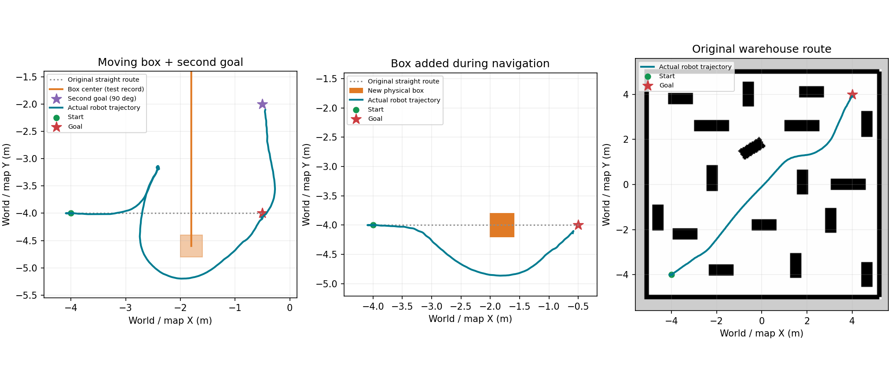

# 持续避让实现与验收


本轮最终验证：20项感知单元、4项原生ground体素、16项任务协议通过；实际15cm箱子标记/移除清除与高处过滤通过。
原仓库途中1m箱到(4,3.5,0)SUCCESS/重规划1；持续0.18m/s移动箱子与追加90°两个任务SUCCESS，主任务重规划5。
箱接触各0，非空接触消息分别791/450；不是所有货架或任意场景零碰撞证明。
当前源码/install已构建，测试进程退出、UDP释放。103分支只在协议测试触发，未冒充实走触发。
证据和所有中间失败见[本轮证据](development_history/evidence/obstacle_reliability_2026-10-18/README.md)。

## 2026-10-18：货架旁误报无路与额外障碍标记（当前修复）

本次以用户现场实时地图、位姿和日志为依据，不继续缩小机器人轮廓。

- 用户停在货架旁时，实际0.84×0.40米矩形没有碰到致命格，但原diff运动集中所有可扩展动作均被挡。
  原生Lattice会将这种“没有可执行下一步”的情况报成205（起点占用），不能由205反推身体已碰撞。
  同一冻结地图，原diff返回205；omni运动集可以输出156点路线。
- 默认MPPI改为Omni，允许横移，横向上限0.30m/s、采样标准差0.25m/s；Lattice同时选安装包的5cm omni运动集。
  后退、完整矩形、碰撞检查和原速度上限保留。controller:=rpp仍选diff运动集，原NavFn回退保留。
  原RL策略文件不变；真实RL左右横移及斜向移动单独测试已通过。
- 平地模式增加有界地面平面拟合，避免仅凭固定世界高度误标轻微倾斜的地面回波。
  至少80个分散地面样本、X/Y跨度各2米、坡度≤0.035、雷达脚下偏差≤2cm；不满足时丢弃整帧标记/清除，
  不推断未知区域安全。仍然只用于平地，不能据此宣称支持斜坡/台阶。
- 障碍标记增加8cm三维网格邻域至少3个回波支持、相邻两帧确认（XY邻格允许移动）。
  只过滤障碍标记，真实清除射线不因此删改；约增加一帧（10Hz时约0.1仿真秒）确认等待。
  小而细、远距离稀疏物体可能漏检，不能把此过滤当作安全保证。
- clearing PointCloud2新增FLOAT32字段ground，明确标识被判定为地面的实测端点。
  FlatGroundVoxelLayer读取此字段补偿原两格端点退让，不再依赖补偿前世界z是否恰好接近0.005。
  xyz、时间戳和真实射线原点不变；没有整列清空、按静态地图屏蔽新障碍或超时盲目删除实测障碍。
- /lite3/perception/status新增raw_obstacles（确认前计数）和ground_plane（z=a*x+b*y+c系数/null）。
  mission_manager对位姿检查失败新增时间年龄/TF查询警告，方便区分感知受阻和定位链路故障。

验证结果及保留的失败见本次证据README；原整体架构、SLAM计划及节点分工不改。
本轮修改尚未提交/推送；2026-10-17同步清单是历史快照。

### 同日后续：清除链路与输出检查

现场及空地测试录得部分远距地面回波落在约1.5～3.5cm高度，
仅两帧确认仍会留下少量候选点。新增ground_range_uncertainty=0.003：每米额外3mm低回波不确定带。
例如1米处需高于拟合地面约2.3cm，8米处约4.4cm；不会承诺检测所有厘米级小物体。
这类不确定点不是ground标记，普通真实清除射线端点保留，不能据此清掉悬空物体。
最大量程端点不标障碍（distance≥range_max-1mm），仍保留清除端点。
竖向体素改为10cm×7层，仍覆盖0～0.70米；XY仍5cm、实际障碍高度上限仍0.65米。
这减少稀疏竖直扫描在细体素中留下的零散旧痕迹，未使用盲目过期/整列清除。

AvoidanceController新增实际速度输出的1秒前视完整轮廓检查，50ms步长，
同时检查中心危险格、边界未知/致命格；拒绝后沿原Nav2失败/任务暂停和有限恢复处理。
MPPI候选评分之外，最终加权平滑指令也要通过检查；预测仍有时序/跟踪误差，不能保证任意动态场景安全。

试验过Lite3ResponseCritic（减少微小无效速度偏好），但移动箱子出现接触、另一次偏离路线后103失败。
该试验保留源码/插件与失败证据，**不在默认critics列表中、enabled=false**，不得按已经修复低速执行宣传。
额外执行前检查保留；没有改RL策略，也没有重新启用原VelocityDeadbandCritic。


2026-10-17。本页说明当前改动和验证边界，终端操作以TERMINAL_COMMANDS为准。

## 系统分工

原有节点继续使用，没有新增常驻ROS节点：

1. Gazebo多层雷达→现有感知节点→障碍/清除点云，以及短期运动占据预测。
2. 全局/局部costmap持续更新，原静态地图保留。
3. Smac Lattice负责带机身朝向和矩形轮廓检查的较大范围路线；controller_server途中使用MPPI，允许局部偏离原路线；终点附近复用RPP。
4. lite3_motion_node选择导航速度来源，再经原UDP接口交给原预训练RL执行。
5. mission_manager在局部控制暂时失败或位置持续无进展时暂停、等待、有限重规划。

MPPI预测的是机器狗候选轨迹。另由现有感知节点对雷达观测到的紧凑物体做短期运动估计，
帮助控制器避开物体接下来可能经过的位置；不读取Gazebo物体真值。

```mermaid
flowchart LR
    L[Gazebo三维雷达] --> P[现有感知节点]
    P --> R[实测障碍与真实清除射线]
    P --> F[连续观测的短期运动估计]
    R --> C[静态地图 + 实测障碍 + 预测层]
    F --> C
    C --> G[Smac Lattice完整轮廓全局路线]
    C --> K[MPPI途中避让 / RPP最终接近]
    G --> K
    K --> V[/nav_cmd_vel]
    V --> M[运动节点 → UDP → 原RL → Gazebo]
    K --> T[任务管理：受阻暂停、等待、有限重规划]
    T --> G
```

## 雷达运动估计与短期预测层

原始障碍、地面、清除与/scan接口不变。新增
`/lite3/perception/forecast`（PointCloud2，odom，原扫描时间戳，BEST_EFFORT、depth=1），
这是**估计的未来占据区域**，不是实测回波。只供独立ForecastLayer使用，不混入真实射线清除。
感知status JSON增加moving_clusters（中心/速度/拟合残差）与forecast_points。

雷达点先转到固定odom，按8cm相邻网格聚类；仅考虑观测尺寸不超过1.6米的紧凑物体。
最近邻关联后，至少6帧且跨度0.5仿真秒，采用最近9帧位置拟合匀速；
速度在0.08～0.8m/s且残差不超过0.035m才生成预测。
还要求观测包围盒两侧边界的移动一致、观测尺寸变化不超过约8cm，抑制视角变化误判。
默认向前2.5仿真秒，按0.25秒取样，观测包围盒增加10cm不确定余量。
它不改变机器狗20cm内切半径，而是暂时预留物体可能经过的区域。
参数在lite3_perception/config/flat_ground.yaml：forecast_enabled、forecast_horizon、forecast_padding。

全局图和MPPI局部图的ForecastLayer位于体素层之后、膨胀层之前。
每轮重建并清除上次预测；空帧、超过0.5仿真秒或1实际秒的新鲜度限制会移除预测。
清除预测不会删除静态地图和实测体素障碍。传感器断流仍由真实体素层的新鲜度检查阻挡控制。
时钟回跳、丢失观测、超过0.5仿真秒的帧间隔会丢弃关联历史，重新积累。

这是短期近邻关联，不是识别“人/箱子”或稳定的多目标身份跟踪。
遮挡、物体贴合/分离、视角变化、突然加速/转向会使估计缺失或不准；
没有可靠预测时仍保留真实障碍反应、MPPI碰撞检查和任务受阻恢复。
不能承诺快速迎面物体不会撞上已停车的机器狗。

## 任务受阻流程

正常局部避让优先在MPPI中完成，不因每帧障碍变化就重新规划整条路线。
控制器104/105/106，或3实际秒既未移动10cm也未转动0.20rad时触发恢复：

```
FOLLOWING → RECOVERY_STOPPING → WAITING_OBSTACLE
                                    ↓
                               REPLANNING
                                    ↓
                            RECOVERY_RESUMING → FOLLOWING
```

内部暂停确认、旧FollowPath终止后才重规划；重规划从实际map位姿到原目标。
暂时无路/目标被挡时保持暂停等待。首次等0.5实际秒，同一受阻窗口内连续重规划
仍无路时按0.5→1→2→2秒退避；恢复行走后再次受阻重置为0.5秒。整个任务最多5次重规划；
每次受阻恢复窗口25实际秒，任务总预算仍120实际秒，规划单次8实际秒。
配置项replan_wait=0.5、replan_wait_max=2.0、stuck_timeout=3.0、progress_distance=0.10、progress_angle=0.20。
正常原地转向可刷新进展时间；微小机身晃动不算有效转向。MPPI failure_tolerance由1.5改为0.5秒（controller_server仿真时钟）。
这些是判定/等待预算，不含服务取消确认和规划计算，不能解释为固定0.5秒必定绕行。
重试耗尽或恢复窗口耗尽返回任务层BLOCKED=2，说明无法恢复可执行运动，
可能是障碍、轮廓/转向限制或RL响应问题，不等于检测到物理接触。
初次规划没有路线仍返回NO_PATH=1；MOTION_FAILED=5仍未实现跌倒分类。

用户取消/关闭总开关/位姿失效/系统故障仍走最终停止锁定与下游取消清理。
内部恢复只使用set_navigation_pause，不调用set_stop(false)，不会解除用户停止锁定。
迟到的内部暂停服务响应也不能解除用户停止；清理期间仍保持忙碌，未确认清理则锁故障。
任务Action的反馈replan_count和结果retry_count现在记录实际重规划请求次数。

## 控制器与配置

- 默认：config/controller_mppi.yaml，AvoidanceController插件封装原生MPPI与原生RPP。
  途中MPPI使用DiffDrive机身模型（前进+转向）；距最终目标0.65m内切至RPP，
  RPP负责短距离接近及原地转向，退出阈值0.80m防反复切换。两者共享同一costmap，碰撞检查都开启。
  每条新路线重置选择；取消、重置、限速和生命周期继续转交原生控制器。
- 回退：config/controller.yaml，原RPP参数保留。
- 恢复：config/mission.yaml；enable_replanning=false可关闭自动恢复。
- 两控制器都复用原/nav_cmd_vel、/odom、FollowPath Action，不改变RL训练或关节控制。
- MPPI当前上限vx=0.4m/s、wz=0.6rad/s，vy=0；3秒候选轨迹，完整多边形碰撞检查开启。
- 候选加速度ax_max=8/az_max=12用于让优化器生成RL有响应的启动命令，不在输出端硬放大。
  VelocityDeadbandCritic关闭，避免目标附近受持续前进惩罚；最终RPP速度0.32m/s、转向0.6rad/s。
  SimpleGoalChecker设stateful=false、位置/朝向容差0.20m/rad，必须同时达标；
  任务层仍保持0.25m/rad再次核对，未放宽原任务成功条件。
- 20cm青圈按用户选择保留，包含padding的检查尺寸0.84×0.40m；
  站姿宽约0.375m，侧向余量很小，不能声称覆盖所有迈腿动作。
- 现默认Smac Lattice检查离散矩形朝向；5cm栅格、离散朝向与运动集、RL执行误差和步态外摆仍使规划可行不等于物理必过。planner:=navfn回退保留旧限制。
- 感知仅平地，障碍高度(0.025,0.65]；不可见区域不能保证立即清除旧障碍。

## 运动响应校准

独立ROS域197、专用Gazebo分区、移除仓库货架的临时空地，使用实际RL与UDP控制，
没有修改原策略。check_rl_response.py记录有限时长前进、转向、零速度后的位移。
本次0.2m/s在空地可以慢走，不应笼统说所有小速度都完全不动；
0.2rad/s原地转向响应很弱，0.6rad/s的2秒平均实际转速约0.55rad/s。
0.6m/s指令后的1.5秒零速度窗口仍有约0.097m位移，不是瞬间停止。
这些是单次平地采样结果，不是所有地形上的最小速度/最坏制动界限。

## 移动障碍测试资源

worlds/lite3_dynamic_box.sdf是40cm立方体、有质量/碰撞体，VelocityControl控制运动，
独立Gazebo Transport话题/lite3/dynamic_box/cmd_vel。它不使用机器狗的/cmd_vel。
PosePublisher和BoxContacts接触记录插件只供验收；默认地图/规划器不订阅箱子真值。
本机原生Contact传感器在运行时新投放模型时未产生数据，故插件直接请求箱子碰撞体的
Physics ContactSensorData，20Hz发布并保留发布间隔中发生的接触对，不修改力或碰撞体。
原world几何/系统保持；箱子不会在正常启动时自动加入。
moving_obstacle终端工具创建、有限实际时间移动、退出发送零速度，支持选择停车后移除。
Gazebo中路线/速度可预先安排；机器狗侧只接收真实模拟雷达数据。

## 验证边界

协议回归使用真实任务/运动节点，Nav2/TF或UDP接收端按测试种类模拟。
下方较早的真实避让验收使用Gazebo物理、原RL、真实多层雷达、costmap、NavFn、MPPI、任务Action；本轮Lattice验收另见SESSION_HANDOFF顶部。
先空地基线，再途中新增静态箱子，再横穿箱子，最后追加转弯和仓库路线。
箱子位姿只记录结果，不写进雷达消息或costmap。接触传感器有数据时才报告无接触。
验证的实际结果、失败和未覆盖项以SESSION_HANDOFF顶部及保存JSON证据为准。
不能将有限单物体场景成功推广为任意速度、任意数量物体的安全保证。

多物体、对向靠近、不可达通道、长时间停车后恢复及复杂运动预测仍需逐步验收。

## 本次实际结果

| 验收 | 结果 |
|---|---|
| 空地行走后投放0.18m/s横穿箱子 | 到达，重规划3次，机器狗与箱子接触0；记录器有681条非空消息 |
| 上述任务后追加90度方向目标 | 到达；接触检查覆盖全过程 |
| 行走后投放静止箱子 | 到达，重规划0次，机器狗与箱子接触0；记录器有228条非空消息 |
| 原仓库到(4,4,0) | 到达，重规划0次，最终(3.991,3.914)；未记录所有货架接触 |

另有82项模块/协议检查；具体哪些是真实Nav2/Gazebo、哪些使用模拟服务，见
[完整验证证据](development_history/evidence/continuous_avoidance_2026-10-17/README.md)。
早期擦碰、目标漂移/绕圈和长路线控制衔接失败均保留，不能混成已通过记录。



实现复用的原生评分/到达机制可参照[Nav2 Jazzy MPPI源码](https://github.com/ros-navigation/navigation2/tree/jazzy/nav2_mppi_controller/src/critics)。
本项目参数与RL行为的结论来自上述本机实测，不能直接推广到其他策略/机器人。

后续按用户反馈缩短等待后的12项恢复协议及真实移动箱子/转弯复测见
[反应时间调整证据](development_history/evidence/faster_replanning_2026-10-17/README.md)。
上表和82项为第一版检查点，当前时间配置以本文恢复流程为准。

## 完整轮廓规划与失败路段偏好（2026-10-17）

默认planner.yaml改为原生SmacPlannerLattice，5cm diff运动集支持转向和前进/后退。
bringup从安装share目录填入lattice_filepath，不把官方整个组件复制进源码。
目标tolerance=0，拒绝目标完整轮廓放不下的情形，任务到达判定仍0.20m/rad。
原NavFn配置原样保存在planner_navfn.yaml，launch的planner:=navfn用于对比回退。
默认MPPI允许vx_min=-0.30m/s、vx_max=0.40m/s，PreferForward仍开启；不是自动后退固定动作。
采用controller:=rpp时launch关闭Lattice倒退扩展，避免规划和控制动作不一致。
目标附近仍由原生RPP做前进/原地转向接近；RPP发生NoValidControl时，同一轮转回MPPI机动，
2实际秒后再尝试RPP（goal_approach_retry）。不旁路碰撞检查；两者都失败仍由原任务恢复处理。
极窄处倒退入位不保证成功。

原固定20cm内切半径/0.84×0.40m完整轮廓和膨胀距离没有缩小。
Lattice检查中心、轮廓和运动原语，离散栅格/朝向带来近似，局部碰撞检查继续保留。
不得将一次可行规划描述为整条物理轨迹、所有中间姿态或完整腿部步态的连续无碰撞证明。

mission_manager发生控制104/105/106或无进展时，截取旧路前方0.5～1.3m（排除最后目标0.5m），
在/lite3/avoidance/failed_route发布map下的Path；最多180点。
现有global_costmap内新增RoutePenaltyLayer，半径.18m、代价200、12实际秒过期，结束主动清空。
代价小于253碰撞阈值，不把失败猜成实体障碍，不会覆写真实障碍或未知格；存在替代路时倾向换路。
它不是保证每次不同的全局禁行，也不能凭空使被围死的位置可达。

执行路线/lite3/navigation_path只在FollowPath接受后显示，恢复/结束清除。
RViz原/plan预览改为默认关闭，防止旧路线让用户误以为任务仍在运行。
/lite3/navigation_marker显示阶段或最终ARRIVED/BLOCKED；状态查询保留last_result_code/message。
新增Topic均可靠/TransientLocal/depth1，不新增常驻节点。操作见终端手册顶部。
