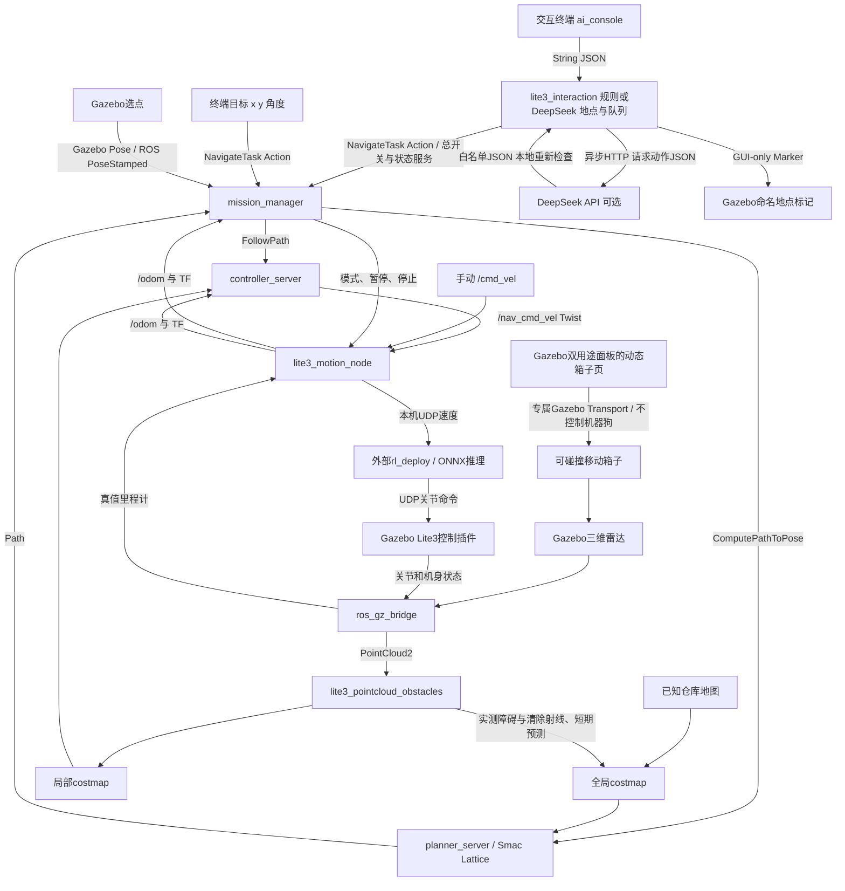

# 当前系统架构（2026-10-20）

2026-10-20当前：bringup的DeepSeek入口默认原生工具闭环，支持环境查询、多物体串行接近和真实结果反馈；不再限制一句话一个物体。旧JSON入口可用agent_tools=false回退，原rules/非AI入口保留。临时接近的固定物体/几何限制仍在；真实API及机器狗实走待验收。见[工具模式说明](AI_TOOL_AGENT.md)。以下单动作/不支持多物体描述是前阶段记录。

2026-10-20后续：现已接入原场景固定物体的单目标临时接近点计算＋Smac可达性验证，支持“去货架A旁边”；不保存为长期地点。计算/执行移位取消，真实机器狗实走和在线模型措辞待验收。见[操作与边界](OBJECT_APPROACH.md)。下方第一步/尚未接入等文字为此前阶段记录。

2026-10-20：已接入Gazebo真值语义目录和地图/world绑定的名称、别名、类别、用途持久标注；通过现有交互后台查询及向DeepSeek提供结构化环境信息。辅助读取进程不是ROS节点。仍未实现自动感知识别、按类别巡检和物体接近点计算；完整实走/真实API表达待验收。见[语义目录说明](ENVIRONMENT_SEMANTICS.md)。

## 2026-10-20同日后续：DeepSeek正式交互入口

用户已确认真实API预览、缺参数和不支持任务测试正常。新增`language_mode:=deepseek`把模型白名单JSON接入原地点/顺序任务执行；默认仍为rules。网络请求在后台有界守护线程处理，ROS线程消费并重新校验，停止/心跳/约定查询不等待模型。请求绑定会话、停止代际、30秒期限与地点快照，失效或迟到结果不执行；覆盖确认只能由用户明确输入。

正式启动：`ros2 launch lite3_navigation bringup.launch.py ai_control:=true language_mode:=deepseek`，另一个终端仍运行`ros2 run lite3_navigation ai_console`。正式控制区别于独立预览：解析通过后会执行。密钥沿用仓库外600权限文件，本轮未读取或发起实际API调用；执行链路使用模拟模型/ROS任务隔离验证，完整真实模型＋机器狗实走待用户验收。没有新增节点或修改RL/Nav2/感知。

操作与边界见[DeepSeek执行入口](DEEPSEEK_EXECUTION.md)。未提交/推送Git。

## 2026-10-20：规则交互入口、命名地点与顺序任务

新增可选`ai_control:=true`启动后台`lite3_interaction`，READY后另一个终端运行`ros2 run lite3_navigation ai_console`。本版未调用大模型/API，使用明确的规则句式，不执行任意shell命令；既有导航默认启动行为保持。

支持开启/关闭导航、停止、状态、保存/查询/删除地点、同名覆盖确认、当前位姿存点、命名地点导航及最多12步顺序任务。地点按地图指纹原子持久化；原点自动记录本次首次有效位姿。整组开始前检查点名并固定坐标；每一步Action成功才进入下一步，失败或断线取消后续任务。2.5实际秒心跳超时、显式退出、迟到接受均有停止/取消处理。

Gazebo圆环、点名和箭头使用GUI-only Marker，无碰撞体或world模型；Ogre2不支持原生TEXT，因此用Qt字形轮廓绘制地面平行标签。刷新与删除同步，标记传输进程不是ROS节点。后台和打开的console各新增1个节点，原RL/Nav2接口不变。

验证：16项规则/存储单元、13项后台/终端协议、5项真实Gazebo GUI/雷达检查通过；证据见[交互验证](development_history/evidence/interaction_2026-10-20/README.md)。

操作与协议见[规则交互说明](NATURAL_LANGUAGE_CONTROL.md)。隔离协议及真实GUI/雷达检查不能替代机器狗＋RL完整队列实走验收；后续再接模型映射与扩展措辞。未提交/推送Git。

2026-10-20补充：节点及接口不变；FlatGroundVoxelLayer内部在原生三维射线清除后，增加同帧近回波保护及3个不同时间戳的空闲证据确认。只保护已有高度体素，不按Gazebo物体尺寸填充障碍。详见[遮挡清除说明](OBSTACLE_VISIBILITY.md)。

本页说明实际实现；[原整体设计](ARCHITECTURE.md)与[原里程碑](ROADMAP.md)保留。
六个源码包，约9节点的精简分工不变；costmap内部节点及短时辅助进程不机械计入原估算。
插件、package、进程与ROS2节点不能混为一谈。当前存在[未解决问题](KNOWN_ISSUES.md)。

## 全局与局部策略

- 全局默认Smac State Lattice，A*框架搜索位置/朝向及运动原语，检查含余量0.94×0.50m矩形。
  MPPI默认Omni运动集，RPP回退选diff。综合路程、代价与转向等，不承诺最短时间。
- 全局图融合静态图、实测三维体素、短期预测、失败路段软偏好和膨胀。
  障碍/清除点云为PointCloud2；/scan只是二维投影，当前三维层直接使用点云。
- controller_server中AvoidanceController包装Rotation Shim＋MPPI，并在近目标阶段使用RPP。
  MPPI为Omni，20Hz，每轮1500候选、60×0.05秒预测；控制器插件不是额外节点。
- 包装器检查完整轮廓、实际速度停止预测与命令过渡；缓冲带限速不解除碰撞拒绝。
- 任务节点受阻时暂停、等待和有限恢复，最多5次；后台优化约每2秒请求更短路线，
  至少缩短0.5m且15%才通过FollowPath抢占交接。停止/取消优先，不恢复旧任务。
- /lite3/navigation_path才是已接受执行路线，planner的/plan可能包含未采用候选。
- Lite3运动由已有策略在线推理执行；没有现场训练，Gazebo不经MuJoCo读取策略。

## 启动、状态与后续

日常统一启动和终端操作见[终端手册](TERMINAL_COMMANDS.md)。Gazebo箱子功能见[面板说明](GAZEBO_DUAL_PANEL.md)。
当前使用Gazebo真值定位/预制地图，SLAM未实现。规则交互入口已可解析约定句式、保存地点并顺序调用既有任务接口，保留停止锁定与目标校验；不输出关节或绕过检查。后台是新增可选常驻节点，console是打开期间的临时节点；用户已验证DeepSeek API预览；正式可选DeepSeek模式已接入，后台线程处理模型请求，真实机器狗＋模型执行仍待验收。
