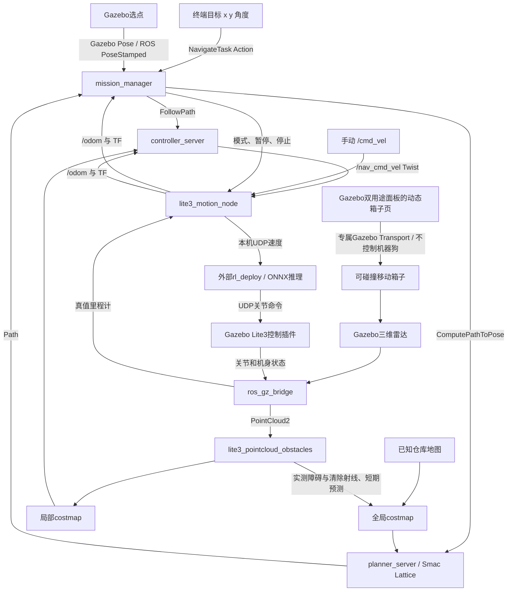

# 当前系统架构（2026-10-19）

本页说明实际实现；[原整体设计](ARCHITECTURE.md)与[原里程碑](ROADMAP.md)保留。
六个源码包，约9节点的精简分工不变；costmap内部节点及短时辅助进程不机械计入原估算。
插件、package、进程与ROS2节点不能混为一谈。当前存在[未解决问题](KNOWN_ISSUES.md)。

## 全局与局部策略

- 全局默认Smac State Lattice，A*框架搜索位置/朝向及运动原语，检查含余量0.94×0.50m矩形。
  MPPI默认Omni运动集，RPP回退选diff。综合路程、代价与转向等，不承诺最短时间。
- 全局图融合静态图、实测三维体素、短期预测、失败路段软偏好和膨胀。
  障碍/清除点云为PointCloud2；/scan只是二维投影，当前三维层直接使用点云。
- controller_server中AvoidanceController包装Rotation Shim＋MPPI，并在近目标阶段使用RPP。
  MPPI为Omni，20Hz，每轮1500候选、60×0.05秒预测；控制器插件不是额外节点。
- 包装器检查完整轮廓、实际速度停止预测与命令过渡；缓冲带限速不解除碰撞拒绝。
- 任务节点受阻时暂停、等待和有限恢复，最多5次；后台优化约每2秒请求更短路线，
  至少缩短0.5m且15%才通过FollowPath抢占交接。停止/取消优先，不恢复旧任务。
- /lite3/navigation_path才是已接受执行路线，planner的/plan可能包含未采用候选。
- Lite3运动由已有策略在线推理执行；没有现场训练，Gazebo不经MuJoCo读取策略。

## 启动、状态与后续

日常统一启动和终端操作见[终端手册](TERMINAL_COMMANDS.md)。Gazebo箱子功能见[面板说明](GAZEBO_DUAL_PANEL.md)。
当前使用Gazebo真值定位/预制地图，SLAM未实现。自然语言入口计划只解析任务意图和目标，
映射到既有任务/查询/取消接口，继续保留停止锁定与目标校验；不直接输出关节或绕过安全规则。
具体实现方式和模型尚未选择，当前不增加常驻节点或API依赖。
