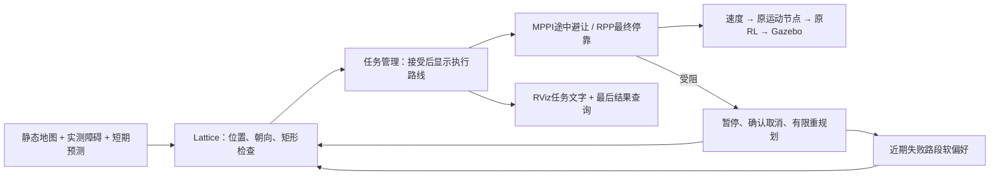

# 完整轮廓规划与卡住恢复优化（2026-10-17）

本轮最终验证：20项感知单元、4项原生ground体素、16项任务协议通过；实际15cm箱子标记/移除清除与高处过滤通过。
原仓库途中1m箱到(4,3.5,0)SUCCESS/重规划1；持续0.18m/s移动箱子与追加90°两个任务SUCCESS，主任务重规划5。
箱接触各0，非空接触消息分别791/450；不是所有货架或任意场景零碰撞证明。
当前源码/install已构建，测试进程退出、UDP释放。103分支只在协议测试触发，未冒充实走触发。
证据和所有中间失败见[本轮证据](development_history/evidence/obstacle_reliability_2026-10-18/README.md)。

## 2026-10-18：货架旁误报无路与额外障碍标记（当前修复）

本次以用户现场实时地图、位姿和日志为依据，不继续缩小机器人轮廓。

- 用户停在货架旁时，实际0.84×0.40米矩形没有碰到致命格，但原diff运动集中所有可扩展动作均被挡。
  原生Lattice会将这种“没有可执行下一步”的情况报成205（起点占用），不能由205反推身体已碰撞。
  同一冻结地图，原diff返回205；omni运动集可以输出156点路线。
- 默认MPPI改为Omni，允许横移，横向上限0.30m/s、采样标准差0.25m/s；Lattice同时选安装包的5cm omni运动集。
  后退、完整矩形、碰撞检查和原速度上限保留。controller:=rpp仍选diff运动集，原NavFn回退保留。
  原RL策略文件不变；真实RL左右横移及斜向移动单独测试已通过。
- 平地模式增加有界地面平面拟合，避免仅凭固定世界高度误标轻微倾斜的地面回波。
  至少80个分散地面样本、X/Y跨度各2米、坡度≤0.035、雷达脚下偏差≤2cm；不满足时丢弃整帧标记/清除，
  不推断未知区域安全。仍然只用于平地，不能据此宣称支持斜坡/台阶。
- 障碍标记增加8cm三维网格邻域至少3个回波支持、相邻两帧确认（XY邻格允许移动）。
  只过滤障碍标记，真实清除射线不因此删改；约增加一帧（10Hz时约0.1仿真秒）确认等待。
  小而细、远距离稀疏物体可能漏检，不能把此过滤当作安全保证。
- clearing PointCloud2新增FLOAT32字段ground，明确标识被判定为地面的实测端点。
  FlatGroundVoxelLayer读取此字段补偿原两格端点退让，不再依赖补偿前世界z是否恰好接近0.005。
  xyz、时间戳和真实射线原点不变；没有整列清空、按静态地图屏蔽新障碍或超时盲目删除实测障碍。
- /lite3/perception/status新增raw_obstacles（确认前计数）和ground_plane（z=a*x+b*y+c系数/null）。
  mission_manager对位姿检查失败新增时间年龄/TF查询警告，方便区分感知受阻和定位链路故障。

验证结果及保留的失败见本次证据README；原整体架构、SLAM计划及节点分工不改。
本轮修改尚未提交/推送；2026-10-17同步清单是历史快照。

### 同日后续：清除链路与输出检查

现场及空地测试录得部分远距地面回波落在约1.5～3.5cm高度，
仅两帧确认仍会留下少量候选点。新增ground_range_uncertainty=0.003：每米额外3mm低回波不确定带。
例如1米处需高于拟合地面约2.3cm，8米处约4.4cm；不会承诺检测所有厘米级小物体。
这类不确定点不是ground标记，普通真实清除射线端点保留，不能据此清掉悬空物体。
最大量程端点不标障碍（distance≥range_max-1mm），仍保留清除端点。
竖向体素改为10cm×7层，仍覆盖0～0.70米；XY仍5cm、实际障碍高度上限仍0.65米。
这减少稀疏竖直扫描在细体素中留下的零散旧痕迹，未使用盲目过期/整列清除。

AvoidanceController新增实际速度输出的1秒前视完整轮廓检查，50ms步长，
同时检查中心危险格、边界未知/致命格；拒绝后沿原Nav2失败/任务暂停和有限恢复处理。
MPPI候选评分之外，最终加权平滑指令也要通过检查；预测仍有时序/跟踪误差，不能保证任意动态场景安全。

试验过Lite3ResponseCritic（减少微小无效速度偏好），但移动箱子出现接触、另一次偏离路线后103失败。
该试验保留源码/插件与失败证据，**不在默认critics列表中、enabled=false**，不得按已经修复低速执行宣传。
额外执行前检查保留；没有改RL策略，也没有重新启用原VelocityDeadbandCritic。

本次针对两个实际问题：规划线能穿过但机器狗不能通过；任务已经失败，RViz仍显示旧线，看起来像一直卡着。
整体节点分工、已知地图/仿真真值定位、预训练RL、三维雷达和后续SLAM规划不变。

## 已查到的原因

1. 原NavFn依据中心格及周围代价规划，不检查每个机身朝向下的完整矩形。局部MPPI检查矩形，因此会拒绝执行某些全局路径。
   受阻快照中旧路线254个采样位姿，按路线切线离线采样矩形边缘，60个位姿碰到全局图障碍格。
   这是地图几何检查，不代表60次真实碰撞，也不是完整连续运动证明。
2. 原任务当时已经在3秒无进展检测后触发5次重规划，最后返回BLOCKED=2、关闭总开关并锁定停止；并非无限等待。
   原生/plan仍保留最后一条规划线，RViz没有区分“规划输出”和“正在执行的任务”。
3. 雷达图会比预制地图边缘更厚，目标中心空闲不代表机器人完整轮廓能放下。
   原用户目标(-4.137228,-3.516892,0)在快照中完整轮廓碰障碍，新Lattice返回206目标占用。
   测试旧目标(4,4,0)也在一次实时图中触碰数个边缘格；不能为让旧目标通过而缩小机器人或关闭碰撞检查。

## 改了什么

- 默认全局插件改为原生SmacPlannerLattice，使用安装包提供的5cm diff运动集。
  同时搜索位置和朝向，考虑矩形轮廓；目标tolerance=0，清晰拒绝放不下的目标姿态。
  原NavFn配置完整保留为planner_navfn.yaml，可用planner:=navfn对比。
- 保持矩形实际外沿0.84×0.40米、20cm内切半径、膨胀半径0.6米；全局更新2Hz提高到5Hz。
- 默认Lattice允许后退扩展，MPPI速度最低-0.30m/s，最高仍0.40m/s，优先向前。
  只允许前进/原地转向时，机器狗在移动箱子旁可能没有可执行的下一动作；允许后退后能重新获得空间。
  切换controller:=rpp时launch关闭后退扩展，避免与原RPP动作不一致。
- RPP最终接近若抛出NoValidControl，返回保留碰撞检查的MPPI机动，2实际秒后再尝试RPP。
  两者都不能执行时仍走原任务受阻流程，不吞掉系统错误、TF异常或所有控制失败。
- 每次控制受阻，将旧路前方0.5～1.3米的部分作为短期软偏好，避开最终目标0.5米，最多180点。
  新RoutePenaltyLayer复用global_costmap：半径0.18米、原始代价200（小于253碰撞阈值）、12实际秒过期。
  它让存在替代路线时倾向换路，既不伪造传感器障碍，也不保证每次都能找到另一条路。
- mission_manager发布当前执行路径和状态文字。恢复和结束时清空执行路径、结束清空偏好；
  RViz默认不显示原生/plan残留。状态服务保留last_result_code和last_result_message。
- 原有限恢复规则保留：无进展3实际秒、首次等待0.5秒、连续无路最多退避2秒、任务最多5次重规划。
  用户停止/取消/关闭入口优先，内部恢复不解除用户停止锁。无新增常驻ROS节点。

## 本轮验证与证据

完整结果、原始数据及失败过程保存在
[本轮证据](development_history/evidence/footprint_replanning_2026-10-17/README.md)。

- 隔离域200：真实mission_manager与模拟Nav2/TF/运动服务，15项通过。
  包括原恢复/用户取消优先、显示路线清除、失败偏好清除、最终结果保留、目标/起点受阻分类。
- 隔离域206：真实Nav2 RoutePenaltyLayer四项通过：软代价、移动提示清除、空提示清除、超时清除且保留静态障碍。
- 隔离域204：真实原生规划器。50cm宽直角通道中NavFn输出156点，Lattice返回208无可行路径；
  开阔地图两者可规划，失败路段偏好使Lattice选择不同路线；原用户快照目标返回206，避免给出不可停靠的终点。
  这些测试没有Gazebo/RL，也没有发运动命令。
- 真实Gazebo/RL验收只用独立域197和专用GZ分区。最终结果以证据README为准，不能把较早成功混作最终配置验收。

保留的失败：最初Lattice在(4,4,0)返回无路，核对发现实时图目标轮廓受阻；随后改为明确的206/任务3。
前进限制下移动箱子测试返回BLOCKED，启用匹配的后退规划/控制后通过一次移动箱子与追加转弯。
后退启用后的仓库测试又暴露终点RPP重复碰撞拒绝；增加MPPI机动回退后，仓库目标(4,3.5,0)通过，
日志实际出现一次RPP受阻→MPPI机动→成功，不只检查源码。
这些失败也保存，不能仅挑成功结果宣称所有问题彻底解决。

## 操作及限制

[终端手册顶部](TERMINAL_COMMANDS.md)包含依赖、重启、正常启动、目标输入、状态查询、参数和旧规划器回退。
本机已安装Smac，新电脑需安装；源码/配置变化需要构建并重启，source不会更新正在运行的程序。

这是离散地图和近似机身模型下的可行性改进。实际足端外摆、动作跟踪误差、地图/雷达边缘差异、
快速或多物体运动、遮挡都仍可能让实际运动与规划不同。不能承诺规划成功就一定物理通过。
目前仍是平地演示；不含SLAM、崎岖地面剔除、自训练策略、跌倒恢复或任意动态场景保证。
