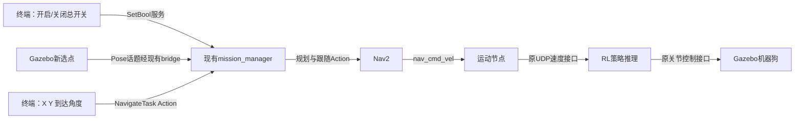

# 导航总开关、Gazebo选点和终端目标（2026-10-13）

新版复用现有 mission_manager，不新增常驻ROS节点。两个入口共用规划、跟随、
取消清理、反馈和结果。终端命令 navigate 运行期间只有一个临时Action客户端节点。
原总体规划、RL、控制参数、地图与模型保持不变。

## 本机应用这次更新

本次为保护用户正在运行的GUI库，先在/tmp独立构建并测试；没有替换当前运行版本。
先按已有取消流程确认任务结束，在启动终端Ctrl+C，等整套系统退出后执行：

```bash
source /opt/ros/jazzy/setup.bash
source /home/ma/lite3_ws/install/setup.bash
cd /home/ma/lite3_ws
colcon build --packages-select lite3_gazebo lite3_navigation
source /home/ma/lite3_ws/install/setup.bash
ros2 launch lite3_navigation bringup.launch.py
```

等待READY和mission_manager提示，总开关默认关闭。另一个终端source Jazzy和工作空间。

## 开启与关闭

只读查询当前状态（新版节点）：

```bash
ros2 service call /lite3/get_navigation_state std_srvs/srv/Trigger '{}'
```

success:true表示查询成功，不代表开关开启。message中的navigation_enabled为实际总开关，
busy为任务/清理占用，fault_latched为未确认清理的故障锁定，switch_pending为开关操作
尚未完成，phase为IDLE或当前任务阶段。查询不启动、不解锁、不取消任务。
节点启动默认关闭；成功到达不关闭；失败/取消/超时经过停止清理关闭；纯非法数字
在提交或起始校验前拒绝不关闭；空闲多久不会自行关闭。旧运行信息话题不是布尔状态查询。

2026-10-13补充这个接口时仍采用/tmp隔离构建，当前运行节点需退出后只构建
lite3_navigation并重启原bringup才能查询，勿把set_navigation_enabled(true)当作查询。

```bash
ros2 service call /lite3/set_navigation_enabled std_srvs/srv/SetBool '{data: true}'
```

返回success:true才表示开启成功。节点先检查新鲜实际位姿、规划/跟随服务器和运动服务，
切换到导航来源，再解除停止锁定；这是用户显式请求的解锁，不是任务自动恢复。
存在旧任务/清理故障时不会解锁。开启前的旧选点不会执行。

```bash
ros2 service call /lite3/set_navigation_enabled std_srvs/srv/SetBool '{data: false}'
```

立即关闭两种任务入口；当前任务请求停止锁定、取消其Nav2目标，并等待确认。
success:true说明输入停止已确认且旧任务已清理，不表示物理上的瞬时停车。
清理失败会报告SYSTEM_ERROR，不会伪称停止成功。关闭总开关保留导航控制来源；
回到手动模式仍需原/lite3/set_navigation_mode(false)和显式解锁操作。

成功到达后总开关仍开启，可发下个目标。任务失败/取消/超时并停止清理后，
总开关关闭；确认旧任务已结束后，再执行开启命令。故障锁定需要排查后重启任务节点。
总开关仅约束mission_manager这两个入口，不能拦截另一个程序直接调用Nav2的Action。
不要同时使用旧mission_manager_once或另外的直接FollowPath任务。

## Gazebo新选点立即导航

开启后点“Lite3目标选点”的“选择目标”，再单击空闲地面。
本次新点击立即交给任务节点，默认到达朝向为0弧度（map的X正方向）；不需再复制坐标。
每次重新选择先再点“选择目标”，普通旋转/拖动视角不触发目标。
关闭总开关时依然可以选点预览，但重新开启后必须重新点，旧点不执行。
忙碌期间的点击会提示BUSY，既不覆盖旧任务，也不排队。

橙色标记和面板坐标表示最后点击的位置，**不代表这个目标已被接受或正在执行**。
任务接收、规划/行走进度、错误和结束结果在启动终端打印，也可查看：

```bash
ros2 topic echo /lite3/navigation_status --qos-durability transient_local
```

## 终端直接输入三个变量

```bash
ros2 run lite3_navigation navigate 4 4 90
```

依次为X、Y、到达朝向；X/Y单位米，角度默认度数[-180,180]，90表示map的Y正方向。
例：`navigate 4 4 0`，`navigate -4 -4 -90`。需要弧度时加`--radians`。
命令等待结果并打印阶段/剩余距离，退出码为任务结果编号（成功0）。
非数字、NaN/Inf和超范围角度在客户端提交前返回INVALID_GOAL(3)。
Ctrl+C退出客户端不等于取消导航；关闭总开关可协调任务停止。

原Action命令仍可用，必须先开启总开关，角度单位仍为弧度[-pi,pi]：

```bash
ros2 action send_goal /navigate_task lite3_interfaces/action/NavigateTask \
  '{goal_x: 4.0, goal_y: 4.0, goal_yaw: 1.5708}' --feedback
```

地图检查仍由Nav2规划器负责；地图外/占据区被判定非法时不交给路线跟随器。
GUI高度过滤只是近地面筛选，不是可通行性检查。

| 情况 | 返回信息 |
|---|---|
| 输入不是数字、非有限值、角度超范围 | INVALID_GOAL / RESULT 3 |
| 地图外或目标占据区 | RESULT 3，保留Nav2码及原因 |
| 没有可达路径 | RESULT 1 |
| 总开关关闭 | NAVIGATION_DISABLED；Action结果8，无规划/运动 |
| 已有任务或操作尚未完成 | BUSY；Action请求拒绝，GUI目标忽略 |
| 关闭总开关协调取消 | RESULT 7；任务已进入清理后才报告结束 |
| 服务/位姿/清理故障 | SYSTEM_ERROR / RESULT 8 |

未新增任务结果枚举；NAVIGATION_DISABLED/BUSY是清晰的状态文本，不是新编号。
总开关内部取消时Action可能为ABORTED且result_code=7；标准Action取消状态是CANCELED，
应同时看Result，不能只凭Action状态判断。BLOCKED/MOTION_FAILED、重规划仍未实现。

## 通信流程与点击去重

| 接口 | 类型 | 来源/接收者 | 内容 |
|---|---|---|---|
| /lite3/set_navigation_enabled | std_srvs/srv/SetBool | 终端→mission_manager | true开启，false取消并关闭；success/message响应 |
| /lite3/get_navigation_state | std_srvs/srv/Trigger | 终端→mission_manager | 只读JSON状态，success表示查询成功 |
| /lite3/selected_goal | geometry_msgs/msg/PoseStamped | GUI Gazebo Pose→现有bridge→mission_manager | map坐标/默认姿态/点击标识 |
| /navigate_task | lite3_interfaces/action/NavigateTask | 终端客户端→mission_manager | 目标、反馈、结果 |
| /lite3/navigation_status | std_msgs/msg/String | mission_manager→终端 | 最近一次入口/进度/结果说明，可靠+持久化最近一条 |

两种目标在同一个节点内进入同一Task状态机→ComputePathToPose→完整Path→FollowPath。
没有Gazebo与MuJoCo通信，没有自发再训练，也没有额外任务转发节点。
当前world/map/odom原点及轴一致，后续改变定位需加坐标转换。



选点仍按2Hz重发便于查询；header.stamp是本次点击的系统时间标识，每次重发不变，
不是机器人状态的仿真时间。任务节点按该标识去重，消耗关闭/忙碌期间的点击；
开启后的新点击才允许执行。切勿把此话题直接当作机器人状态去做带时间TF查询。

## 本次验证范围

独立构建、15项新入口/总开关/只读状态模拟Nav2协议检查、16项原任务回归、真实GUI插件/QML
事件交互和实际ros_gz_bridge的点击标识保持检查通过。真实Nav2/仿真行走联动由用户
重启后验收，不把模拟服务器或注入场景事件称作实际Gazebo导航。
测试不运行RL、不发送真实UDP或速度；原用户仿真未停止、原已加载库未覆盖。
未提交/推送Git。
