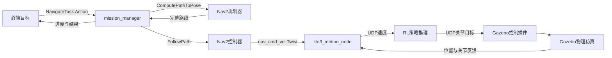

# 课程进度汇报素材（2026-10-10）

## 一句话介绍

基于ROS2 Jazzy、Gazebo Harmonic、RViz2和DeepRobotics Lite3，复用现成RL策略负责基础运动，
让Nav2在预先制作的仓库地图中完成目标点导航，后续扩展实时障碍检测和重新规划。

## 已完成且有实际仿真证据

- 官方URDF/STL整理、五个ROS2包的源码与资源组织、Gazebo/RViz展示。
- 本机ROS速度→RL推理→Gazebo关节控制，前进、转向、停车和输入超时保护。
- 实际关节/joint_states、仿真时钟/clock、里程计/odom与完整机身TF。
- 手动与导航速度互斥、停止锁定和显式解锁。
- 仓库世界及对应地图、实际位置对齐、已知静态障碍的全局规划和路径执行。
- 旧单次入口的短直线与绕货架长路线成功，后者465点、初始反馈11.67m、位置误差约0.14m。

## 已实现并通过隔离协议检查

常驻mission_manager/navigate_task：终端输入目标、反馈、最终结果、单任务忙碌拒绝、
可选起点检查、最终位置/朝向检查、取消清理、总超时、清理无法确认时拒绝后续任务。
16项真实任务二进制与模拟Nav2/TF/运动服务检查通过；新入口在真实Gazebo中仍待用户验收。

## 系统流程

## 尚未完成

实时激光/scan、临时障碍检测和局部绕行、受阻重规划、跌倒检测、完整任务停止/状态管理、
地图和导航启动管理合并、起伏地形与长期稳定性验证。SLAM和自主训练作为后续扩展。

## 汇报时不能混淆

- 根据已知地图绕货架不等于检测未知临时障碍。
- RL推理不等于我们已经完成训练；当前使用官方预训练policy.onnx。
- 包/进程/节点不是同一概念，接口包不增加常驻节点。
- 隔离协议测试不等于新Action入口真实Gazebo导航验收。
- 返回初始位置是再次发送记录的A坐标，尚无自动记忆起点和专门回家接口。
- BLOCKED和MOTION_FAILED已预留格式，尚未实现对应判定。
