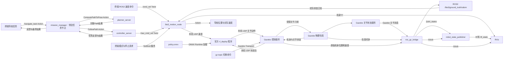

# Lite3 ROS2 Navigation Simulation

**2026-10-17 完整轮廓与受阻优化（当前版本）：** 默认全局规划改为Smac Lattice，
在5cm地图上结合机身朝向和0.84×0.40m矩形检查路线；MPPI允许必要的短距离后退（最低-0.30m/s）。
受阻恢复增加近期失败路段软代价，促使有替代路线时换路；不把失败路段当作真实障碍。
RViz只默认显示当前接受执行的路线，结束/恢复清空，并显示任务状态；状态查询保留最后结果。
总开关、任务Action、20cm内切半径、RL和原整体规划保持；未新增常驻节点。
操作、回退、错误及新增话题见[终端手册](docs/TERMINAL_COMMANDS.md)顶部，
本轮证据和限制见[完整轮廓优化记录](docs/FOOTPRINT_REPLANNING.md)。较早NavFn说明为历史阶段。


**2026-10-17 反应时间调整：** 无有效平移/转向的判定从8秒缩到3秒，首次恢复等待从2秒缩到0.5秒；
连续无路按0.5→1→2秒退避，原地转向也计入进展。控制失败容忍缩至0.5仿真秒。
参数见[终端手册](docs/TERMINAL_COMMANDS.md)，本轮验证与此前结果区分记录。

**2026-10-17 持续避让更新：** controller_server默认接入MPPI，原RPP保留回退；
mission_manager增加内部暂停、等待和有限重规划，仍使用原任务Action/速度接口/预训练RL，
已有感知节点增加雷达紧凑物体运动估计和独立短期预测层；不是SLAM或完整多目标跟踪。
没有新增常驻ROS节点。新增有限时长移动实体箱子工具。详见
[持续避让说明与边界](docs/CONTINUOUS_AVOIDANCE.md)和[终端手册](docs/TERMINAL_COMMANDS.md)。
实际验收结果以SESSION_HANDOFF顶部为准；短期匀速估计有遮挡/突然转向限制，不能保证任意动态场景。
以下按日期保留开发历史；较早“尚无雷达/重规划”等表述不代表上述当前版本。

**2026-10-17 导航轮廓调整（最新）：** 按用户要求青圈调到约20cm：
全局/局部costmap使用0.80×0.36米矩形及每侧0.02米padding，实际检查长0.84/宽0.40米。
替换同日较早的30cm配置；外围膨胀仍0.6米。站立碰撞投影宽约0.375米，
此仿真调试配置侧向余量很小，完整步态/窄通道行走仍需验收。
已构建安装，需重启bringup生效；独立域196的6项真实Nav2合成场景检查通过。
上述缩圈阶段使用NavFn；现默认Lattice已检查完整矩形朝向，执行端仍保留轮廓检查。
重启/只读核对步骤见[终端操作手册](docs/TERMINAL_COMMANDS.md)第10.1节。

**2026-10-14 三维感知更新：** 雷达升级为720×31多层点云，新增
`lite3_perception`包及一个平地感知节点：扫描时刻TF补偿、地面/自身过滤、高度筛选，
输出障碍与清除点云；现有全局/局部costmap加入VoxelLayer，静态地图继续保留。
`/scan`现在是base_footprint下的二维障碍投影，原始数据改为`/lite3/lidar/points`。
雷达前移到TORSO前方0.30米/上方0.15米以减小前方低障碍被机身遮挡的概率。
此功能限平地，尚无SLAM/起伏地面分割/任务自动重规划；不要把感知接入称为动态绕行完成。
使用见[终端手册第9.1节](docs/TERMINAL_COMMANDS.md#91-三维雷达平地过滤与二维障碍地图2026-10-14)
及[感知包说明](src/lite3_perception/README.md)。最新测试状态见SESSION_HANDOFF顶部。
现在共有六个源码package，新增package与新增ROS节点各一个；RL/任务接口保持原样。

**日常终端操作统一入口：[终端交互操作手册](docs/TERMINAL_COMMANDS.md)。**
涵盖启动、状态查询、导航总开关、目标输入、取消/停止、手动/键盘控制、诊断及退出；
以后新增或修改交互功能时同步维护这份文档。

**最新进度（2026-10-13）：二维模拟雷达已接入并构建安装。** 机身上方0.15米，
360°/720点/10Hz（仿真时间）/0.12～12米；现有桥接发布 `/scan`（LaserScan，
lidar_link，BEST_EFFORT），完整启动的导航RViz自动显示扫描点。
仿真状态发布器读取实际生成的同一URDF，单独模型展示仍默认原Lite3.urdf。
独立后台站立仿真验证扫描/同时间戳TF，以及新箱子出现和移除后的距离变化通过；
未启动RL或发送移动目标。Nav2障碍层、动态绕行、重规划与SLAM仍未接入，
现成地图和导航控制参数保留。后续用户已明确希望加入实时SLAM建图，先验收雷达。
操作见[雷达验收](docs/TERMINAL_COMMANDS.md#91-雷达扫描验收2026-10-13)。
下方带日期的旧进度为历史阶段，以此及SESSION_HANDOFF最新记录为准。

2026-10-13状态查询补充：新增只读 `/lite3/get_navigation_state`（Trigger），
返回实际总开关、忙碌、清理故障和任务阶段。须退出旧节点、构建导航包并重启后生效。
查询不改变运动，详细命令见[导航交互手册](docs/NAVIGATION_INTERACTION.md)。

**2026-10-13 交互更新：** 新版提供导航总开关，开启后Gazebo新选点立即提交导航，
也可用 `ros2 run lite3_navigation navigate X Y 角度`（角度默认度数）输入目标。
非法输入有明确错误，关闭总开关会协调取消和停止；不新增常驻节点。
本机仍运行旧版本，本次先隔离构建测试；退出旧系统后构建应用步骤见
[导航交互手册](docs/NAVIGATION_INTERACTION.md)。下方2026-10-12“只选点”是前一阶段。

基于 Ubuntu 24.04、ROS2 Jazzy、Gazebo Harmonic、RViz2 和 DeepRobotics Lite3 的机器人操作系统课程项目。最终目标是在车间通道中从实际当前位置 A 到目标 B，完成已知障碍的全局规划、临时障碍检测与局部避障、必要时重新规划，并返回成功或具体失败结果。

**2026-10-10 当前进度：既有单次导航已完成短直线及一次仓库长路线实测，465点路线、初始剩余距离约11.7米，绕过已知货架后到达(4,4)附近，验收后位置误差约0.14米。现已将mission_manager接为常驻的 `/navigate_task` Action服务端，支持任务反馈/结果、忙碌拒绝、取消清理、可选起点检查和总超时；16项隔离协议检查通过，新Action入口的实际Gazebo行走待用户验收。转向参数仍为0.6 rad/s、最大角加速度12.0 rad/s²。完整任务管理、重新规划、LiDAR和临时障碍检测仍待实现。** 地图、`map→odom`和导航服务器仍手动启动；整体规划保持不变。

**给下一位 AI / 开发者：先读根目录 [AGENTS.md](AGENTS.md)，再按其顺序阅读接续记录和原整体规划。** 所需源码、策略、外部修改与恢复依据已保存，不需要旧聊天才能理解当前状态。新电脑仍需安装环境，并按外部恢复说明获取指定版本的官方依赖；仓库是 private，需要授权访问或提供本地 clone。

**完整开发过程已归档：** [时间线与541条可获取文字记录](docs/development_history/README.md)、[课程进度汇报](docs/PROGRESS_REPORT.md)、[终端交互/PPT素材](docs/TERMINAL_COMMANDS.md)、[当前完整启动手册](docs/RUNBOOK.md)。开发证据明确区分真实Gazebo行走和隔离协议测试；截图附件不包含在文字归档中。

## 整体规划保持不变

**2026-10-12 新增 Gazebo 选点预览：** 完整 launch 默认加载“Lite3 目标选点”面板。
点击“选择目标”后单击地面，显示坐标和橙色标记，可复制坐标，并通过现有桥接发布
`/lite3/selected_goal`（`geometry_msgs/msg/PoseStamped`，`map` 坐标）。
这一步不会发送导航任务，不新增 ROS2 节点；使用与验证说明见 [RUNBOOK](docs/RUNBOOK.md#gazebo-选点预览2026-10-12)。
整体导航链路、RL、任务结果与未来雷达计划保持不变。

- 最终演示使用 Gazebo，同时打开 RViz 观察地图、激光、模型和路径。
- 所有用户指令通过终端发送；根据 Gazebo 场景提前制作地图。
- 第一版使用 Gazebo 实际位姿，不先加入 SLAM 或 AMCL；之后有余力再考虑自主建图/定位。
- 复用开源 RL 成果负责基础运动，演示时运行策略推理，不进行现场训练。
- 地面可以有轻度起伏，但必须实测能通行；台阶和危险地形能力不预先承诺。
- 精简方案约 9 个 ROS2 节点；必要时恢复现成地图/启动管理节点，使用原有约 11 节点备用方案。
- 任务入口、手动/导航/停止互斥、无路/受阻/取消等不同结果定义保持原设计。

原规划文档 [ARCHITECTURE.md](docs/ARCHITECTURE.md) 与 [ROADMAP.md](docs/ROADMAP.md) 保留 2026-10-01 原文，**其中当时的“当前状态”是历史记录**。最新进度及下一次对话的接续依据见 [SESSION_HANDOFF.md](docs/SESSION_HANDOFF.md)。

## 已完成、进行中与未完成

### 已实现

- `lite3_interfaces` 已定义 `NavigateTask.action` 的目标、结果和反馈，构建与序列化检查通过。它仅提供格式，不增加常驻节点；现有 `mission_manager` 已接入 `/navigate_task` 服务端。详见 [接口包说明](src/lite3_interfaces/README.md)。
- `lite3_description` 安装 URDF、四个必需 STL、RViz 配置和展示 launch；保留 `Lite3.urdf`、`Lite3_original.urdf` 和新增 `Lite3_gazebo.urdf`。
- 单独模型展示保留 `robot_state_publisher`、`joint_state_publisher_gui` 和 RViz；`display.launch.py` 提供 `use_gui`、`use_sim_time` 和 `fixed_frame`，默认true/false/TORSO，维持原展示方式。
- `lite3_gazebo` 安装 world/launch；保留原空世界，新导入 `large_warehouse.sdf` 和配套地图，地图目前保存在src中手动加载。
- `simulation.launch.py` 同时启动仓库 Gazebo、在(-4,-4,0.365)生成 Lite3、启动 RViz、运动节点和一个桥接节点；自动设置资源和插件路径，初始暂停。
- Gazebo 模型中的官方 JointStatePublisher 插件以最高 30 Hz 发布实际关节状态；桥接到 ROS2 `/joint_states`，并把 `/world/large_warehouse/clock` 转为 `/clock`。仿真关闭滑块，避免两套角度争用。
- `lite3_control` 插件识别 12 个关节、初始化固定站姿、施加受限力矩，读取身体姿态和关节状态。
- 控制插件以最高50Hz发布原始机身Odometry，位姿以world为参考，速度以TORSO为参考，使用仿真时间戳；现有桥接节点单向转到ROS2 `/lite3/ground_truth/odom`，供后续运动节点整理位置与TF。
- 插件以本机 UDP 与官方 `rl_deploy` 交换状态和动作；默认 `stand`，明确切换 `external` 后才由 RL 接管。
- 指令失联超过 250 毫秒、错误格式或 NaN 时回退固定站姿；髋关节限 ±24 N·m、膝关节 ±36 N·m。
- 保存工作空间之外的六份 RL 修改/新增文件、恢复补丁、准确上游版本、许可和当前 `policy.onnx`，见 [外部 RL 保存说明](external/lite3_rl_deploy/README.md)。
- `lite3_motion_node` 接收 `Twist` 的 vx/vy/wz，以 20 Hz 向 `127.0.0.1:30011` 发送三个 float；0.5 秒无新指令后持续发送零速度，拒绝 NaN/Inf并限制每个使用分量为 ±0.8。
- 同一运动节点默认手动，只接受 `/cmd_vel`；服务 `/lite3/set_navigation_mode`（SetBool）切到导航时只接受 `/nav_cmd_vel`。`/lite3/set_stop` 显式锁定/解锁停止，切换模式不能解除锁定；切换、锁定、解锁均清除保存的速度。非当前来源与锁定期间的消息不刷新超时。
- `lite3_navigation` 保存并安装规划/控制配置和常驻 `mission_manager`：接收终端Action任务，以真实当前位置请求规划，直接把完整Path交给路线跟随器，返回反馈和结果。同一时刻只接受一个任务，取消/失败/超时会锁定停止并取消下游；清理无法确认时拒绝后续任务。控制器仍向 `/nav_cmd_vel` 输出Twist。旧单次入口原样保留为 `mission_manager_once`；通过短直线/仓库长路线实测的是旧入口，新入口通过隔离协议检查。详见 [导航节点说明](src/lite3_navigation/README.md)。
- 同一个运动节点订阅ROS `/lite3/ground_truth/odom`，发布平面 `/odom`（odom/base_footprint），并发布 `odom→base_footprint→TORSO`。odom原点和轴与Gazebo world一致；导航参考投影在z=0平面，机身完整高度与倾斜保留在第二段TF。
- 三维机身速度转换到水平导航轴，转向速度采用真实朝向变化率；使用原始仿真时间戳，拒绝错误坐标名、无效数值/四元数及接近竖直的不可可靠平面姿态。不重复发布旧状态。协方差为默认零，仅用于本阶段理想仿真真值。
- 官方程序新增 `--ros-velocity`：监听30011、换算到策略速度比例、250毫秒未收到速度包时归零；保留默认键盘方式。ROS速度模式下移动按键禁用，空格锁定停止、c显式恢复。

### 实际验证和限制

常驻任务节点构建通过，真实程序在独立ROS域178中完成16项模拟Nav2/TF/停止服务检查：连续任务、忙碌拒绝、完整Path传递、反馈/最终位姿、起点检查、结果分类、规划/行走取消、超时、位姿过期、停止服务拒绝和晚到接受响应等。没有启动Gazebo/RL或发送真实速度。证据 `/tmp/lite3-mission-action-jd16n1ih/result.json`。旧入口源码指纹保持一致；新入口收到旧goal_x等启动参数时会明确提示改用mission_manager_once。

下面短直线与仓库长路线是接入任务Action之前的实测记录，不作为新Action入口的实机仿真验收。当前还没有/stop_task和状态查询、受阻重试、跌倒检测、重规划、地图发布或生命周期管理；BLOCKED/MOTION_FAILED结果尚不产生。Ctrl+C关闭客户端/节点不能代替标准任务取消。

2026-10-10用户完成仓库长路线测试，助手只读核对成功日志和Action状态：从规划起点约(-3.10,-4.00)到目标(4,4)，路线465点，初始反馈剩余距离11.67m；控制器约43.8秒后打印Reached the goal，mission_manager报告到达，FollowPath状态4（SUCCEEDED）。验收后位置约(3.967,3.860)，位置误差约0.144m。此前预览的12.3m/486点是另一条起点稍有不同的路线，不能作为本次成功行走的路线长度；反馈距离也不等同于实际累计行走距离。

原地转向曾以0.35rad/s不能形成明显踏步，固定0.6rad/s测试成功。运行控制器的rotate_to_heading_angular_vel调到0.6、max_angular_accel调到12.0后，用户确认上述长路线成功；两项现已保存到controller.yaml。这是已测试配置，不代表测出了最低转向阈值或任意路线均可通行。其余碰撞检查、速度约束及到达判定保留。

2026-10-10新增 `mission_manager` 并构建通过。第一次联调获得32点路线、控制器输出0.32m/s，但机器狗没有实际前进；测试监测程序取消任务并锁定停止。用户提供的RL日志显示target mode为0（等待起身），按z、等待至少4秒、再按c后确认进入rl_control；重新请求Gazebo external接管后复测成功。节点取得30点路线，从约(-4.003,-3.999)前进到(-3.378,-4.039)，位移0.626m，目标误差0.182m，Action状态4（SUCCEEDED），程序退出码0，最后导航速度为零。任务结束后最初2秒仍有约0.033m的收敛位移，不能声称瞬时停车。

后续额外3秒采样140条里程计，位置漂移为零，确认最终停车稳定。这是旧单次入口的自动规划与跟随验收；当时的监测/取消由临时检查程序完成。原单次程序保留为mission_manager_once，其关闭客户端不会自动取消已被控制器接受的任务。

此前手工短直线FollowPath在0.20m/s时没有持续前进。按用户建议将期望速度和接近目标最低速度调为0.32m/s后，用户确认行走及到达正确；机器人实际移动约0.61m，目标误差约0.19m。低速运动阈值、更多弯道和路线仍需验证，不把小速度或虚拟网卡当作已确认的唯一根因。

用户已确认 Gazebo/RViz 能加载模型、固定站立和读取机身/关节状态。2026-10-04 独立后台 Gazebo 平地测试验证了 UDP 状态格式、控制切换、断线回退、NaN 拒绝，以及现有 RL 的站立、前进和空格停车；一次前进约 2.15 米，无 NaN 或姿态保护触发。

上述后台测试本身不代表转向、台阶、起伏地形或长期稳定性已经验收。用户随后确认了可见 Gazebo 中的 ROS 速度前进、转向和停止；复杂地形及长期稳定性仍未验收。固定站姿不是自主起身算法。先前 MuJoCo 中能平地运动，但遇台阶曾跌倒，不能声称已完成台阶通行。

2026-10-08 发送端和接收端编译通过。发送端验证启动零速度、数据格式、持续更新、0.5秒归零、限幅、NaN/Inf和正常退出。接收接口验证尺度换算、250毫秒断线归零、错误包拒绝、键盘停止锁定及默认键盘兼容。独立后台ROS2/Gazebo联调中，以ROS速度0.32米/秒前进约1.06米，停发后停下；强制结束测试发送节点后，接收端归零并停止行走，无NaN或姿态保护触发。这仍不是导航、复杂地形或长期稳定性验收。

### 尚未完成

- 更多路线、狭窄通道、复杂地形与长期运动验证。
- 把临时地图发布/启动管理合入 `mission_manager`，把临时 `map→odom` 合入运动节点。
- 新Action入口的实际Gazebo行走验收、/stop_task和状态查询、完整结果分类、受阻处理与重新规划。
- `/scan`接入Nav2障碍层、临时障碍导航处理与实时绕行，以及定位失效/跌倒的任务级处理；雷达扫描本身已接通。
- 自主训练完整流程、SLAM、危险地形识别和移动障碍扩展。

仿真启动下 RViz 已配置使用实际关节状态，Fixed Frame为`odom`，机身位置/完整姿态和腿部TF已连通。显示参数由launch覆盖，原RViz配置和单独展示默认仍为`TORSO`。Gazebo初始暂停时可能暂时没有odom坐标，点击播放后状态消息与TF才开始更新。配置中有2D Goal按钮，不代表已完成导航。

2026-10-09用户确认仓库、地图对齐及规划到(4,4)的绕行路线。该阶段用临时map_server和静态map→odom发布器，RViz手动选map固定参考。2026-10-10助手新增模式/停止接口并完成18项独立ROS域检查，读取实际运动节点的UDP包，覆盖来源互斥、切换/锁定清零、解锁等待新消息、无效数据、限幅、两来源超时、冻结仿真时钟、原odom/TF、退出与重启。复测脚本见 [控制包说明](src/lite3_control/README.md)。本次没有启动RL或Gazebo，不代表实际路线跟随已验收。

2026-10-08 本次独立 ROS 域中复用实际桥接和状态发布配置，读取正在运行的 Gazebo：收到 20 条关节消息、656 条时钟消息，检查 120 个同时间戳的关节角度/TF 对应关系及固定关节 TF；确认 `/joint_states` 只有一个发布者、状态节点使用仿真时间、仿真关闭滑块而独立展示默认保留。测试没有发送运动指令或操作用户窗口；未把可见 RViz 动态效果标记为已验收。

随后独立ROS域复用安装后的三话题桥接配置，只读现有Gazebo，收到20条原始机身状态、11条关节消息和384条时钟消息；验证world/TORSO标签、有限位置与速度、单位四元数及最小20毫秒的仿真时间间隔。测试未发送运动指令，测试桥接已退出。该验证不代表导航用 `/odom` 或机身TF已实现。

新增位置订阅后，独立后台Gazebo与ROS域验证实际Gazebo→桥接→运动节点：收到103条机身状态、运动节点两次位置打印，并确认ROS图中的订阅者存在；同时接收83个零速度UDP包，证明没有输入速度时仍持续发送零速度。未运行RL或发送移动指令，测试进程已退出。

新增/odom和机身TF后，独立ROS域验证4种倾斜/朝向的平面位置与速度换算、TF组合还原完整机身朝向、4类非法状态拒绝，以及仿真时钟固定时速度输入仍按实际时间超时归零。实际后台Gazebo从非零世界位置/朝向生成机器人并运行现有RL，前进约0.74米、朝向变化约0.79弧度后停发停车；573组原始状态、/odom和TF对应一致，odom到四只脚的TF均可查询。该结果不代表精确速度跟踪、复杂地形或长期稳定性验收，也未操作可见RViz。

## 当前运动架构与 ROS2 的关系



Gazebo 不直接读取 ONNX；`rl_deploy` 读取并执行策略。MuJoCo 是之前用于独立验证的另一个仿真器，当前 Gazebo 运动时不需要运行 MuJoCo。它们不互相通信。

统一仿真launch持续运行 `lite3_motion_node`、`ros_gz_bridge`、`robot_state_publisher` 和 `rviz2`；`ros_gz_sim/create` 生成模型后退出。导航联调另外手动启动map_server、静态map→odom发布器、planner_server和controller_server（含两个costmap），以及常驻mission_manager。mission_manager_once是旧单次入口，两者择一运行。单独展示模式仍会启动滑块节点。Gazebo插件与rl_deploy不是另外的ROS2节点，/lite3/control_mode是Gazebo话题。整体约9节点的规划保持不变，地图/启动管理合并等工作尚未完成。

## 实际保存的结构

```text
lite3_ws/
├── .gitignore
├── AGENTS.md                      AI 接手阅读入口
├── README.md
├── THIRD_PARTY_NOTICES.md
├── docs/
│   ├── ARCHITECTURE.md            原整体设计，原文保留
│   ├── ROADMAP.md                 原开发路线，原文保留
│   ├── SESSION_HANDOFF.md         最新进度与接续开发说明
│   ├── SYNC_AUDIT.md              本次文件清单、忽略与检查结果
│   ├── RUNBOOK.md                 完整恢复与多终端启动步骤
│   ├── TERMINAL_COMMANDS.md       当前用户交互及PPT命令素材
│   ├── PROGRESS_REPORT.md         课程进度与验收范围
│   ├── SNAPSHOT_MANIFEST.json     有效文件SHA256清单
│   └── development_history/
│       ├── README.md / TIMELINE.md
│       ├── ENVIRONMENT.json
│       ├── SYNC_AUDIT_2026-10-04.md
│       ├── conversation/          本任务可获取可见文字，按日期归档
│       └── evidence/              指定开发验证日志与结果
├── external/lite3_rl_deploy/
│   ├── README.md
│   ├── UPSTREAM.json
│   ├── LICENSE.DeepRoboticsLab.txt
│   ├── requirements-mujoco.txt
│   ├── patches/local-simulation-fixes.patch
│   ├── policy/ppo/policy.onnx
│   └── snapshots/                 六份外部修改/新增源码的完整副本
├── src/
│   ├── lite3_description/
│   │   ├── CMakeLists.txt
│   │   ├── package.xml
│   │   ├── LICENSE.DeepRoboticsLab.txt
│   │   ├── launch/display.launch.py
│   │   ├── meshes/{hip,shank,thigh,torso}.STL
│   │   ├── rviz/lite3.rviz
│   │   └── urdf/{Lite3,Lite3_original,Lite3_gazebo}.urdf
│   ├── lite3_gazebo/
│   │   ├── CMakeLists.txt
│   │   ├── package.xml
│   │   ├── config/{target_picker.config,LICENSE.gui-config.Apache-2.0.txt}
│   │   ├── gui/{Lite3TargetPicker.hh,Lite3TargetPicker.cc,Lite3TargetPicker.qml,target_picker.qrc,LICENSE}
│   │   ├── test/{check_target_picker.cc,check_picker_bridge.py}
│   │   ├── launch/simulation.launch.py
│   │   ├── maps/large_warehouse.{pgm,yaml}
│   │   └── worlds/
│   │       ├── lite3_empty.sdf
│   │       ├── large_warehouse.sdf
│   │       └── LICENSE.large_warehouse.txt
│   ├── lite3_control/
│   │   ├── CMakeLists.txt
│   │   ├── package.xml
│   │   ├── LICENSE
│   │   ├── README.md
│   │   ├── test/check_motion_modes.py
│   │   └── src/
│   │       ├── lite3_gazebo_interface.cpp
│   │       └── lite3_motion_node.cpp
│   ├── lite3_navigation/
│   │   ├── CMakeLists.txt
│   │   ├── package.xml
│   │   ├── LICENSE
│   │   ├── README.md
│   │   ├── config/{planner,controller}.yaml
│   │   ├── test/check_mission_manager.py
│   │   └── src/{mission_manager,mission_manager_once}.cpp
│   └── lite3_interfaces/
│       ├── CMakeLists.txt
│       ├── package.xml
│       ├── LICENSE
│       ├── README.md
│       └── action/NavigateTask.action
├── build/                         本地生成，不提交
├── install/                       本地生成，不提交
└── log/                           本地生成，不提交
```

空的 include/src 目录仍在本地保留；Git 不保存空目录。完整实际文件清单见同步审计。

## 全新 Ubuntu + ROS2 Jazzy 恢复

先按 [ROS2 Jazzy 官方安装说明](https://docs.ros.org/en/jazzy/Installation/Ubuntu-Install-Debs.html) 配置 ROS 软件源。以下路径使用本机用户名 `ma`，其他用户名需要替换 `/home/ma`。

```bash
sudo apt update
sudo apt install git build-essential cmake python3-colcon-common-extensions python3-rosdep ros-jazzy-desktop ros-jazzy-joint-state-publisher-gui ros-jazzy-ros-gz ros-jazzy-ament-cmake ros-jazzy-ament-lint-auto ros-jazzy-ament-lint-common ros-jazzy-gz-sim-vendor ros-jazzy-gz-plugin-vendor ros-jazzy-gz-transport-vendor ros-jazzy-gz-msgs-vendor
sudo apt install ros-jazzy-std-srvs ros-jazzy-nav2-map-server ros-jazzy-nav2-planner ros-jazzy-nav2-navfn-planner ros-jazzy-nav2-smac-planner ros-jazzy-nav2-controller ros-jazzy-nav2-regulated-pure-pursuit-controller
sudo apt install ros-jazzy-gz-gui-vendor qtbase5-dev qtdeclarative5-dev qtquickcontrols2-5-dev
```

仓库为 private，需要先具备 GitHub 访问权限和身份验证。目录不存在时执行：

```bash
git clone https://github.com/STAR-626/lite3_ros2_navigation.git /home/ma/lite3_ws
source /opt/ros/jazzy/setup.bash
cd /home/ma/lite3_ws
colcon build
source /home/ma/lite3_ws/install/setup.bash
```

每个新终端重新 source。build/install/log 由本机生成，不能代替源码同步。也可在 rosdep 已初始化时运行 `rosdep install --from-paths /home/ma/lite3_ws/src --ignore-src -r -y` 检查依赖。

完整地图、规划器、控制器的配置/激活顺序和新任务入口操作见 [RUNBOOK](docs/RUNBOOK.md)；安装版本记录见 [ENVIRONMENT.json](docs/development_history/ENVIRONMENT.json)。

## 完整系统简化启动（2026-10-12）

已新增 `ros2 launch lite3_navigation bringup.launch.py`。日常只需要两个终端：一个保持整套系统运行，另一个发送任务或检查状态。
它自动加载仓库、生成 Lite3、播放仿真、打开导航 RViz、启动运动/桥接/模型节点、加载安装目录中的地图、发布 map→odom、配置并激活 Nav2、准备已有 RL 程序，确认 Gazebo external 接管后再启动常驻 mission_manager。
不会自动发送导航目标。原来的单模块和多终端方式仍可调试，但不要与完整入口同时运行。

修改后首次构建（本机此次已完成）：

```bash
source /opt/ros/jazzy/setup.bash
cd /home/ma/lite3_ws
colcon build --packages-select lite3_description lite3_gazebo lite3_navigation
```

终端 1，每次启动：

```bash
source /opt/ros/jazzy/setup.bash
source /home/ma/lite3_ws/install/setup.bash
ros2 launch lite3_navigation bringup.launch.py
```

等待 `[Lite3 startup] READY` 和任务节点的启动提示。无需手动点击播放、按 z/c、发布 external 或逐个调用 lifecycle。
RL 源码与策略未改变，仍使用 `/home/ma/Lite3_rl_deploy/build/rl_deploy --ros-velocity`；启动辅助程序用伪终端完成原有 z/c 准备，依据仿真数据、生命周期响应、策略进入日志和实际插件接管日志确认顺序，不是固定 sleep 后假定就绪。
临时 ROS 节点 `lite3_startup` 就绪后销毁，辅助进程继续监管其自己启动的 RL。启动阶段先锁定速度，完成后解除本次启动锁定；运行阶段仍沿用原任务失败/取消后显式解锁的规则。

终端 2：

```bash
source /opt/ros/jazzy/setup.bash
source /home/ma/lite3_ws/install/setup.bash
ros2 action send_goal /navigate_task lite3_interfaces/action/NavigateTask \
  '{goal_x: 4.0, goal_y: 4.0, goal_yaw: 0.0}' --feedback
```

取消、返回基地和模式切换仍使用已有接口，详见 TERMINAL_COMMANDS。取消/失败后先确认清理完成，再按需显式解除停止锁定，不由 launch 自动恢复旧任务。
退出时先取消并确认正在执行的任务结束，再在终端 1 按 Ctrl+C；launch 回收本次启动的组件和 RL。等待退出完成后再启动，Gazebo 包装进程退出时端口可能短暂延后释放。

可选参数：`gui:=false rviz:=false` 不打开窗口，`rl_dir:=/实际路径/Lite3_rl_deploy` 指定已有外部项目，`startup_timeout:=180` 延长启动总等待（实际秒）。
端口 20001/30010/30011 被占用，或同一 ROS 域已有本项目节点时拒绝重复启动，不自动杀其他进程。初始暂停或反复重启导致启动失败时查看启动终端日志。
完整 RL 原始输出写入本次 ROS launch 日志目录的 `rl-deploy.log`。终端显示重要状态，不需要用户打开额外 RL 终端。
模型、地图、RL 权重、控制器速度、任务协议和未来规划均保持原样。

## 单独调试：Gazebo + RViz 与 RL 使用

先关闭此前启动的 Gazebo/控制进程再构建，避免覆盖正在加载的动态库。终端 1：

```bash
source /opt/ros/jazzy/setup.bash
cd /home/ma/lite3_ws
colcon build --packages-select lite3_description lite3_control lite3_gazebo
source /home/ma/lite3_ws/install/setup.bash
ros2 launch lite3_gazebo simulation.launch.py
```

Gazebo 初始暂停；点击播放，确认机器人固定站立。统一启动已经包含运动节点和桥接，不再单独启动这两个程序。仿真中没有滑块窗口，RViz 使用实际关节和仿真时间。只想展示模型时，可单独运行 `ros2 launch lite3_description display.launch.py`，默认保留滑块且使用电脑时间。

全新机器先按 [RL 恢复说明](external/lite3_rl_deploy/README.md) 获取指定版本、应用补丁并编译。下面保留原键盘调试方式；ROS速度方式见本节后面的说明。终端 2：

```bash
cd /home/ma/Lite3_rl_deploy/build
./rl_deploy
```

按 `z`，至少等待 4 秒，再按 `c`。确认进入 `rl_control` 和 `PolicyRunner entered`。此时插件仍为固定站立。终端 3：

```bash
source /opt/ros/jazzy/setup.bash
gz topic -t /lite3/control_mode -m gz.msgs.StringMsg -p 'data: "external"'
```

Gazebo 终端打印 `Mode: external` 后，回终端 2 连续按两三次 `w` 尝试前进；按空格停车。`w/s` 调整前后速度，`a/d` 调整侧向速度，`q/e` 调整转动速度；松开按键不会自动归零。`z/c` 是模式按键，不要连续乱按。退出前先在终端 3 执行：

```bash
gz topic -t /lite3/control_mode -m gz.msgs.StringMsg -p 'data: "stand"'
```

再在终端 2 按 Ctrl+C。插件操作细节和协议见 [lite3_control/README.md](src/lite3_control/README.md)。

### ROS2 速度控制方式

终端1按上面方式启动仿真并点击播放；运动节点和关节/时钟桥接已自动启动。
终端2从 `/home/ma/Lite3_rl_deploy/build` 执行 `./rl_deploy --ros-velocity`，按z等待至少4秒再c。
终端3执行以下命令，交出关节控制权并持续发布速度：

```bash
source /opt/ros/jazzy/setup.bash
source /home/ma/lite3_ws/install/setup.bash
gz topic -t /lite3/control_mode -m gz.msgs.StringMsg -p 'data: "external"'
ros2 topic pub --rate 10 /cmd_vel geometry_msgs/msg/Twist '{linear: {x: 0.3}, angular: {z: 0.0}}'
```

停止这个发布命令后，约0.5秒速度要求归零；正常速度包仍由发送节点持续发送。
若发送节点退出/失联，RL接收端250毫秒未收到包后也归零。
ROS速度模式中，控制程序的w/s/a/d/q/e不改变速度；空格锁定停止，c恢复接受ROS速度。
z/c/x/r继续用于状态切换。该接口仍是手动ROS速度入口，不是Nav2导航。
临时Python接收器必须退出，避免占用30011；旧键盘程序和ROS速度程序不能同时运行。

### ROS2 模式切换与停止锁定

以下命令在已有运动节点的空闲已source终端执行：

```bash
# true 导航，false 手动；切换清除当前速度。
ros2 service call /lite3/set_navigation_mode std_srvs/srv/SetBool '{data: true}'

# true 锁定停止；模式切换无法解除此锁定。
ros2 service call /lite3/set_stop std_srvs/srv/SetBool '{data: true}'

# false 显式解锁，等待当前来源新收到的速度。
ros2 service call /lite3/set_stop std_srvs/srv/SetBool '{data: false}'
```

默认手动模式仅接受/cmd_vel；导航模式仅接受/nav_cmd_vel，消息类型均为Twist。
解锁不会恢复保存的旧目标，但当前来源持续发布的新收到消息可以恢复运动。
此接口不取消Nav2任务；未来任务节点需同时取消路径跟随并锁定停止。
重启不保存模式/锁定状态，回到默认手动、未锁定、零速度；Twist无生成时间戳。
实际操作语义、复测脚本与验证范围见 [控制包说明](src/lite3_control/README.md)。

### 仓库地图与全局规划检查点

统一launch已加载仓库。以下组件仍分别手动启动，尚未并入最终9节点方案。
所有新终端先source Jazzy和工作空间。地图发布终端：

```bash
ros2 run nav2_map_server map_server --ros-args \
  -p yaml_filename:=/home/ma/lite3_ws/src/lite3_gazebo/maps/large_warehouse.yaml \
  -p use_sim_time:=true -p bond_heartbeat_period:=0.0
```

空闲终端依次配置、激活地图并提供固定map→odom：

```bash
ros2 lifecycle set /map_server configure
ros2 lifecycle set /map_server activate
ros2 run tf2_ros static_transform_publisher \
  --x 0 --y 0 --z 0 --roll 0 --pitch 0 --yaw 0 \
  --frame-id map --child-frame-id odom
```

地图原点[-5.6,-5.6,0]是地图图片左下角，不要重复填入TF。RViz选Fixed Frame=map，
添加Map /map（Transient Local/Reliable）与Path /plan（先添加再发规划请求）。
另一个终端运行已安装的规划配置：

```bash
ros2 run nav2_planner planner_server --ros-args \
  --params-file /home/ma/lite3_ws/install/lite3_navigation/share/lite3_navigation/config/planner_navfn.yaml
```

空闲终端执行：

```bash
ros2 lifecycle set /planner_server configure
ros2 lifecycle set /planner_server activate
ros2 action send_goal /compute_path_to_pose nav2_msgs/action/ComputePathToPose \
  "{goal: {header: {frame_id: map}, pose: {position: {x: 4.0, y: 4.0, z: 0.0}, orientation: {w: 1.0}}}, planner_id: GridBased, use_start: false}"
```

用户已确认该阶段SUCCEEDED、error_code=0且RViz出现绕行路线。ComputePathToPose只计算路线，
不发送行走速度。地图对齐、真值定位、无雷达的已知静态障碍规划不等于临时障碍检测。

### 实际关节同步与时间检查

关闭此前手动启动的桥接节点和旧仿真，再使用统一 launch。点击播放后，在空闲的已source终端检查：

```bash
ros2 topic echo /joint_states --once
ros2 topic echo /clock --once
ros2 topic echo /lite3/ground_truth/odom --once
ros2 topic echo /odom --once
ros2 param get /robot_state_publisher use_sim_time
ros2 param get /rviz2 use_sim_time
ros2 param get /lite3_motion_node use_sim_time
```

三个参数应为true。`/joint_states` 来自Gazebo，`/clock` 是仿真时间。原始机身状态为world/TORSO，运动节点输出的 `/odom` 为odom/base_footprint，包含水平位置、朝向和速度。速度发送定时器及0.5秒停车保护仍使用实际时间，不因仿真暂停而冻结。仿真暂停时位置/时钟暂不更新，查看消息可能等待；点击播放后再检查。

机身坐标链可用 `ros2 run tf2_ros tf2_echo odom TORSO` 查看，Ctrl+C结束。当前odom与Gazebo world数值原点/轴一致；运动节点没有另行发布world坐标TF或map→odom，地图检查阶段使用上述临时静态map→odom发布器。base_footprint是机身投影到z=0的水平导航参考，不代表实时识别了地形高度。

### 资源路径为什么需要设置

统一 launch 已自动设置 `GZ_SIM_RESOURCE_PATH` 和 `GZ_SIM_SYSTEM_PLUGIN_PATH`。
前者让 Gazebo 查找 `package://lite3_description/meshes/*.STL`，后者查找本项目的 `.so` 控制插件。ROS package 的安装索引和 Gazebo 的资源搜索不是同一套机制。

手动启动时需在启动 Gazebo 的同一终端先设置（统一 launch 不需要重复执行）：

```bash
source /opt/ros/jazzy/setup.bash
source /home/ma/lite3_ws/install/setup.bash
export GZ_SIM_RESOURCE_PATH="/home/ma/lite3_ws/install/lite3_description/share${GZ_SIM_RESOURCE_PATH:+:$GZ_SIM_RESOURCE_PATH}"
export GZ_SIM_SYSTEM_PLUGIN_PATH="/home/ma/lite3_ws/install/lite3_control/lib${GZ_SIM_SYSTEM_PLUGIN_PATH:+:$GZ_SIM_SYSTEM_PLUGIN_PATH}"
gz sim -v 3 /home/ma/lite3_ws/install/lite3_gazebo/share/lite3_gazebo/worlds/lite3_empty.sdf
```

另一个已 source 的终端可手动 Spawn（不要和统一 launch 重复生成）：

```bash
ros2 run ros_gz_sim create -world lite3_world -file /home/ma/lite3_ws/install/lite3_description/share/lite3_description/urdf/Lite3_gazebo.urdf -name Lite3 -z 0.36
```

## 常驻任务入口：自动规划与路线跟随

前提：统一仿真已播放；map_server、planner_server、controller_server均已configure/activate；map→odom零变换已发布；控制器以 `-r cmd_vel:=/nav_cmd_vel` 启动。RL从build目录以 `./rl_deploy --ros-velocity` 运行，先z、等待至少4秒、再c进入rl_control，然后Gazebo明确切换external。Gazebo里站着不等于RL就绪；target mode 0是等待起身，不能直接用c进入行走。

在已经完成上述启动的ROS终端执行：

```bash
source /opt/ros/jazzy/setup.bash
source /home/ma/lite3_ws/install/setup.bash
# 终端A：只启动任务节点，等待任务。
ros2 run lite3_navigation mission_manager --ros-args -p use_sim_time:=true
```

另一个已source的终端B，在确认旧任务结束、RL已进入行走且external接管后发目标（会实际移动）：

```bash
ros2 service call /lite3/set_stop std_srvs/srv/SetBool '{data: false}'
ros2 action send_goal /navigate_task lite3_interfaces/action/NavigateTask \
  '{goal_x: -3.2, goal_y: -4.0, goal_yaw: 0.0}' --feedback
```

起点由规划器读取实际TF；节点完成任务后继续等待。目标示例用于初始位置约(-4,-4)的短直线，必须结合当前位置选目标；重复已到达目标可能立即成功。任务结果使用NavigateTask中0–8编号，详见 [导航节点说明](src/lite3_navigation/README.md)。

另一个已source终端可取消任务：`ros2 service call /navigate_task/_action/cancel_goal action_msgs/srv/CancelGoal '{}'`。取消请求被接受不等于已经停止，需等待最终结果确认清理完成；取消/失败/超时后保持运动停止锁定，恢复前确认旧任务已结束再显式解锁。直接调用 `/lite3/set_stop` 的data=true只锁输入，需同时取消任务。Ctrl+C退出客户端/任务节点不能代替取消。

旧单次参数入口原样保留为 `ros2 run lite3_navigation mission_manager_once --ros-args -p use_sim_time:=true -p goal_x:=-3.2 -p goal_y:=-4.0 -p goal_yaw:=0.0`。不要与常驻节点同时运行。

## 排错

- **robot_description 为空**：先 build 并 source；launch 从 install/share 读 URDF，源码修改后必须重新构建。
- **RViz 不显示**：RobotModel 使用 `/robot_description`，展示阶段 Fixed Frame 为 `TORSO`；核查 `/joint_states`。晚订阅拿不到描述时检查 Transient Local 或重启展示 launch。
- **找不到 gz**：新终端先 source Jazzy，`gz sim --versions` 查看版本。
- **有 Entity 但 mesh 缺失**：检查安装后的 STL 与资源路径；只在另一终端改变量不会更新已启动的 Gazebo。
- **world 或插件找不到**：重新构建三个包、source overlay；本项目现在已经安装 worlds/launch，并显式配置世界插件。
- **Error binding socket**：检查 `ss -lunp 'sport = :20001 or sport = :30010'`。只运行一套仿真和一个 rl_deploy，不同时启动 MuJoCo。确认占用进程后正常退出，不猜测 PID 批量杀进程。
- **运行 rl_deploy 找不到策略**：必须从其 build 目录执行；上游使用相对路径 `../policy/ppo/policy.onnx`。
- **切换 external 被拒绝**：Gazebo 必须播放且收到新鲜有效指令，控制程序先 `z` 等待再 `c`。
- **NaN 或控制断线**：插件回退 stand；检查官方程序状态，修复后重新显式切换。固定站立不是跌倒恢复，不能保证从任意摔倒姿势站起。
- **松开键仍走**：默认键盘输入累加速度，空格停车。`--ros-velocity`方式下移动按键禁用，停发ROS速度约0.5秒后停止；空格是停止锁定，按c显式恢复。
- **RViz 不显示整体移动**：确认新版统一launch的Fixed Frame为odom，Gazebo正在播放，`/odom`有消息且odom→TORSO TF可查；显示节点使用仿真时间。单独展示的TORSO固定参考只显示相对机身的腿部动作。

## 下一步

已保存控制器配置，并接入常驻NavigateTask入口。下一步由用户在实际Gazebo中验收新入口及取消流程，然后完善/stop_task、状态查询、受阻处理与重规划，并继续增加路线验证。原约9节点架构保持不变。当前任务使用方法与结果分类见 [导航节点说明](src/lite3_navigation/README.md)，运动输入的模式/停止接口见 [控制包说明](src/lite3_control/README.md)。

用户选择先完成场景与已知地图导航，再补雷达/scan和临时障碍绕行。当前已完成一次仓库长路线实际行走；完整任务管理和动态障碍处理仍待实现。原总体功能、SLAM、自训练和危险地形扩展保留。

## 来源与许可

Lite3 robot model resources originate from DeepRobotics / DeepRoboticsLab.
预训练策略和部署源码同样来自 DeepRoboticsLab。保留模型和部署项目原始 BSD 3-Clause 许可，详见 [THIRD_PARTY_NOTICES.md](THIRD_PARTY_NOTICES.md)。仓库保持 private。

第三方许可证不自动覆盖独立项目代码；`lite3_control` 有自己的 BSD-3-Clause LICENSE，另外两个 package 的原有 License TODO 仍保留，未替用户擅自选择项目统一许可证。外部原始模型/部署仓库、凭据、虚拟环境和生成日志不整体上传。
