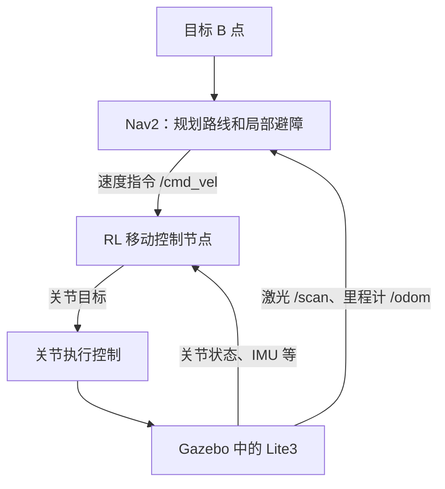
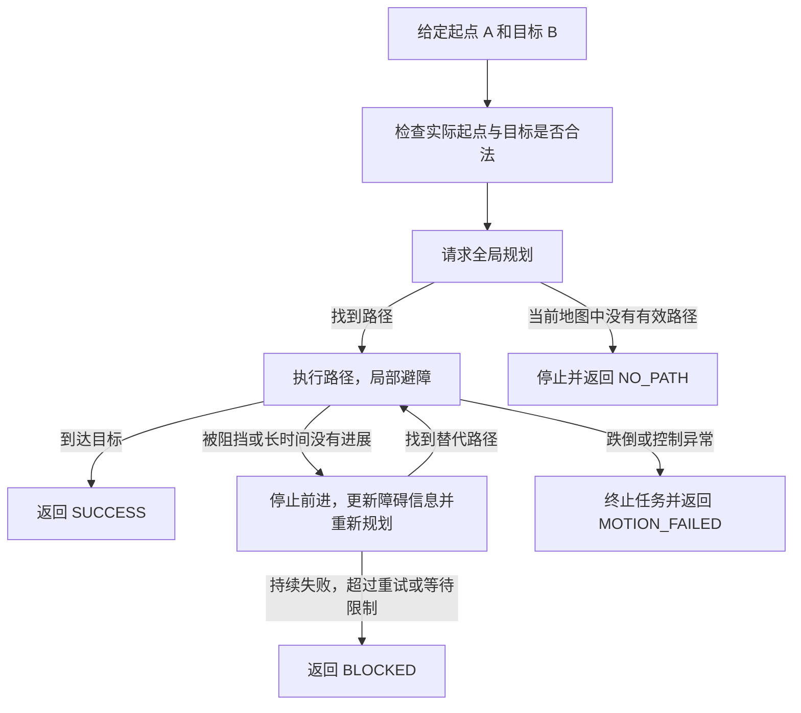
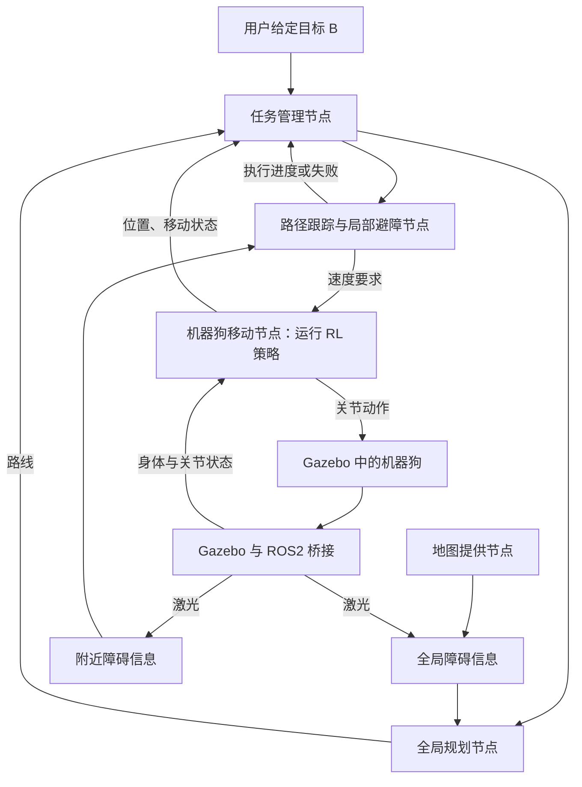

# Lite3 项目开发对话：2026-10-01

本文件从本任务本地可获取记录导出，仅保留用户与助手的可见文字。时间为Asia/Shanghai。
不包含系统/开发者指令、内部推理、工具原始输出、图片或账号凭据。历史命令和建议可能已被后续修正；当前用法以根README和SESSION_HANDOFF为准。

## 12:15:31 用户

我希望你帮我把我目前本地已经完成的 ROS2 Lite3 项目，完整、可靠地整理并同步到我的 GitHub。

非常重要：

不要仅仅根据我下面列举的几个文件进行上传。
请以我电脑上实际存在的本地项目目录为唯一准确信息源，先完整扫描整个项目，再决定哪些属于项目源码、配置、模型资源和文档。

本地项目根目录：

~/lite3_ws

==================================================
一、首先完整检查我的本地项目
==================================================

请先递归检查：

~/lite3_ws

尤其是：

~/lite3_ws/src

请完整查看当前实际存在的：

- 文件夹
- 普通文件
- 隐藏文件
- ROS2 package
- CMakeLists.txt
- package.xml
- Python 文件
- launch 文件
- URDF / Xacro（如果存在）
- SDF
- YAML
- RViz 配置
- STL / DAE / mesh 等模型资源
- scripts
- config
- worlds
- maps
- params
- README 或说明文件
- 其他我们已经创建的项目文件

不要假设我下面列出的结构就是全部内容。

请以实际文件系统扫描结果为准。

可以使用例如：

find
tree
ls -la
git status

等方式检查整个项目。

在真正执行 Git 操作之前，先理解整个项目的真实目录结构。

==================================================
二、当前项目背景
==================================================

这是一个 ROS2 课程结课项目。

开发环境：

- Ubuntu 24.04
- ROS2 Jazzy
- Gazebo Harmonic
- RViz2

机器人平台：

DeepRobotics / 云深处 Lite3 四足机器人。

最终目标：

让 Lite3 在 Gazebo 中作为一个已经具备底层移动能力的机器人平台，完成：

A 点 → B 点
→ ROS2 导航
→ 障碍物检测
→ 局部避障
→ 全局路径规划
→ 必要时重新规划

本项目不准备从零实现四足步态、足端轨迹、逆运动学、MPC 或 RL。

后续希望主要建立：

/cmd_vel
→ Gazebo Lite3 移动

/odom
→ 里程计

/scan
→ 激光雷达

Nav2
→ 全局规划
→ 局部规划
→ 避障
→ A 到 B

==================================================
三、目前已知的项目内容
==================================================

以下只是我目前记得的内容，不保证完整。

你必须扫描实际文件系统补充遗漏内容。

目前至少有：

~/lite3_ws/src/lite3_description

其中可能包括：

- CMakeLists.txt
- package.xml

- urdf/
  - Lite3.urdf
  - Lite3_original.urdf

- meshes/
  - torso.STL
  - hip.STL
  - thigh.STL
  - shank.STL

- launch/
  - display.launch.py

- rviz/
  - lite3.rviz

以及 ros2 pkg create 自动建立的其他目录，如果其中已经存在有效内容，也需要保留。

另一个包：

~/lite3_ws/src/lite3_gazebo

目前至少包括：

- CMakeLists.txt
- package.xml

- worlds/
  - lite3_empty.sdf

以及其他当前实际存在的有效项目文件。

注意：

不要只上传上述内容。
请扫描 ~/lite3_ws/src 下的所有项目文件。

==================================================
四、什么应该完整提交到 GitHub
==================================================

原则：

凡是“项目源码、配置、模型资源、启动文件、环境说明、仿真世界、导航配置”等无法通过简单重新 build 自动生成的文件，都应该保留并提交。

例如：

src/**

以及其中所有实际项目内容，例如：

- ROS2 package 源文件
- CMakeLists.txt
- package.xml
- launch/
- config/
- scripts/
- worlds/
- rviz/
- urdf/
- xacro/
- meshes/
- models/
- maps/
- params/
- yaml
- py
- cpp
- hpp
- sdf
- urdf
- rviz
- STL
- DAE
- JSON
- XML
- txt
- markdown

等等。

如果某些文件你不确定是否应该提交：

不要自行删除。
优先保留，并告诉我你的判断。

特别强调：

lite3_description/meshes/ 下面项目运行所需的 STL 文件必须保留。

Lite3.urdf 和 Lite3_original.urdf 当前也需要保留。

==================================================
五、什么不要提交
==================================================

下面这些是构建产物，不要上传：

~/lite3_ws/build/
~/lite3_ws/install/
~/lite3_ws/log/

还要合理忽略：

__pycache__/
*.pyc
*.pyo
*.swp
*.swo
*~
.DS_Store
Thumbs.db

如果存在 IDE 本地配置，一般忽略：

.vscode/
.idea/

但是如果你发现 .vscode 中存在对项目运行真正有必要的共享配置，不要直接删除，先告诉我。

不要上传：

- 密码
- API key
- token
- GitHub credential
- SSH 私钥
- cookie
- 浏览器数据
- 代理订阅
- 个人账号凭据
- 其他敏感内容

==================================================
六、不要把第三方原始仓库整体上传
==================================================

我的电脑上还有类似：

~/deep_robotics_model

这样的云深处官方模型仓库。

不要把这个整个第三方仓库复制到我的 GitHub 项目里。

我只需要提交目前已经整理进入：

~/lite3_ws/src/lite3_description

中的、这个项目运行确实需要的 Lite3 文件。

也就是说：

外部原始仓库：
~/deep_robotics_model

不要整体上传。

自己的项目：
~/lite3_ws

才是本次 GitHub 仓库的主体。

==================================================
七、先检查第三方模型许可
==================================================

在把 Lite3 官方 URDF / STL 等模型资源放入 GitHub 前：

请检查这些资源原始来源中的 LICENSE、README 或版权说明。

重点判断：

- 是否允许重新分发
- 是否允许放入 GitHub 仓库
- 是否要求保留版权声明
- 是否要求附 LICENSE
- 是否要求注明 DeepRobotics 来源

如果仓库设置为 private，可以先正常保存我的项目。

如果准备 public，而第三方模型许可证存在疑问：

不要贸然公开。
告诉我风险和应该怎么处理。

README 中应该明确注明：

Lite3 robot model resources originate from DeepRobotics / DeepRoboticsLab

具体措辞根据其实际 LICENSE 决定。

==================================================
八、创建高质量 .gitignore
==================================================

在 ~/lite3_ws 创建：

.gitignore

至少包含：

build/
install/
log/

__pycache__/
*.py[cod]

.vscode/
.idea/

*.swp
*.swo
*~

.DS_Store
Thumbs.db

以及其他根据实际项目扫描发现的、不应该上传的临时文件。

但是不要误伤：

src/lite3_description/meshes/*.STL
src/lite3_description/urdf/*
src/lite3_description/rviz/*
src/lite3_description/launch/*
src/lite3_gazebo/worlds/*

这些必须正常进入 Git。

==================================================
九、创建完整 README.md
==================================================

请根据实际项目内容，在：

~/lite3_ws/README.md

创建一个高质量 README。

README 不要虚构还没有完成的功能。

请明确区分：

已经完成
正在进行
未来计划

建议包括：

# Lite3 ROS2 Navigation Simulation

或者根据实际项目给一个更合适的仓库名称。

README 至少包含：

1. 项目简介

说明这是基于：

- ROS2 Jazzy
- Gazebo Harmonic
- RViz2
- DeepRobotics Lite3

构建的机器人导航仿真项目。

2. 项目目标

车间通道中：

A → B
避障
全局规划
动态障碍扩展

3. 当前已经完成

根据实际项目文件和代码判断，不要乱写。

目前大概已经包括：

- Lite3 官方 URDF 整理
- ROS2 lite3_description package
- Lite3 mesh
- robot_state_publisher
- joint_state_publisher_gui
- /joint_states
- TF
- RViz RobotModel
- display.launch.py
- RViz 配置保存
- Gazebo Harmonic
- lite3_gazebo package
- 自建 SDF world
- Gazebo spawn Lite3
- Gazebo 正确加载 STL mesh

4. 尚未完成

例如：

- /cmd_vel
- Velocity Control
- /odom
- LiDAR
- /scan
- Nav2
- A→B navigation
- obstacle avoidance
- global path planning

5. 项目目录树

必须根据实际：

~/lite3_ws

扫描结果生成。

不要凭空猜目录。

6. 环境

Ubuntu 24.04
ROS2 Jazzy
Gazebo Harmonic

7. 依赖安装

根据项目当前依赖写。

例如已经安装过：

ros-jazzy-joint-state-publisher-gui
ros-jazzy-ros-gz

但请根据实际情况检查，不要乱列。

8. 编译

例如：

cd ~/lite3_ws
colcon build
source install/setup.bash

9. RViz 使用

目前应类似：

ros2 launch lite3_description display.launch.py

10. Gazebo 使用

写明：

gz sim ...

Spawn Lite3 的方式。

11. Gazebo mesh 资源路径

当前我们用过：

export GZ_SIM_RESOURCE_PATH=$HOME/lite3_ws/install/lite3_description/share:$GZ_SIM_RESOURCE_PATH

请说明它目前为什么需要设置。

如果你能在不破坏当前项目的情况下，用 ROS2 package / launch 更优雅地解决，可以提出方案，但这次不要擅自大幅修改项目。

12. Troubleshooting

记录当前遇到过的重要问题：

- robot_description 为空
- RViz RobotModel 没订阅 /robot_description
- gz 安装后需要 source Jazzy 环境
- Gazebo 有 Lite3 Entity 但找不到 mesh
- GZ_SIM_RESOURCE_PATH

13. Roadmap

/cmd_vel
/odom
/scan
Nav2
A→B
避障
全局路径规划

==================================================
十、Git 初始化规则
==================================================

先进入：

~/lite3_ws

检查：

git status
git rev-parse --is-inside-work-tree
git branch
git remote -v

如果尚未初始化：

git init

如果已经初始化：

不要破坏已有 Git 历史。

绝对禁止：

git reset --hard
git clean -fd
git push --force

除非我之后明确要求，否则不要使用任何破坏性 Git 操作。

==================================================
十一、提交之前必须先检查
==================================================

在 git add 之前：

请输出并让我确认：

1. 实际扫描到的项目目录树
2. 准备上传的文件列表
3. 被 .gitignore 排除的文件
4. 是否存在超大文件
5. 是否存在敏感信息
6. 是否存在第三方许可证风险
7. README.md 摘要
8. 当前 Git 状态

重点检查：

build/
install/
log/

绝不能进入 commit。

可以使用：

git status --short
git check-ignore
git diff
git diff --cached

等方式确认。

==================================================
十二、GitHub 仓库
==================================================

检查：

gh auth status

如果 GitHub CLI 已经登录：

可以创建一个新的仓库。

建议仓库名：

lite3_ros2_navigation

或根据项目内容给出更合适的名字。

默认：

PRIVATE

不要默认 public。

如果：

- gh 没登录
- GitHub 用户身份不明确
- 已经存在同名仓库
- remote 情况不清楚

请暂停并告诉我，不要猜。

==================================================
十三、Git commit
==================================================

确认没有问题后：

把整个有效项目加入 Git。

注意是：

完整有效项目

不是只加入我上面列出的几个文件。

执行合理的：

git add ...

然后再次：

git status

确认无误后 commit。

首次 commit message 可以类似：

Initial Lite3 ROS2 simulation setup

或者：

Initial ROS2 Lite3 simulation and visualization setup

根据实际项目内容选择更准确的。

==================================================
十四、Push
==================================================

只有在：

- GitHub 仓库正确
- remote 正确
- branch 正确
- commit 正确
- 无敏感信息
- 无错误大文件
- 没有把 build/install/log 加进去

的情况下才 push。

严禁：

git push --force

==================================================
十五、最终必须给我的结果
==================================================

完成后请明确告诉我：

1. 本地项目根目录
2. GitHub repository 名称
3. GitHub repository URL
4. 当前 branch
5. 最新 commit hash
6. 本次 commit message
7. 一共提交了多少文件
8. 上传的完整项目结构概要
9. 哪些内容被 .gitignore 排除了
10. 是否有未提交文件
11. 是否发现敏感信息
12. 是否存在第三方许可证注意事项
13. 如何从一台全新的 Ubuntu + ROS2 Jazzy 电脑 clone 后恢复这个项目
14. clone 后需要执行哪些安装、build、source、环境变量命令
15. 下一步应该从项目的哪一个文件 / package 继续开发

==================================================
十六、最重要的原则
==================================================

请严格遵守：

1. 以实际本地文件系统为准，而不是只相信我列出的文件。
2. 完整保存 ~/lite3_ws 中所有有意义的项目源码和资源。
3. 不提交 build/install/log。
4. 不删除现有源码。
5. 不覆盖已有成果。
6. 不重构无关代码。
7. 不大规模改写项目。
8. 不上传凭据。
9. 不上传整个第三方 deep_robotics_model 仓库。
10. 不 force push。
11. 任何可能造成数据丢失的操作都先问我。
12. GitHub 默认建立 private repository。
13. 最终目标是：GitHub 上的仓库能够完整代表我当前 ~/lite3_ws 的实际开发状态，并且未来可以从 GitHub clone 回来继续开发。

## 12:15:36 助手进度

我会先完整扫描本地项目、检查现有 Git 状态和模型许可证，再整理 README 与 `.gitignore`。按照你的要求，我会在 `git add` 前给出完整清单，等你确认后再提交和推送到 private 仓库。

## 12:16:44 助手进度

扫描确认：项目当前有两个 ROS2 包、13 个源码与资源文件，另有 `build/`、`install/`、`log/`；尚未初始化 Git。四个 STL 和两份 URDF 都在项目中。

发现两点需要写进文档：`lite3_gazebo` 尚未配置安装 `worlds/`，所以当前应从源码路径启动世界；包清单也尚未声明运行时依赖。模型原仓库附有 BSD 3-Clause 许可证，我会保留完整许可和来源说明。

本机没有 `gh` 命令，因此还无法核实 GitHub 账号或创建仓库。我会先完成本地整理和上传前清单，在暂存前停下。

## 12:19:27 助手进度

README、`.gitignore` 和模型许可说明已整理好，原有源码未改动。哈希核验确认：四个 STL 和 `Lite3_original.urdf` 与本地官方模型仓库完全一致。

目前还缺少 Git commit 作者姓名和邮箱，我不会根据目录名猜测。接下来会核验完整候选文件清单与忽略规则；本轮不会执行 `git add`、commit 或 push。

## 12:20:30 助手回复

本地整理和上传前检查已完成，**尚未执行 `git add`、commit 或 push**，等待你按第十一节要求确认。

项目根目录：[~/lite3_ws](/home/ma/lite3_ws)。完整递归扫描发现原有 **13 个项目文件**，全部保留且哈希未变；新增了 README、`.gitignore`、第三方来源说明和完整模型许可证，准备提交 **17 个文件，约 3.55 MB**。

下面是实际项目结构；列出的所有文件均准备提交：

```text
lite3_ws/
├── .gitignore
├── README.md
├── THIRD_PARTY_NOTICES.md
├── src/
│   ├── lite3_description/
│   │   ├── CMakeLists.txt
│   │   ├── package.xml
│   │   ├── LICENSE.DeepRoboticsLab.txt
│   │   ├── launch/display.launch.py
│   │   ├── meshes/
│   │   │   ├── hip.STL
│   │   │   ├── shank.STL
│   │   │   ├── thigh.STL
│   │   │   └── torso.STL
│   │   ├── rviz/lite3.rviz
│   │   ├── urdf/
│   │   │   ├── Lite3.urdf
│   │   │   └── Lite3_original.urdf
│   │   ├── include/lite3_description/  （空）
│   │   └── src/                        （空）
│   └── lite3_gazebo/
│       ├── CMakeLists.txt
│       ├── package.xml
│       ├── worlds/lite3_empty.sdf
│       ├── include/lite3_gazebo/       （空）
│       └── src/                       （空）
├── build/                             （排除）
├── install/                           （排除）
└── log/                               （排除）
```

Git 不保存空目录；这些目录中没有遗漏的源码。

上传前检查结果：

| 检查项 | 结果 |
|---|---|
| 忽略内容 | `build/` 71 项、`install/` 39 项、`log/` 35 项，含符号链接 |
| 其他忽略规则 | Python 缓存、IDE 配置、编辑器临时文件、系统杂项、实际 `.env` 文件 |
| 必需资源 | 四个 STL、两份 URDF、RViz、launch、world 均未被忽略 |
| 大文件 | 最大文件 `shank.STL` 约 1.35 MB；没有超过 50 MiB 的文件 |
| 敏感信息 | 原有项目文件的凭据模式扫描未发现命中；新增文档未包含凭据 |
| 第三方模型 | 四个 STL 和原始 URDF 与本地上游文件逐字节一致 |
| Git 状态 | 已初始化 `main`；17 个未跟踪文件，暂存区为空，无 commit、无 remote |
| GitHub | 本机未安装 `gh`，账号、仓库 URL 和同名仓库情况尚无法核实 |
| Commit 身份 | `user.name`、`user.email` 均未设置 |

模型上游使用 **BSD 3-Clause**，允许附条件重新分发；已保留完整版权、许可条件和免责声明，并注明 DeepRoboticsLab 来源。不得暗示上游为项目背书。项目自行编写部分的许可证仍未选定。[上游许可证](https://github.com/DeepRoboticsLab/deep_robotics_model/blob/main/LICENSE.txt)

[README.md](/home/ma/lite3_ws/README.md) 已包含实际完成状态、未完成项、依赖安装、编译、RViz、Gazebo Spawn、资源路径、排错和 roadmap。它明确记录了当前限制：Gazebo 包尚未安装 `worlds/`，运行依赖尚未写全，速度控制和 Nav2 尚未实现；本次未重新验证 GUI 仿真效果。

完整候选文件、大小、逐项排除清单和 Git 状态见：[上传前检查报告](/tmp/lite3-upload-preflight.md)。

请回复：

1. 是否确认上述 **17 个文件**可以暂存并提交？
2. Git commit 使用的**作者姓名和邮箱**。
3. 安装并登录 `gh` 后告诉我已完成：
   ```bash
   sudo apt install gh
   gh auth login
   ```

无需把 token 或密码发给我。登录后我会核实账号与同名仓库，再创建 **private** 的 `lite3_ros2_navigation`，检查提交后推送，并给出最终 URL、commit hash 和完整恢复步骤。

## 12:25:41 用户

文件没问题，然后接下来我干嘛？我是完全小白

## 12:25:55 助手回复

你已经确认文件清单了。接下来只需要完成 **GitHub 登录**，剩下的提交和上传我来操作。

**第一步：安装 GitHub 工具**

打开 Ubuntu 终端（按 `Ctrl + Alt + T`），复制下面这行，按回车：

```bash
sudo apt update && sudo apt install gh
```

如果要求输入密码，输入你的 **Ubuntu 登录密码**。输入时屏幕不显示字符，这是正常的。遇到“是否继续”，输入 `Y` 并回车。

**第二步：登录 GitHub**

安装结束后执行：

```bash
gh auth login
```

按提示依次选择：

1. `GitHub.com`
2. `HTTPS`
3. 如果问是否让 Git 使用 GitHub 凭据，选 `Yes`
4. `Login with a web browser`

终端会显示一个一次性验证码。按提示打开浏览器，输入验证码，登录你希望保存项目的 GitHub 账号，并完成授权。没有账号的话，先在 [GitHub](https://github.com/signup) 注册。

**第三步：回来告诉我**

回复这三项即可：

```text
GitHub 已登录
提交作者姓名：你希望显示的名字或昵称
提交作者邮箱：你的 GitHub 邮箱
```

邮箱会记录在 Git 提交里。如果不想使用真实邮箱，可以在 [GitHub 邮箱设置](https://github.com/settings/emails) 开启邮箱隐私，复制页面提供的 `noreply` 邮箱给我。

**不要发送密码、token 或一次性验证码。** 如果过程中卡住，直接把提示文字发给我。

## 12:30:43 用户

GitHub 已登录
提交作者姓名： STAR-626
提交作者邮箱：hanchao.ma@outlook.com

## 12:30:46 助手进度

我会核实登录账号、复查项目文件，并设置你提供的提交身份。检查通过后，会创建 private 仓库、提交并推送。

## 12:32:12 助手进度

已确认登录账号是 `STAR-626`，private 仓库已创建。17 个文件已暂存，`build/`、`install/`、`log/` 均未进入暂存区。

检查发现两份原有 URDF 使用 CRLF 换行，并有少量行尾空格；XML 语法检查通过，我会保留原文件。README 已补上真实仓库地址，接下来提交并推送。

## 12:33:40 助手回复

**已成功同步到 GitHub，仓库是 private。** 已核验远端全部 17 个文件与本地提交一致，原有源码和模型资源未改动。

| 项目 | 结果 |
|---|---|
| 本地目录 | [/home/ma/lite3_ws](/home/ma/lite3_ws) |
| GitHub 仓库 | [STAR-626/lite3_ros2_navigation](https://github.com/STAR-626/lite3_ros2_navigation) |
| 当前分支 | `main`，跟踪 `origin/main` |
| 最新 commit | `0bf11b7f6f2a82f0e588df746380ed019b35923f` |
| Commit message | `Initial ROS2 Lite3 simulation and visualization setup` |
| 提交文件数 | **17 个** |
| 未提交项目文件 | **没有，工作区干净** |

上传内容包括两个 ROS2 包的 `CMakeLists.txt`、`package.xml`，四个 STL、两份 URDF、RViz 配置、display launch、SDF world，以及 README、`.gitignore` 和第三方许可说明。没有上传整个 `deep_robotics_model` 仓库。

`build/`、`install/`、`log/` 已排除，仍保留在本机；Python 缓存、IDE 本地配置和临时文件也设置了忽略规则。未发现凭据模式命中，没有超大文件。模型 BSD 3-Clause 完整许可证及 DeepRoboticsLab 来源说明已保留；项目自行编写部分的许可证仍待确定。

在另一台已经安装 **Ubuntu 24.04 + ROS2 Jazzy，并配置好 ROS apt 源**的电脑上，先登录 GitHub，再执行：

```bash
sudo apt update
sudo apt install git gh python3-colcon-common-extensions \
  ros-jazzy-desktop ros-jazzy-ament-cmake \
  ros-jazzy-ament-lint-auto ros-jazzy-ament-lint-common \
  ros-jazzy-ament-index-python ros-jazzy-launch ros-jazzy-launch-ros \
  ros-jazzy-robot-state-publisher ros-jazzy-joint-state-publisher-gui \
  ros-jazzy-rviz2 ros-jazzy-ros-gz

gh auth login
gh auth setup-git

git clone https://github.com/STAR-626/lite3_ros2_navigation.git ~/lite3_ws
cd ~/lite3_ws
source /opt/ros/jazzy/setup.bash
colcon build
source install/setup.bash
```

启动 RViz：

```bash
ros2 launch lite3_description display.launch.py
```

启动 Gazebo：

```bash
export GZ_SIM_RESOURCE_PATH="$HOME/lite3_ws/install/lite3_description/share${GZ_SIM_RESOURCE_PATH:+:$GZ_SIM_RESOURCE_PATH}"
gz sim -v 4 "$HOME/lite3_ws/src/lite3_gazebo/worlds/lite3_empty.sdf"
```

另开终端生成机器人：

```bash
source /opt/ros/jazzy/setup.bash
source ~/lite3_ws/install/setup.bash
ros2 run ros_gz_sim create -world lite3_world \
  -file "$HOME/lite3_ws/install/lite3_description/share/lite3_description/urdf/Lite3.urdf" \
  -name Lite3 -z 0.6
```

详细恢复与排错步骤已写入 [README.md](/home/ma/lite3_ws/README.md)。本次验证了文件保存与远端同步，未重新运行 GUI 仿真。

下一步建议从 [lite3_gazebo/CMakeLists.txt](/home/ma/lite3_ws/src/lite3_gazebo/CMakeLists.txt) 开始：补齐 world 安装、Gazebo 启动文件和运行依赖，然后接入 `/cmd_vel` 移动能力。**你目前不需要再做上传操作了。**

## 12:38:14 用户

我因为我们这个是机器人操作系统课，所以我首先需要对我们的这个项目有一个大概的了解，然后我现在最想知道的是，现在我们这个项目一共是需要几个node呢？我觉得这是最重要的，然后我们是计划使用网上开源的rl（应该有的吧）来训练我们的机器狗的基础移动这些，然后基于此来给我建议吧

## 12:38:21 助手进度

我会先把当前已有的 ROS2 节点和未来导航需要的节点分开说明，再查一下 Lite3 的开源 RL 项目，重点看它们能否接入你们现在的 Gazebo Harmonic 环境。

## 12:39:43 助手回复

**现在你们的项目启动文件里有 3 个 ROS2 node。按“RL 基础移动 + ROS2 导航”的目标，最终可以先设计成约 15 个主要节点，但其中大部分直接使用现成软件，需要你们自己写的节点可能只有 2～3 个。**

节点数量不是固定指标，关键是知道每个节点负责什么、它们如何传递数据。

**先看你们现在的 3 个节点**

我重新检查了 [display.launch.py](/home/ma/lite3_ws/src/lite3_description/launch/display.launch.py)：

| node | 作用 | 通俗理解 |
|---|---|---|
| `robot_state_publisher` | 根据 URDF 和关节状态发布 TF | 告诉系统每条腿、身体在哪里 |
| `joint_state_publisher_gui` | 用滑块生成 `/joint_states` | 手动摆机器狗的姿势 |
| `rviz2` | 显示模型、坐标系等 | 观察机器人的窗口 |

所以当前完成的是**机器人模型和姿态可视化**。滑块能让腿动，并不意味着机器狗已经具备站立、走路能力。

另外：

- **package 是组织代码的目录，node 是运行时参与 ROS 通信的程序。**两个 package 不代表两个 node。
- URDF、STL、SDF、YAML 是文件，不是 node。
- Gazebo 运行物理仿真，本身不应直接算成一个 ROS2 node；通过桥接节点才能与 ROS2 通信。
- `ros2 run ros_gz_sim create` 用于生成机器人实体，通常任务完成后退出，不算长期运行的核心节点。

**你们计划的 RL 和 Nav2，分别负责两件事**

RL 负责：**“收到速度要求后，四条腿如何协调运动，让身体站稳并移动。”**

Nav2 负责：**“为了去 B 点并绕开障碍，此刻应该朝哪个方向、用多大速度移动。”**

整体关系可以画成：



这里还有一个很重要的区别：**训练 RL 和运行 RL 策略是两个阶段。**

训练是在仿真里反复试错，最后得到一个策略文件；课程演示时通常加载这个策略做推理，并不一边导航一边重新训练。训练程序也不一定是 ROS2 node。

**按你们的目标，我建议先这样划分节点**

以下是一个拟议方案，当前还没有实现。采用已有地图 + AMCL 定位，Gazebo 传感器通过一个桥接节点传入 ROS2。

| 部分 | 主要节点 | 职责 |
|---|---|---|
| 机器人显示 | `robot_state_publisher` | 发布机器人内部 TF |
| 观察窗口 | `rviz2` | 显示地图、机器人、路径 |
| 仿真通信 | `ros_gz_bridge` | 桥接关节状态、IMU、激光、仿真时钟等 |
| RL 控制 | `lite3_policy_node`，拟自建 | 读取速度和机器人状态，运行策略 |
| 关节执行 | `controller_manager`，若采用 ros2_control | 管理关节控制器、把指令送入仿真 |
| 里程计 | `lite3_odometry_node`，拟自建或复用 | 提供 `/odom` 和 `odom → base_link` |
| 地图 | `map_server` | 加载地图 |
| 定位 | `amcl` | 根据激光与地图估计位置 |
| 全局规划 | `planner_server` | 计算到目标的路径 |
| 路径跟踪 | `controller_server` | 根据路径、障碍物生成速度 |
| 导航组织 | `bt_navigator` | 组织导航、重试和重新规划 |
| 恢复行为 | `behavior_server` | 执行配置的恢复行为 |
| 速度平滑 | `velocity_smoother` | 减少速度突变 |
| 生命周期管理 | `lifecycle_manager_navigation` | 启动和管理导航节点 |
| 生命周期管理 | `lifecycle_manager_localization` | 启动和管理定位节点 |

**这张表是 15 个主要节点的设计方案，不是承诺运行时 `ros2 node list` 恰好只有 15 行。**控制器、costmap、额外功能和启动配置可能增加节点；若里程计直接桥接，则又可以少一个。Nav2 本身由多个服务器组成，直接复用即可。[Nav2 官方节点与启动示例](https://docs.nav2.org/jazzy/tutorials/general_tutorials/adding_a_nav2_task_server/)

几个容易混淆的地方：

- 接入真实仿真关节状态后，运行控制时应停用 `joint_state_publisher_gui`，避免它和仿真同时发布相互矛盾的状态。
- LiDAR 可以是 Gazebo 传感器插件，通过桥接发布 `/scan`，不一定另写一个“雷达节点”。
- 障碍物检测和局部避障可以先使用 Nav2 的 costmap 与控制器，不必各自再写一个节点。
- Nav2 的 `controller_server` 控制的是机器人整体速度；RL 控制器处理的是四条腿的运动，两者职责不同。

**Lite3 的开源 RL 确实有，优先看官方项目**

我查到了云深处官方的两套相关代码：

| 项目 | 用途 | 对你们的意义 |
|---|---|---|
| [DeepRoboticsLab/rl_training](https://github.com/DeepRoboticsLab/rl_training) | 基于 Isaac Lab 的训练，明确提供 Lite3 环境 | 可以复用训练环境和算法配置 |
| [DeepRoboticsLab/Lite3_rl_deploy](https://github.com/DeepRoboticsLab/Lite3_rl_deploy) | 策略部署，提供 MuJoCo / PyBullet 仿真运行流程 | 可以研究如何加载策略、处理状态和关节动作 |

**但它们不是安装后就能直接接入你们当前 Gazebo Harmonic 的 ROS2 包。**官方训练仓库采用 Isaac Lab，部署示例采用 MuJoCo/PyBullet；Gazebo 接口需要单独适配。也不能把“有训练代码”理解为“已经确认有与你们模型完全匹配、可以直接用的预训练权重”。[官方训练说明](https://github.com/DeepRoboticsLab/rl_training)、[官方部署说明](https://github.com/DeepRoboticsLab/Lite3_rl_deploy)

适配最关键的是关节顺序、动作缩放、默认姿势、IMU 坐标、控制周期和电机控制参数。任何一项不一致，都可能导致策略在原仿真器能走，在 Gazebo 里却倒下。

**基于机器人操作系统课程，我建议这样安排**

1. **先理解并演示当前 3 个节点。**能说清 `/joint_states`、`/robot_description`、TF，以及 launch 如何启动节点。
2. **单独验证官方 RL 的基础移动。**先在官方支持的仿真器里跑通站立、前进、转向、停止；如果有合适的预训练策略，先验证它，再决定是否重新训练。
3. **打通 ROS2 速度控制接口。**先用键盘发送 `/cmd_vel`，让 RL 控制机器人移动，再完成 `/odom` 和 `/scan`。
4. **最后接 Nav2。**从静态地图、静态障碍物的 A → B 开始，再加动态障碍物。

如果课程要求必须用 Gazebo，就把“策略迁移到 Gazebo”列为一个明确的开发阶段；如果仿真器没有硬性要求，可以评估沿用官方部署仿真器并接 ROS2，以减少适配工作。

对你们而言，**最应该先做出来的里程碑是：一个 ROS2 速度指令，能让 Lite3 稳定前进、转向并停止。**这一环跑通后，节点架构和导航任务才有可靠的基础。

接下来决定路线，需要知道：**老师是否要求必须使用 Gazebo、距离结课还有多久，以及你电脑的显卡型号和显存。**这些会直接影响“使用现成策略”还是“自己训练”的选择。

## 12:48:03 用户

那个RL也算作一个节点吗，我们只是使用这个RL来完成机器狗的运动，不想让其参与实际的仿真演示。另外，我们最终的演示环境拟定于gazebo，然后我其实希望节点数目少一点，我觉得你这个有点太多了。然后我们整个的演示就是给定起始点和目标点，让机器狗可以从起始点走到目标点，然后在这个路径上，可能是不平的路（但是我觉得这个应该可以在开始之前的RL的训练中解决吧），然后可能会有一些障碍物等，机器狗在遇到障碍物的时候可以自己避障，如果避障不成功（比如障碍物给他围起来了）或者是全局中没有从A到B的可达路径，机器狗可以返回不同的值。整个的流程大概是这样的，然后如果你有任何对项目的疑问，请向我提问。如果没有疑问，请帮我规划一下一共需要大概多少个节点

## 12:48:16 助手进度

RL 的训练程序可以不出现在演示里，但如果机器狗靠训练好的策略走路，演示时仍需运行这个策略。我会按“Gazebo 演示、尽量少的节点、能区分导航失败原因”来规划，同时确认地图、定位和不平路面的范围。

## 12:49:28 助手回复

**RL 训练本身不必算作 ROS2 节点；但演示时如果靠训练好的 RL 策略走路，仍需要一个程序运行这个策略。建议把它封装在一个“机器狗移动节点”中。**

也就是说：

```text
演示前：训练 RL → 得到策略文件

演示时：加载策略文件 → 接收速度要求 → 控制四条腿
```

演示时不训练，但策略仍在执行。否则训练成果不会自动让 Gazebo 里的机器狗走起来。

根据你的描述，可以把上一版方案精简很多。**我的建议是：8 个主要节点，加上 Nav2 内部的 2 个 costmap 节点，共约 10 个 ROS2 节点；如果打开 RViz，则约 11 个。你们主要开发其中 2 个。**

这个方案暂时以“提前准备地图、使用 Gazebo 真实位姿定位、第一版路面为平缓坡面和小幅起伏”为前提。我已经发出三个确认问题，你的回答可能会调整数量。

**建议的节点分工如下**

| 节点 | 负责什么 | 是否需要自己开发 |
|---|---|---|
| `robot_state_publisher` | 根据实际关节状态发布机器人各部分的 TF | 使用现成节点 |
| `ros_gz_bridge` | Gazebo 与 ROS2 之间传输激光、IMU、关节状态、位姿、时钟等 | 使用现成节点，配置桥接 |
| `lite3_motion_node` | 加载 RL 策略，接收 `/cmd_vel`，控制关节；处理移动状态与停止 | **需要适配开发** |
| `map_server` | 发布提前准备的地图 | 使用现成节点 |
| `planner_server` | 全局规划，计算到目标的路径 | 使用 Nav2 |
| `controller_server` | 根据路径和附近障碍物，计算移动速度 | 使用 Nav2 |
| `lifecycle_manager` | 启动和管理上述 Nav2 节点 | 使用 Nav2 |
| `mission_manager` | 接收任务、请求规划、执行路径、触发重新规划、返回结果 | **需要开发** |

另外，`planner_server` 和 `controller_server` 会分别创建 `global_costmap`、`local_costmap` 节点，所以不能只数表里这 8 个。它们用于记录全局和局部的障碍物信息。[Nav2 全局 costmap 源码](https://github.com/ros-navigation/navigation2/blob/jazzy/nav2_planner/src/planner_server.cpp)、[局部 costmap 源码](https://github.com/ros-navigation/navigation2/blob/jazzy/nav2_controller/src/controller_server.cpp)

这个精简方案里：

- `mission_manager` 直接调用 Nav2 的规划、路径跟踪 Action，承担重新规划和失败处理，不启动整套导航行为树。
- 第一版不使用 SLAM、AMCL、独立恢复行为服务器、路径平滑服务器和航点服务器。
- 运行演示时停用 `joint_state_publisher_gui`，使用 Gazebo 提供的实际关节状态。
- 激光雷达作为 Gazebo 传感器，经桥接发布 `/scan`，不用单独编写雷达节点。
- Gazebo 的关节执行和传感器插件仍然需要配置，只是它们不一定各自成为 ROS2 节点。

**节点减少的代价，是 `mission_manager` 要多承担一点逻辑。**它需要明确管理任务状态、取消旧路径、重新规划和超时，不能只是“发一次目标然后等待”。

整个演示流程可以这样设计：



起点 A 要和 Gazebo 中机器狗的实际位置一致。通常在任务开始前把机器人生成在 A，再使用其实际位姿开始规划，不能只给规划器填写一个 A，而机器人实际站在别处。

**你说的“返回不同的值”，很适合用一个自定义 ROS2 Action**

例如 `mission_manager` 提供 `NavigateTask` Action，目标包含起点、终点，反馈包含当前位置、剩余距离和重试次数，最后返回：

| 拟定结果码 | 含义 |
|---|---|
| `0 SUCCESS` | 成功到达目标 |
| `1 NO_PATH` | 起始规划时，当前地图中找不到有效路径 |
| `2 BLOCKED` | 执行途中受阻，等待或重新规划达到限制 |
| `3 INVALID_START_OR_GOAL` | 起点或目标在地图外，或处于障碍物内 |
| `4 MOTION_FAILED` | 跌倒、移动控制异常等 |
| `5 TIMEOUT` | 超过任务总时限 |
| `6 CANCELED` | 用户取消任务 |
| `7 SYSTEM_ERROR` | 传感器、TF 或服务异常 |

这些是**我们拟定的任务层结果码**。Nav2 自身已经提供“找不到路径”“无法取得进展”“没有有效控制指令”等错误，可以由 `mission_manager` 转换成上述结果。[规划 Action 错误定义](https://github.com/ros-navigation/navigation2/blob/jazzy/nav2_msgs/action/ComputePathToPose.action)、[路径跟踪 Action 错误定义](https://github.com/ros-navigation/navigation2/blob/jazzy/nav2_msgs/action/FollowPath.action)

这里需要严谨一点：**机器人只能根据当前地图和感知判断失败。**“被围住”可以表现为持续受阻，但不能仅凭局部激光就断言整个世界永远没有通路。因此 `NO_PATH` 和 `BLOCKED` 应按上表的操作性定义区分。

**不平路面不能完全交给 RL 训练解决**

RL 可以学习在训练范围内站稳、走过坡面和小幅起伏，但导航仍需要知道哪些地方能走：

- 平缓坡面、小幅起伏：可以先采用二维导航，再验证策略的实际通过能力。
- 台阶、深坑、很陡的坡：还涉及地形感知和可通行性判断，普通二维障碍地图可能不够。

即使训练过，也必须在 Gazebo 中验证迁移后的表现，不能直接认定训练成功就意味着演示场景一定能走通。

所以，我目前推荐的精简规模是：**约 10 个运行节点，打开 RViz 后约 11 个；主要自行开发 `lite3_motion_node` 和 `mission_manager`。**地图定位方式、RL 是否在演示中执行，以及路面难度确认后，就可以把这个数量和接口定下来。

## 13:04:30 用户

打开RViz是干啥？有必要打开这个吗？然后还有就是机器狗到时候是直接获得map吗？也就是我Gazebo的场景信息是直接给到机器狗是吗？不是机器狗自己去建图是吗？然后还有就是我起始点必须是我自己按机器狗的位置来给它吗，如果我给的位置和它的真实位置不一样，那它会怎么样？自主纠错还是毫不知情呢

## 13:04:36 助手进度

这几个问题正好涉及“显示、地图、定位”的区别。我会说明 Gazebo 和 RViz 各自做什么，以及起点填错时系统是否有能力发现。

## 13:05:36 助手回复

**RViz 可以不开；地图不会从 Gazebo 自动交给机器人；起点最好由系统读取实际位置，而不是让你手动填写。**这三件事分别属于可视化、建图和定位。

**1. RViz 是给我们观察导航过程用的**

两个窗口显示的内容不同：

| 软件 | 主要看什么 |
|---|---|
| Gazebo | 仿真世界、机器狗走路、碰撞、坡面和障碍物 |
| RViz | 机器人接收到的激光、地图、定位结果、规划路径和目标点 |

例如机器狗突然绕远路：Gazebo 只能看到它绕路；RViz 能让你看到规划器认为哪里有障碍，以及它规划了哪条路线。RViz 本质上是 ROS 数据可视化工具。[官方说明](https://github.com/ros2/rviz)

**它不是导航必需组件。**目标点可以由你们的任务程序提交，因此关闭 RViz 后，导航仍然可以运行。建议开发时打开，正式演示时按需要选择；如果要向老师解释全局规划和局部避障，同时展示 RViz 很有帮助。

**2. 有地图，不代表机器人自己建过图**

上一版精简方案采用的是：**提前准备地图，再让机器人加载地图。**

但这里要纠正一个可能的误解：Gazebo 的 `.sdf` 场景与导航使用的地图不是同一种数据。

```text
Gazebo 场景：三维模型、地面、墙、物理属性等
导航地图：哪些位置空闲、哪些位置被占据、哪些位置未知
```

需要我们提前制作或生成与场景对应的导航地图，再通过 `map_server` 发布。**Gazebo 不会默认把整个场景自动变成 `/map`。**

你们可以选择：

| 方案 | 地图怎么来 | 演示时是否建图 |
|---|---|---|
| 提前制作地图 | 根据固定 Gazebo 场景制作 | 否 |
| 提前扫描并保存 | 先让机器人用 SLAM 建图，保存后供导航加载 | 否 |
| 边探索边建图 | 演示时运行 SLAM | 是，流程更复杂 |

为了控制项目规模，我建议**先使用提前准备的地图完成导航**，如果课程需要展示建图，再把“提前扫描并保存地图”作为一个独立环节。

而且，提前有地图仍然需要激光检测：**地图保存已知环境，激光发现当前新增的障碍物。**比如原地图中通道畅通，演示时突然放进一个箱子，机器人应该通过 `/scan` 发现它，更新障碍信息并绕行。

**3. 知道地图，和知道自己在哪里，是两回事**

可以把它理解为：

- 地图：校园平面图。
- 定位：你现在站在校园里的哪个位置、朝哪个方向。
- 导航：从当前位置去教学楼怎么走。

上一版方案还提出使用 **Gazebo 提供的真实位姿**作为定位。这是为了减少节点而采用的仿真简化：机器人直接获得准确位置，不需要靠激光去估计位置。

如果你们希望更接近真实机器人，则可以使用已知地图 + 激光定位，例如 AMCL。导航通常需要完整的 `map → odom → base_link` 坐标关系。[Nav2 坐标关系说明](https://docs.nav2.org/rolling/tutorials/general_tutorials/navigation2_with_gps/navigation2_with_gps/)

**4. 起点填错，会怎么样？要看这个“起点”用来干什么**

假设机器狗实际在 `(0, 0)`，你填了 `(5, 5)`：

| 填写位置的用途 | 可能发生什么 |
|---|---|
| 指定 Gazebo 的生成位置 | 机器人会被生成在 `(5, 5)`，这就是它的新真实位置 |
| 指定规划路径的起点 | 规划器可能从 `(5, 5)` 开始规划，但机器人仍在 `(0, 0)`；路径跟踪可能失败 |
| 给定位算法一个初始位置猜测 | 定位算法会从这个猜测开始；可能根据激光纠正，也可能无法收敛或定位到错误位置 |

**不能默认它会自主纠错。**尤其是只把错误位置写进 TF、又没有定位算法时，导航系统可能一直把错误位置当真。即使使用 AMCL，环境相似、偏差过大等情况也可能导致纠正失败。

**我建议你们的任务接口这样设计：**

```text
正常导航：
用户只输入目标 B
系统读取当前实际位置作为起点 A
```

如果演示必须明确指定 A 和 B，就设计成：

```text
选择 A、B
→ 把机器狗生成或重置到 A
→ 等待位置和状态稳定
→ 读取实际位置
→ 开始去 B
```

如果不允许重置机器人，而用户输入的 A 与实际位置明显不一致，就返回 `START_MISMATCH`，暂不执行任务。这是我们要在任务节点里明确实现的检查，不是 Nav2 自动保证的行为。

对于你们第一版，我建议采用：**提前准备地图 + Gazebo 实际位姿定位 + 激光发现新增障碍 + 自动读取导航起点。**这样能把工作集中在机器狗移动、路径规划、避障和失败结果上；RViz 作为可选观察窗口。

## 13:58:00 用户

首先，那还是打开RViz吧，然后建图这块，目前还是使用根据Gazebo场景制作的地图吧，如果把这个弄好了，后边可以考虑使用slam实时建图。我还有一个疑问就是，这个比如提前做的地图里边，从A到B点地图里本身就有一些需要绕过障碍的地方，这些东西不算我们项目里的避障是吧，这个应该是Nav2里边一开始的运动路径规划就已经规划好的是吗？然后那些本身不在地图里的，自己临时加的障碍才是需要机器狗去进行避障的东西是吗？而这个避障就需要激光来检测了是吧

## 13:58:28 助手回复

对，你对流程的理解基本正确，但有一点需要调整：**地图里已知障碍物的绕行，也属于避障；临时新增障碍物的处理，更能体现机器人在线感知和调整路线的能力。**

方案就先确定为：**Gazebo + RViz + 预先制作的地图**，后续再扩展 SLAM。

可以把障碍物处理分成两种：

| 情况 | 机器人如何知道障碍 | 怎么处理 |
|---|---|---|
| 地图里已有的墙、货架等 | 从预先加载的地图知道 | 全局规划时就选择绕开的路线 |
| 地图里没有、临时放入的箱子等 | 通过激光雷达检测 | 更新障碍信息，局部绕行，必要时重新全局规划 |

例如，地图中 A 到 B 之间原本有一堵墙，Nav2 初始规划就会绕过墙。这可以在项目中称为**已知障碍环境下的全局路径规划**，当然也是整个避障功能的一部分。

如果执行途中，你在原本畅通的路线上放一个箱子：

```text
激光发现箱子
→ 更新 costmap（导航使用的障碍与安全距离信息）
→ 判断还能不能沿附近区域绕过去
→ 能绕：调整移动方向，继续走
→ 原路线被封死：重新进行全局规划
→ 持续无法找到可行路线：停止并返回失败结果
```

这里并不是新增障碍只交给“局部避障”。**它也可能影响全局规划**：例如箱子把整个通道堵住，机器人就需要换另一条通道。实现时要配置好激光数据进入局部和全局 costmap，以及任务节点触发重新规划的逻辑。

**是的，你们第一版可以用激光雷达检测这些新增障碍。**Gazebo 负责模拟雷达，ROS2 接收 `/scan`，导航系统根据扫描结果判断障碍位置。不过激光只能检测其视野、距离和扫描高度范围内的东西，所以第一版建议使用能被扫描平面覆盖的箱子、墙或柱子。

另外两个概念不要混淆：

- **在线检测障碍，不等于 SLAM 建图。**即使不运行 SLAM，机器人仍然可以检测新增障碍并避让。
- **临时新增障碍，不等于动态障碍。**放下后不动的箱子是新增静态障碍；持续移动的人或物体才是动态障碍。

你们最终很适合安排三个演示场景：

1. **地图已有障碍：**展示初始全局路线如何绕过墙和货架。
2. **途中新增障碍：**展示激光检测、局部绕行或重新规划。
3. **通道完全封闭：**展示停止、重试限制，以及不同的失败结果。

这样既能体现规划，也能体现在线避障和任务异常处理。

## 14:02:26 用户

nav2是具有“在已知全部地图的时候就进行全局路径规划的能力”是吧？

## 14:02:39 助手回复

**是的，Nav2 具备根据已知地图进行全局路径规划的能力。**

你给它：

- 地图：哪里能走、哪里有障碍；
- 机器人当前位置 A；
- 目标位置 B；
- 机器人的尺寸和安全距离。

它的全局规划器就可以计算一条绕开已知障碍、从 A 到 B 的路径。如果当前地图中找不到有效路径，会报告规划失败。

之后，局部控制器负责让机器人跟随路径，并结合激光检测到的障碍调整运动；必要时重新进行全局规划。

**但 Nav2 不要求地图必须完整已知。**它也能配合 SLAM 使用逐步建立的地图；未知区域是否允许规划通过，取决于配置。

对你们目前的方案，就是：**提前加载地图 → 根据机器狗当前位置和目标点规划全局路径 → 执行途中检测新增障碍并避让。**

## 14:05:37 用户

然后还有一个需要说明的就是，我计划一开始把地面做成不平的，但是是机器狗可以在RL之后顺利通行的程度，后边如果有余力的话再考虑是否可以做成高度崎岖以至于机器狗会把这种地形当成障碍而将其考虑在地图的静态障碍中来进行路径规划或者是将其通过实时的激光雷达来检测，从而绕行。

## 14:05:56 助手回复

明白，这样可以把项目分成两个阶段，第一版的范围比较清楚。

| 阶段 | 地形设计 | 导航如何处理 |
|---|---|---|
| 第一版 | 平缓坡面、小幅起伏，机器狗能够稳定通过 | 地图中标为可通行区域，由 RL 移动策略负责适应地面 |
| 后续扩展 | 陡坡、大台阶、深坑等难以通过的地形 | 识别为不可通行区域，让规划器绕行 |

**第一版需要把“RL 后能通过”作为实际验收条件。**训练完成后，还要在 Gazebo 中验证同类地形上的站立、前进、转向和停止；在训练仿真器里表现好，不代表迁移到 Gazebo 后一定稳定。

另外，平缓地面起伏不应被误判成障碍。后续配置传感器和障碍检测时，需要验证坡面上的激光扫描、机器人姿态变化是否会影响避障。

扩展阶段可以先做较简单的方案：**提前把已知危险地形标入地图的不可通行区域**，继续使用二维全局规划，不必立刻开发实时地形识别。

实时检测则要另行评估：普通二维激光只有一个扫描平面，难以可靠判断坡度、地面高差，尤其是深坑。通常需要三维点云或深度数据，再根据坡度、高差等判断可通行性，不能直接把“雷达检测到东西”等同于“识别出了危险地形”。

因此，当前第一版就定为：**可通行的轻度起伏地面 + RL 基础移动 + 已知地图规划 + 激光检测新增障碍 + 导航结果返回。**实时危险地形识别暂列为扩展项，不增加第一版的节点和开发范围。

## 14:07:42 用户

好的，现在帮我确定一下一共大概需要哪些节点，然后帮我详细说明这些节点都是干嘛的（不要使用太过于专业的术语）

## 14:17:22 助手回复

按照我们已经确定的第一版目标，建议规划为 **约 11 个 ROS2 节点，包括 RViz**。

其中 **8 个是主要功能节点，2 个是 Nav2 内部的地图处理节点，1 个是 RViz**。主要需要我们自己开发或适配的是两个：**机器狗移动节点、任务管理节点**。其余尽量使用现成软件。

这套方案对应：

- Gazebo 中演示，RViz 辅助观察。
- 提前制作地图，暂时不做 SLAM。
- 使用 Gazebo 提供的实际位置，暂时不做自主定位。
- 运行训练好的 RL 策略，让机器狗通过轻度起伏路面。
- 完成 A → B、已知障碍绕行、临时障碍检测、重新规划和失败结果返回。

**一、机器狗和仿真相关的 3 个节点**

**1. `robot_state_publisher`：告诉系统机器狗各部分在哪里**

机器狗由身体、四条腿和多个关节组成。关节弯曲之后，各部分的位置也会变化。

这个节点读取：

- URDF：机器狗的结构说明。
- 实际关节状态：每个关节目前转到了什么角度。

然后告诉其他程序：身体、腿、雷达等部件之间的位置关系。

它让 RViz 能正确显示姿态，也帮助导航程序理解“雷达发现的障碍相对于机器狗在哪里”。

**你们当前已经有这个节点，继续保留。它不负责让机器狗走路。**

**2. `ros_gz_bridge`：在 Gazebo 和 ROS2 之间传递数据**

Gazebo 模拟机器人和环境，ROS2 中的程序负责控制、规划。这两边需要交换信息。

这个节点像一个翻译和传递消息的窗口，把 Gazebo 中的数据送给 ROS2，例如：

- 激光扫描。
- 身体姿态和转动情况。
- 关节角度、关节速度。
- 机器人实际位置。
- 仿真时间。

按最终控制接口，也可以把 ROS2 的关节指令送回 Gazebo。

**使用现成节点，主要工作是配置传哪些数据。一个桥接节点可以传多种数据，不需要每种数据各建一个节点。**

**3. `lite3_motion_node`：让机器狗站稳、走路、转向和停止**

这是我们需要适配开发的核心节点。

导航程序给它的是类似这样的要求：

> 向前走，速度慢一点；同时稍微向左转。

它读取机器人姿态和关节状态，运行训练好的 RL 策略，把这个要求变成四条腿的动作，再交给 Gazebo 中的关节执行接口。

它主要负责：

- 加载训练好的策略文件。
- 接收 `/cmd_vel`，也就是机器人整体的速度要求。
- 根据当前身体和关节状态计算动作。
- 执行站立、行走、转向和停止。
- 检查指令是否中断，以及是否出现跌倒等异常。
- 给任务管理节点报告移动是否正常。

为了减少节点，第一版也可以把 **Gazebo 实际位姿整理成导航所需的位置和速度信息**的工作放在这里，并处理导航地图与仿真世界坐标的对应关系。

**RL 训练程序不计入这 11 个节点。演示时，这个节点只加载策略并运行，不重新训练。**

关节真正执行动作仍需 Gazebo 插件或其他执行接口。这里按“执行接口不额外创建 ROS2 节点”的方案估算；若最后选择 `ros2_control`，节点数可能增加。

**二、地图、规划和避障相关的 5 个节点**

**4. `map_server`：提供提前准备好的地图**

它读取我们为 Gazebo 场景制作的地图，告诉导航系统：

- 哪些区域可以走。
- 哪里有墙、货架或其他固定障碍。
- 地图覆盖多大范围。

第一版的小幅起伏地面，如果已经验证能通过，就标为可通行区域。

**它不会自己建图，也不会自动把 Gazebo 场景转换成地图。地图需要提前制作，并与 Gazebo 的位置坐标对应。**

**5. `global_costmap`：整理整个导航区域的障碍信息**

它以预先准备的地图为基础，形成规划使用的障碍信息。

除了障碍本身，还要考虑机器狗的体积：一条缝隙即使看起来有空地，也未必足够机器狗通过。因此它会让规划器与障碍保持一定距离。

第一版建议它也接收激光发现的新增障碍。这样，当原来的通道被箱子堵住时，全局规划能够考虑更换通道。

**它负责整理“哪里适合走”，不负责计算路线。**

**6. `planner_server`：计算从当前位置到目标的路线**

它接收机器狗当前位置和目标点，结合全局障碍信息，计算一条可行路线。

例如：

```text
从 A 出发
→ 绕过地图中的货架
→ 经过右侧通道
→ 到达 B
```

它主要负责：

- 初次规划路线。
- 被任务管理节点要求时重新规划。
- 返回路径，或者返回规划失败原因。

**它决定整段路怎么走，但不直接控制四条腿。**

**7. `local_costmap`：整理机器狗附近的障碍信息**

它关注机器狗附近的一小片区域，主要结合激光扫描更新。

例如地图里原来没有箱子，但机器狗前方突然出现一个，它会把箱子所在位置标出来，同时考虑机器狗绕过去需要的空间。

**可以把它理解为机器狗随身携带、不断更新的“附近路况图”。**

**8. `controller_server`：决定机器狗此刻怎么移动**

它读取全局路线、机器狗当前位置和附近障碍信息，计算当前应该采用的速度：

- 向前多快。
- 向哪边转。
- 是否应该减速或停下。

计算结果通过 `/cmd_vel` 发给 `lite3_motion_node`。

因此，这两个节点的区别是：

| 节点 | 回答的问题 |
|---|---|
| `controller_server` | 为了沿路线走并避开障碍，现在身体应该怎样移动？ |
| `lite3_motion_node` | 为了实现这个移动要求，四条腿应该怎样动作？ |

附近有空间时，控制器可以尝试局部绕行；持续无法前进时，则报告问题，由任务管理节点决定是否重新规划。

这四个 Nav2 规划与地图节点采用现成实现。其中两个 costmap 节点由规划和控制服务器内部创建，不需要我们分别编写程序。[全局地图与规划实现](https://github.com/ros-navigation/navigation2/blob/jazzy/nav2_planner/src/planner_server.cpp)、[局部地图与控制实现](https://github.com/ros-navigation/navigation2/blob/jazzy/nav2_controller/src/controller_server.cpp)

**三、组织任务和启动的 2 个节点**

**9. `mission_manager`：负责整个 A → B 任务**

这是另一个主要需要自己开发的节点，可以理解为项目的任务负责人。

它负责把所有步骤串起来：

```text
接收目标
→ 检查当前位置和目标
→ 请求规划
→ 执行路线
→ 观察进度
→ 必要时停止、等待或重新规划
→ 返回最终结果
```

具体包括：

- 自动读取当前位置作为导航起点。
- 如果用户明确给了 A，检查它与实际位置是否一致。
- 请求 `planner_server` 计算路径。
- 把路径交给 `controller_server` 执行。
- 在路线受阻或环境变化时触发重新规划。
- 管理等待时间、重试次数和任务总时限。
- 处理取消任务和移动异常。
- 最后返回成功或失败原因。

拟定的结果包括：

| 结果 | 含义 |
|---|---|
| `SUCCESS` | 成功到达目标 |
| `NO_PATH` | 初始规划时，当前地图中没有找到有效路径 |
| `BLOCKED` | 执行途中受阻，等待或重新规划达到限制 |
| `INVALID_GOAL` | 目标位置不合法 |
| `START_MISMATCH` | 用户指定的起点与实际位置不一致 |
| `MOTION_FAILED` | 跌倒或移动控制异常 |
| `TIMEOUT` | 超过任务总时限 |
| `CANCELED` | 用户取消 |
| `SYSTEM_ERROR` | 数据或程序异常 |

失败时，它还要取消正在执行的导航，要求移动节点停止，并返回说明，不能只返回一个数字后继续走。

**10. `lifecycle_manager`：按顺序让导航程序准备好**

地图没加载完、规划程序还没准备好时，不能直接开始导航。

这个节点负责让地图、规划和控制等程序按照顺序完成准备，再进入可以工作的状态，也帮助检查它们是否仍然正常运行。

**使用现成节点，第一版配置一个即可。它不负责路线和避障。**

**四、观察用的 1 个节点**

**11. `rviz2`：显示机器人眼中的导航过程**

它用来显示：

- 地图。
- 机器人位置。
- 激光发现的障碍。
- 全局路线。
- 附近障碍和安全距离。
- 目标点。

Gazebo 展示机器狗实际怎么走，RViz 展示系统根据什么信息决定这样走。你已决定打开，因此计入本次方案。

**整体关系**



RViz 观察这些数据，`robot_state_publisher` 提供身体各部分的位置关系，`lifecycle_manager` 管理导航程序的准备过程。

这次建议的数量是**约 11 个节点，而非最终严格固定的数字**，控制接口确定后才能核实运行时数量。第一版不增加 SLAM、AMCL 或实时危险地形识别节点；已有的关节滑块节点也不参与导航演示。当前仓库仍处于模型与可视化阶段，上述导航和移动节点是接下来的开发规划。

## 14:27:07 用户

能不能稍微精简一点节点呢，就是功能相近的可以放在同一个节点里边？你觉得呢？然后我有一个疑问就是你这个任务管理节点是不是也可以接受用户从终端向机器狗发送的信息呢？因为我们后边的所有指令都是通过终端来发布的

## 14:27:50 助手回复

**可以合并，尤其是我们自己开发的辅助功能。任务管理节点也完全可以接收终端发来的指令，不需要再增加一个“用户输入节点”。**

不过，不建议为了少几个节点去改写 Nav2 内部结构。节点之间的职责清楚，后续排查问题会容易得多。

可以把上一版调整为 **约 9 个节点，包含 RViz**：

| 节点 | 主要作用 |
|---|---|
| `mission_manager` | 接收终端命令、加载并发布地图、组织导航、管理启动准备、重新规划、返回任务结果 |
| `lite3_motion_node` | 运行 RL 策略、控制机器狗移动、整理仿真位置与速度、报告移动异常 |
| `ros_gz_bridge` | 在 Gazebo 和 ROS2 之间传递传感器数据与控制指令 |
| `robot_state_publisher` | 提供身体、腿和雷达之间的位置关系 |
| `planner_server` | 计算全局路线 |
| `global_costmap` | 整理全局障碍和安全距离 |
| `controller_server` | 跟随路线、局部避障、生成速度要求 |
| `local_costmap` | 根据激光更新附近的障碍信息 |
| `rviz2` | 显示地图、激光、位置和规划路径 |

**减少的两个节点，是把地图发布和启动管理合进 `mission_manager`。**但这意味着我们需要自己实现原来由 `map_server` 和 `lifecycle_manager` 提供的必要功能，包括正确加载地图、等待导航程序准备好、处理启动失败。不是简单删掉它们就能运行。

如果这部分实现成本不划算，保留现成节点的 11 节点方案仍然合理。**我建议把 9 个作为精简设计目标，具体数量以最终控制接口为准。**

任务管理节点可以作为整个项目的**终端指令入口**。你在终端提出任务，它负责检查、执行和返回结果。例如，后续可以设计成：

```bash
# 以下是拟定接口，当前还不能直接执行

ros2 action send_goal /navigate_task \
  lite3_interfaces/action/NavigateTask \
  "{goal_x: 8.0, goal_y: 3.0, goal_yaw: 0.0}" \
  --feedback
```

含义是：**让机器狗从当前位置，走到地图中的 `(8, 3)`，并在终端持续显示进度。**

这个终端命令可以显示：

```text
任务已接受
正在规划
正在移动，距离目标还有……
发现阻挡，正在重新规划
最终结果：SUCCESS / NO_PATH / BLOCKED / …
```

不同类型的指令，建议分开处理：

| 终端指令 | 谁接收 | 用途 |
|---|---|---|
| 去某个目标、取消导航 | `mission_manager` | 完整导航任务 |
| 查询状态、重置任务 | `mission_manager` | 管理任务 |
| 手动前进、转向 | `lite3_motion_node` | 调试基础移动，通常通过 `/cmd_vel` |
| 停止 | 两者协调处理 | 取消导航，并让机器狗停止移动 |

这里要设置明确的**手动模式和导航模式**，避免终端手动速度与导航速度同时控制机器狗。停止后也要取消当前导航任务，不能让导航程序马上又发出前进指令。

因此，你们后续完全可以只通过终端操作：**终端负责提出要求，任务管理节点负责组织执行，移动节点负责让机器狗实际走起来。**RViz 只用于观察，不必用鼠标发布目标。

## 14:30:09 用户

好的，现在根据我们现在讨论的结果把我的git仓库更新一下吧，尤其是与未来的计划相关的都要给我改了，然后一定要整一个整体的项目架构出来，也可以配图

## 14:30:15 助手进度

我会把讨论确定的第一版范围、约 9 个节点的精简方案、终端指令入口和后续扩展写进仓库，并补一份整体架构文档与流程图。会明确标出哪些已经实现、哪些仍是计划，检查后提交并推送。

## 14:35:36 助手进度

文档已更新，补了整体数据流、RL 训练与演示分离、任务执行流程三类图。节点合并需要补上的地图发布和启动管理工作也写清楚了，同时保留约 11 节点的备用方案。

第一版范围与未来扩展已分开：先做轻度起伏、预制地图和临时静止障碍避让；SLAM、危险地形识别和移动障碍留到后续。

## 14:37:33 助手回复

已更新并推送到 [GitHub 仓库](https://github.com/STAR-626/lite3_ros2_navigation)，仍为 **private**。

本次更新了三份文档：

- [README](https://github.com/STAR-626/lite3_ros2_navigation/blob/main/README.md)：更新第一版目标、节点方案和未来计划。
- [整体项目架构](https://github.com/STAR-626/lite3_ros2_navigation/blob/main/docs/ARCHITECTURE.md)：约 9 个节点的职责、终端接口、地图与定位、RL 接入、任务结果，以及架构流程图。
- [开发路线与验收](https://github.com/STAR-626/lite3_ros2_navigation/blob/main/docs/ROADMAP.md)：开发顺序、演示场景，以及 SLAM、危险地形识别等扩展计划。

共加入 **4 张 Mermaid 图**，可在 GitHub 文档页面查看。所有计划都与已实现功能明确区分。

最新提交：`2fa5507`  
提交说明：`Document Lite3 navigation architecture and phased roadmap`

已验证远端文档与本地一致，工作区干净。**本次只改文档，原有源码、URDF、STL 和仿真文件均未修改。**

## 14:41:57 用户

我们现在开发是按照节点来一个一个节点进行开发吗？还是怎么来做这个项目呢？

## 14:42:25 助手回复

**建议按“功能阶段”开发，每完成一个阶段就验证一次，而不是把节点逐个写完，最后才连接起来。**

因为一个功能经常需要几个节点配合。例如“终端发指令让机器狗前进”，就同时涉及 Gazebo、通信桥接和移动控制。只把某个节点写完，不能证明机器狗真的能走。

现成节点主要做配置；我们自己的节点则随着阶段逐步增加功能，不需要一开始就写完整。

按你们的项目，我建议这样推进：

| 阶段 | 做什么 | 怎样判断完成 |
|---|---|---|
| **1. 稳定启动仿真** | 整理 Gazebo 启动、机器人生成、模型资源和 RViz | 一条启动命令能稳定打开同一个世界和机器狗 |
| **2. 打通基础移动** | 验证开源 RL 策略，适配 Gazebo，建立移动节点 | 终端能控制站立、前进、转向、停止，能通过设定的轻度起伏 |
| **3. 打通位置和感知** | 接入实际位置、关节状态、激光和仿真时间 | RViz 中机器人位置、姿态和扫描障碍与 Gazebo 对齐 |
| **4. 完成最简单的 A → B** | 准备地图，配置 Nav2，建立任务节点的基本流程 | 从终端给目标，机器狗能在简单场景中到达，并返回成功 |
| **5. 加入障碍与重新规划** | 先测试地图中的障碍，再测试途中新增障碍 | 能绕行；原路线堵住时能尝试替代路线 |
| **6. 完善失败和停止处理** | 加入无路、受阻、超时、取消、移动异常等结果 | 各场景返回正确原因，失败后不会继续执行旧任务 |

**停止和指令超时保护要从第 2 阶段就加入**；第 6 阶段是完善整套任务处理，不是到最后才考虑停止。

两个主要自建节点可以这样逐步成长：

- **`lite3_motion_node`**：先实现基础移动 → 再加入位置整理 → 再完善模式切换、停止和异常报告。
- **`mission_manager`**：先接受目标并完成一次导航 → 再加入重新规划 → 最后完善各种反馈和结果。

尤其是第 2 阶段，应该先验证官方策略能否运行，再决定 Gazebo 接口怎么写。**先证明机器狗能够受控地走路，是这个项目最关键的一步。**不要先写出一套复杂导航程序，却发现底层移动还不能稳定执行。

每个阶段完成后，保存对应的配置、操作步骤和验证结果，再提交到 Git。这样遇到问题时，能判断是新增加的功能出了问题，还是前面的基础已经不稳定。

**我们当前应该从第 1 阶段开始：把现有“手动开世界、手动生成机器狗”的流程整理成可靠的统一启动方式。**随后立即进入 RL 基础移动验证。

## 14:44:11 用户

也就是第一个阶段就是可以通过条命令然后同时启动RViz和Gazebo以及让里边加载上我们的机器狗模型是吗？

## 14:44:23 助手回复

**对，第一阶段就是：用一条命令启动 Gazebo、加载 Lite3 模型，并同时打开 RViz 显示机器狗。**

例如，之后我们可以实现这样的命令：

```bash
ros2 launch lite3_gazebo simulation.launch.py
```

这个启动文件会自动完成：

1. 启动指定的 Gazebo 世界。
2. 设置模型资源路径，让 STL 正常加载。
3. 在指定位置生成 Lite3。
4. 启动模型显示所需的 ROS2 节点。
5. 打开 RViz，加载保存的显示配置。

**第一阶段的验收是“稳定启动和正确显示”，还不包括站稳、走路或导航。**目前没有移动控制器，开始物理仿真后机器狗可能倒下，所以可以先让 Gazebo 保持暂停。

上面的命令是我们准备实现的入口，现在还不能直接运行。

## 14:47:25 用户

好的，现在可以开始了。然后你禁止修改我的本地任何的文件内容，只允许在必要时查看。这是我们的ROS结课作业，我希望在你的辅助下自己来完成整个项目的搭建。请你告诉我我都需要怎么操作，然后告诉我某个操作是在干什么，意义是什么等等。我自己在终端进行操作。再次重申，你禁止修改任何本地文件，只可以查看。

## 14:47:58 助手回复

明白。**从现在起，我不修改你的任何本地文件，也不替你执行安装、编译、Git 提交或推送。**你在终端操作，我负责解释、检查结果并指导下一步；必要时我只读取文件。

第一阶段的目标是：**一条命令打开 Gazebo 和 RViz，并加载 Lite3，Gazebo 初始保持暂停。**

我们按小步骤完成：

1. 确认当前环境和文件。
2. 配置仿真世界需要的功能。
3. 让编译过程正确安装世界和启动文件。
4. 编写统一启动文件。
5. 编译、启动并检查。

先做第一步，**下面的命令只检查，不修改项目文件**。

**① 打开终端，进入项目**

```bash
cd ~/lite3_ws
pwd
```

`cd` 是进入目录；`pwd` 是确认当前位置。预期显示：

```text
/home/ma/lite3_ws
```

**② 加载 ROS2 环境并检查 Gazebo**

```bash
source /opt/ros/jazzy/setup.bash
printenv ROS_DISTRO
gz sim --versions
```

`source` 让**当前终端**能够找到 ROS2 的命令和软件包，不修改配置文件。后两条命令分别检查 ROS2 版本与 Gazebo Sim 版本。

预期 ROS2 显示 `jazzy`；Gazebo Harmonic 对应 Sim **8.x**。

**③ 检查项目里的 ROS2 包**

```bash
colcon list
```

这条命令查找当前工作区里的软件包，**不会编译**。预期至少能看到：

```text
lite3_description
lite3_gazebo
```

**④ 查看这次要用的配置文件**

逐条执行：

```bash
cat src/lite3_gazebo/CMakeLists.txt
```

这是包的构建与安装说明。我们要确认以后执行 `colcon build` 时，世界文件和启动文件能被安装到 ROS2 找得到的位置。

```bash
cat src/lite3_gazebo/package.xml
```

这是包的基本信息与依赖清单。我们要声明启动 Gazebo、生成机器人等步骤需要哪些 ROS2 软件包。

```bash
cat src/lite3_gazebo/worlds/lite3_empty.sdf
```

这是 Gazebo 世界说明。除地面和灯光外，还需要确认物理仿真、机器人生成和场景显示所需的功能是否已配置。

```bash
cat src/lite3_description/launch/display.launch.py
```

这是已有的 RViz 启动流程。我们会复用其中合适的内容，避免重复启动节点。

`cat` 只是把文件内容显示在终端，不会改变文件。

**完成后，把第②、③、④步的输出贴给我。**如果某条命令报错，也把报错一起贴来。确认后，我会告诉你第一处需要亲自编辑哪个文件、添加什么内容，以及每一段的作用。

## 15:01:50 用户

ok，都已经显示了，你自己查一下这三个文件的内容是什么吧，我不给你粘贴了

## 15:01:54 助手进度

我会只读查看 `lite3_gazebo` 的构建配置、包清单和世界文件，再给你具体的编辑步骤。

## 15:05:05 助手回复

我已只读查看这三个文件，**没有修改任何内容**。

当前情况是：

| 文件 | 现状 |
|---|---|
| `CMakeLists.txt` | 目前只包含基本包配置，没有安装世界文件和启动文件的规则 |
| `package.xml` | 只有构建、检查相关依赖，尚未声明仿真启动需要的运行依赖 |
| `lite3_empty.sdf` | 有地面、灯光和重力，但没有显式配置物理、模型生成及场景通信插件 |

我们先处理最基础的一项：**让 ROS2 在编译后能找到世界文件和未来的启动文件。**

**第一步：创建启动文件目录**

你在终端执行：

```bash
cd ~/lite3_ws
mkdir -p src/lite3_gazebo/launch
```

`launch/` 用来保存“一次启动多个程序”的 Python 文件。`mkdir -p` 会在目录不存在时创建它，已经存在则保留。

**第二步：打开构建配置**

```bash
nano src/lite3_gazebo/CMakeLists.txt
```

找到文件最后的：

```cmake
ament_package()
```

在它**前面**添加：

```cmake
install(
  DIRECTORY worlds launch
  DESTINATION share/${PROJECT_NAME}
)
```

修改后，文件末尾应类似：

```cmake
endif()

install(
  DIRECTORY worlds launch
  DESTINATION share/${PROJECT_NAME}
)

ament_package()
```

其他内容保持原样。

这段配置的意思是：

- `DIRECTORY worlds launch`：安装这两个目录及其中的文件。
- `share/${PROJECT_NAME}`：安装到当前包的共享资源目录；这里包名是 `lite3_gazebo`。
- `ament_package()`：完成 ROS2 包的配置，通常放在最后。

以后执行 `colcon build`，相关文件会进入：

```text
~/lite3_ws/install/lite3_gazebo/share/lite3_gazebo/
```

这样统一启动文件就能通过**包名**找到世界，而不用把 `/home/ma/...` 写死在代码中，换电脑后也更容易使用。

**第三步：保存并退出**

在 nano 中：

1. 按 `Ctrl + O` 保存。
2. 按回车确认文件名。
3. 按 `Ctrl + X` 退出。

这一步先不编译。完成后告诉我，我会只读检查你的修改，再指导你补运行依赖和 Gazebo 世界插件。

## 15:09:02 用户

不太明白你这是在干嘛，然后不太明白这个share文件夹是啥东西

## 15:09:19 助手回复

我们刚才做的事情是：**告诉编译工具，把世界文件和启动文件放到 ROS2 能找到的位置。**

先记住这两个位置的区别：

| 位置 | 用来干什么 |
|---|---|
| `src/lite3_gazebo/` | 你编写、修改项目文件的地方 |
| `install/lite3_gazebo/` | 编译工具整理出来、供运行使用的地方 |

例如，你现在的世界文件在：

```text
src/lite3_gazebo/worlds/lite3_empty.sdf
```

添加刚才的配置后，以后运行 `colcon build`，它就会把世界文件复制到：

```text
install/lite3_gazebo/share/lite3_gazebo/worlds/lite3_empty.sdf
```

**`share` 就是存放软件包资源的标准目录。**这里的资源包括世界文件、启动文件、机器人模型、配置等。它不是网络共享文件夹，也不会上传文件。

路径里出现两次 `lite3_gazebo`，分别表示：

```text
install/
└── lite3_gazebo/           ← 这个包的安装区域
    └── share/
        └── lite3_gazebo/   ← 这个包的资源目录
            ├── worlds/
            └── launch/
```

为什么要这样整理？因为以后我们希望用：

```bash
ros2 launch lite3_gazebo simulation.launch.py
```

来启动项目。ROS2 会根据包名 `lite3_gazebo`，到它的安装资源目录里找启动文件，而不是去猜你的源码放在哪个位置。

所以刚才这段：

```cmake
install(
  DIRECTORY worlds launch
  DESTINATION share/${PROJECT_NAME}
)
```

意思就是：

> 编译安装时，把 `worlds` 和 `launch` 两个目录，放到这个包的资源目录里。

`${PROJECT_NAME}` 在这个文件里就是 `lite3_gazebo`。

**你日常仍然修改 `src/` 里的文件，不要修改 `install/` 里的副本。**修改后重新编译，运行用的副本才会更新。我们现在只是在配置这条“从源码到运行目录”的整理规则，还没有启动 Gazebo。

## 15:19:14 用户

# Response annotations:
Each item contains text selected from an earlier Codex response and may include a user comment. Treat items as Annotation 1, Annotation 2, and so on in array order. Use every selection as context and address every comment. For every annotation you address, include its inline directive `:codex-annotation{index="N"}`, where N is its one-based array position (for example, `:codex-annotation{index="1"}`). Do not use unstructured annotation labels.
<response-annotations>
[{"text":"${PROJECT_NAME} 在这个文件里就是 lite3_gazebo。","source":{"messageId":"msg_0503dded8f78b5f3016abe071075d887d08ad095b3a2cdd24a","startOffset":809,"endOffset":847}}]
</response-annotations>

## My request:
这是为啥，因为是在这个lite3_gazebo文件夹里吗

## 15:19:23 助手回复

:codex-annotation{index="1"} **因为 `CMakeLists.txt` 前面有这一行：**

```cmake
project(lite3_gazebo)
```

它把当前项目的名字设成了 `lite3_gazebo`，CMake 就会让变量 `PROJECT_NAME` 保存这个名字。

所以：

```cmake
DESTINATION share/${PROJECT_NAME}
```

实际等同于：

```cmake
DESTINATION share/lite3_gazebo
```

`${PROJECT_NAME}` 的意思是“取出这个变量保存的值”。

**这个值来自 `project(...)`，不是根据所在文件夹自动决定的。**只是 ROS2 包通常会让文件夹名、`package.xml` 中的包名和这里的项目名保持一致，所以它们现在都叫 `lite3_gazebo`。

## 21:46:24 用户

嗷嗷 明白了，这一步做好了。下一步干啥？

## 21:46:31 助手进度

我先只读检查你刚改的安装规则。确认后，下一步补充包的运行依赖，让它明确声明启动仿真需要哪些软件包。

## 21:47:05 助手回复

我检查了，**刚才的安装规则添加正确。**

下一步修改 `package.xml`，声明这个包**运行时需要哪些其他软件包**。可以把它理解为项目的“依赖清单”。

例如，未来启动文件要调用 `ros_gz_sim` 来启动 Gazebo、生成机器狗，就应在清单里注明这个依赖。

**① 打开文件**

```bash
cd ~/lite3_ws
nano src/lite3_gazebo/package.xml
```

**② 找到这一行**

```xml
<buildtool_depend>ament_cmake</buildtool_depend>
```

在它下面添加：

```xml
  <exec_depend>ament_index_python</exec_depend>
  <exec_depend>launch</exec_depend>
  <exec_depend>launch_ros</exec_depend>
  <exec_depend>ros_gz_sim</exec_depend>
  <exec_depend>lite3_description</exec_depend>
```

这部分修改后应该是：

```xml
  <buildtool_depend>ament_cmake</buildtool_depend>

  <exec_depend>ament_index_python</exec_depend>
  <exec_depend>launch</exec_depend>
  <exec_depend>launch_ros</exec_depend>
  <exec_depend>ros_gz_sim</exec_depend>
  <exec_depend>lite3_description</exec_depend>

  <test_depend>ament_lint_auto</test_depend>
  <test_depend>ament_lint_common</test_depend>
```

其他内容先保持原样。

**这些名字分别是什么？**

| 依赖 | 我们为什么需要它 |
|---|---|
| `ament_index_python` | 让 Python 启动文件根据包名找到安装后的资源目录 |
| `launch` | 组织多个程序一起启动 |
| `launch_ros` | 在启动流程中启动 ROS2 节点 |
| `ros_gz_sim` | 提供启动 Gazebo、生成机器人等工具 |
| `lite3_description` | 提供我们自己的 Lite3 模型和显示启动文件 |

`exec_depend` 表示“**运行这个包时需要它**”。添加这些行是在声明依赖，**不会自动安装软件，也不会新增节点**。

**③ 保存退出**

按 `Ctrl + O` → 回车 → `Ctrl + X`。

完成后告诉我。这一步仍然不用编译；接下来我们给 Gazebo 世界补上物理仿真、生成模型和显示场景所需的插件。

## 22:10:03 用户

你再详细解释一下这个依赖清单里边的这些包都是干什么用的，详细！我真的不懂

## 22:11:17 助手回复

先理解一个概念：**我们的启动文件不需要自己实现所有功能，它会调用其他软件包提供的工具。`package.xml` 就是记录“这个包需要用到谁”的清单。**

比如我们想用一条命令完成：

```text
找到世界和模型文件
→ 启动 Gazebo
→ 把机器狗放进 Gazebo
→ 启动模型显示节点
→ 打开 RViz
```

这些步骤分别依靠不同的软件包。

**1. `ament_cmake`：负责把我们的包整理、安装好**

它已经出现在文件中：

```xml
<buildtool_depend>ament_cmake</buildtool_depend>
```

它是 ROS2 包使用的一套构建工具，帮助处理 `CMakeLists.txt` 中的规则。

你刚才添加的：

```cmake
install(
  DIRECTORY worlds launch
  DESTINATION share/${PROJECT_NAME}
)
```

就属于构建安装阶段的规则。

你执行：

```bash
colcon build
```

时，`colcon` 负责组织各个包的构建；对于我们的这个包，它会调用 CMake，并使用 `ament_cmake` 提供的 ROS2 支持，把资源安装好、把包登记好。

**它负责准备运行所需的文件，不负责让机器狗走路。**

---

**2. `ament_index_python`：根据包名查找资源在哪里**

假设启动文件要读取 `lite3_description` 中的机器人模型。

我们可以把位置写死：

```python
"/home/ma/lite3_ws/install/lite3_description/share/lite3_description"
```

但换一台电脑，用户名或工作区位置可能不同，这个路径就不一定正确。

所以使用：

```python
from ament_index_python.packages import get_package_share_directory
```

再写：

```python
package_path = get_package_share_directory('lite3_description')
```

这句话的意思是：

> 请根据包名，找到 `lite3_description` 安装后的资源目录。

在你现在的默认安装方式下，它通常返回：

```text
/home/ma/lite3_ws/install/lite3_description/share/lite3_description
```

然后启动文件就能在这个目录下继续找：

```text
urdf/Lite3.urdf
rviz/lite3.rviz
```

你已有的 `display.launch.py` 就使用了这个功能。

**它负责找地址，不负责读取模型内容、启动 Gazebo或显示机器人。**而且它依靠 ROS2 已登记的包信息查找，不是扫描整台电脑；因此运行前需要 `source` 工作区环境。

---

**3. `launch`：把多个启动步骤组织起来**

如果不用启动文件，你可能需要分别执行：

```text
一个命令启动 Gazebo
一个命令生成机器人
一个命令启动 robot_state_publisher
一个命令启动关节状态程序
一个命令启动 RViz
```

`launch` 提供工具，让我们把这些步骤写进一个 Python 启动文件，由一条命令组织执行。

你已有的启动文件中有：

```python
from launch import LaunchDescription
```

以及：

```python
return LaunchDescription([
    ...
])
```

可以把 `LaunchDescription` 理解为**启动步骤清单**。括号里的内容说明要启动哪些程序、执行哪些动作。

除了启动程序，`launch` 还可以帮助我们：

- 设置程序需要的环境变量。
- 接收启动参数，例如世界文件的位置。
- 引用另一个启动文件。
- 在某个程序启动或退出时，执行后续动作。
- 在你结束启动流程时，管理它启动的程序。

需要注意：**把多个程序写进列表，不代表前一个完全准备好后才启动后一个。**例如必须等 Gazebo 能接收生成请求，再放入机器人；这个等待关系需要我们在启动流程里处理。

---

**4. `launch_ros`：让启动流程懂得如何启动 ROS2 节点**

`launch` 是基础启动工具，`launch_ros` 在它之上增加了针对 ROS2 的功能。

你已有的文件中有：

```python
from launch_ros.actions import Node
```

例如：

```python
Node(
    package='rviz2',
    executable='rviz2',
    name='rviz2'
)
```

这段表示：

> 找到 `rviz2` 软件包里的 `rviz2` 程序，把它启动起来。

`Node` 还可以告诉启动程序：

- 从哪个软件包找程序。
- 启动哪个程序。
- 给节点取什么名字。
- 传入哪些配置参数。
- 是否调整它使用的通信名称。

所以这两个依赖的关系是：

| 包 | 作用 |
|---|---|
| `launch` | 组织整个启动流程 |
| `launch_ros` | 在流程中方便地启动和配置 ROS2 节点 |

**它们都是工具包，不是两个必须长期运行的节点。**

---

**5. `ros_gz_sim`：提供 ROS2 启动 Gazebo和生成机器人的工具**

Gazebo负责模拟世界和物理运动，ROS2 是我们组织机器人程序的环境。

`ros_gz_sim` 提供方便我们从 ROS2 一侧使用 Gazebo Sim 的工具，包括启动仿真和生成模型等。

例如之前生成机器狗的命令：

```bash
ros2 run ros_gz_sim create ...
```

可以拆开理解：

| 部分 | 含义 |
|---|---|
| `ros2 run` | 运行某个 ROS2 包里的程序 |
| `ros_gz_sim` | 程序所属的软件包 |
| `create` | 用来向 Gazebo 请求生成模型的程序 |
| 后面的参数 | 告诉它模型文件、世界名、生成位置等 |

我们未来的统一启动文件会调用类似的功能，省去你手动执行生成命令。

**它不负责 RL 步态，也不会自动完成导航。**

另外，它和我们以后使用的 `ros_gz_bridge` 是不同的包：

- `ros_gz_sim`：这里主要用来启动仿真、生成模型。
- `ros_gz_bridge`：以后用来传递激光、仿真时间等数据。

当前这一阶段先声明 `ros_gz_sim`。

---

**6. `lite3_description`：我们自己的机器狗模型包**

前面的几个是已有的工具包，这个是你们项目自己的包。

它里面放着：

```text
URDF：机器狗由哪些部件组成，关节怎么连接
STL：各部件长什么样
launch：启动模型显示的流程
RViz 配置：显示窗口的设置
```

`lite3_gazebo` 要把 Lite3 放进仿真，就需要读取这里的模型。我们还可能引用它的显示启动文件，所以声明：

```xml
<exec_depend>lite3_description</exec_depend>
```

意思是：

> 使用 `lite3_gazebo` 的启动流程时，需要 `lite3_description` 提供模型和相关资源。

**这不会把模型复制一份到 `lite3_gazebo` 中。**两个包仍然分别保存自己的内容，只是在运行时互相配合。

---

最后，再理解这些标签：

```xml
<buildtool_depend>ament_cmake</buildtool_depend>
```

表示：**构建这个包时，要使用这个工具。**

```xml
<exec_depend>ros_gz_sim</exec_depend>
```

表示：**运行这个包的功能时，需要这个软件包。**

```xml
<test_depend>ament_lint_auto</test_depend>
<test_depend>ament_lint_common</test_depend>
```

表示：**执行项目检查时，需要这些检查工具**，例如检查代码或配置格式；它们不是机器狗运动控制的一部分。

**写进依赖清单只是声明需要什么，不等于已经安装，也不等于已经启动。**安装工具可以利用这份清单准备依赖；真正启动哪些程序，则由我们之后编写的 launch 文件决定。

## 22:19:23 用户

你再详细解释一下这个依赖清单里边的这些包都是干什么用的，详细！我真的不懂，就是这个为什么需要这些包，以及需要的这些包是干嘛用的，我都不太懂，你还要告诉我所有的这些程序后台是怎么执行的，以及你为啥需要某个包

## 22:19:39 助手进度

我会结合你现有的显示启动文件和本机的 Gazebo 启动程序，解释每个依赖具体在哪里用到，以及一条启动命令背后各个程序怎样配合。只读取文件，不修改或启动任何程序。

## 22:21:55 助手回复

我们先把最关键的一点讲清楚：**依赖清单里的包，并不是都要作为一个程序运行。**

有的包提供 Python 工具，有的包提供可执行程序，有的包只是提供模型和配置文件。我们需要它们，是因为未来的启动文件会用到这些工具、程序和资源。

我刚才只读查看了你现有的 `display.launch.py`，以及本机安装的 Gazebo 启动文件。下面结合你项目里的实际代码解释。

---

**一、先分清“包、文件、程序、节点”**

以你自己的 `lite3_description` 为例：

```text
lite3_description：一个包
├── Lite3.urdf：机器人结构文件
├── meshes/*.STL：机器人外观资源
├── lite3.rviz：显示配置
└── display.launch.py：启动说明
```

**包相当于把相关内容装在一起的一个工具箱。**

包里面可能有：

| 内容 | 是什么 | 示例 |
|---|---|---|
| 资源文件 | 被程序读取的数据 | URDF、STL、SDF |
| Python 工具 | 被启动文件导入并调用的代码 | 查找包目录的函数 |
| 可执行程序 | 能被启动起来执行工作的程序 | RViz、机器人状态发布程序 |
| 启动文件 | 告诉系统该启动什么、传什么参数 | `display.launch.py` |

**节点则是运行起来后，参与 ROS2 通信的功能单元。**例如 `robot_state_publisher` 运行起来后，会接收关节状态并发布坐标关系。

所以：

> 声明依赖一个包，不等于启动一个节点；也不等于这个包里面所有程序都会运行。

---

**二、`package.xml` 到底在做什么？**

这行：

```xml
<exec_depend>ros_gz_sim</exec_depend>
```

表达的是：

> 我的包在运行时，需要 `ros_gz_sim` 提供的功能。

它是一个**声明**，不是启动命令。

添加它之后：

- 不会自动启动 Gazebo。
- 不会自动生成机器狗。
- 不会仅凭这一行自动安装软件。
- 不会直接执行 `ros_gz_sim` 中的代码。

它让 ROS2 相关工具知道这个包的依赖关系。以后检查依赖、使用 `rosdep` 安装依赖、发布软件包时，这份清单就有意义。

真正使用这个依赖，还需要启动文件中有相应代码。

可以把两者区分为：

```text
package.xml：声明“我需要哪些东西”

launch 文件：说明“我要怎么使用这些东西”
```

---

**三、这 5 个运行依赖，分别在哪里用？**

**1. `ament_index_python`：根据包名找到资源目录**

你的显示启动文件里已经有：

```python
from ament_index_python.packages import get_package_share_directory
```

这行的意思是：

> 从这个工具包中，取出“查找包资源目录”的函数，供下面使用。

随后执行：

```python
package_path = get_package_share_directory('lite3_description')
```

它会查找已加载的 ROS2 环境，找到 `lite3_description` 的安装资源目录。你当前工作区通常对应：

```text
/home/ma/lite3_ws/install/lite3_description/share/lite3_description
```

然后启动文件可以在这个目录下面找到：

```text
urdf/Lite3.urdf
rviz/lite3.rviz
```

**为什么需要它？**

因为我们不想在代码里固定写：

```python
package_path = '/home/ma/lite3_ws/...'
```

如果同学的用户名不是 `ma`，或者工作区放在别的位置，写死的路径就可能失效。

使用它之后，代码只需要表达：

> 我要找 `lite3_description` 这个包的资源。

**它不是一个常驻节点。**它的函数在启动文件执行时被调用，完成查找后返回一个目录路径。

未来的统一启动文件还会用它找到：

- `lite3_gazebo` 的世界文件。
- `ros_gz_sim` 的 Gazebo 启动文件。
- `lite3_description` 的显示启动文件。

---

**2. `launch`：组织整个启动流程**

你的显示启动文件里有：

```python
from launch import LaunchDescription
```

`LaunchDescription` 可以理解为一份**启动任务清单**。

你的文件最后写：

```python
return LaunchDescription([
    ...
])
```

意思是：

> 下面这些事情，是这次启动需要完成的任务。

`launch` 提供的是通用启动工具，例如：

- 执行外部程序。
- 包含另一个启动文件。
- 设置启动程序使用的环境变量。
- 传递启动参数。
- 根据程序启动、退出等事件安排后续操作。

**为什么需要它？**

我们希望你只输入一次命令，就能启动 Gazebo、生成模型、启动 ROS2 程序、打开 RViz。

如果没有统一启动流程，你就需要分别在几个终端输入命令，自己处理参数和顺序。

但这里有一个细节：**把几个任务写进清单，不表示前一个一定完全准备好后，才启动下一个。**

例如：

```text
Gazebo 程序开始运行
≠
Gazebo 世界已经加载完成
≠
生成机器人所需的服务已经准备好
```

未来我们要明确处理等待和启动顺序，不能只把命令堆在一起。

---

**3. `launch_ros`：在启动流程中启动 ROS2 节点**

你的文件里还有：

```python
from launch_ros.actions import Node
```

`launch` 提供通用启动能力；`launch_ros` 在这个基础上，提供专门启动 ROS2 节点的工具。

例如，你当前的代码：

```python
Node(
    package='robot_state_publisher',
    executable='robot_state_publisher',
    name='robot_state_publisher',
    parameters=[
        {'robot_description': robot_description}
    ],
    output='screen'
)
```

每一项分别表示：

| 设置 | 意思 |
|---|---|
| `package` | 到哪个 ROS2 包里找程序 |
| `executable` | 启动其中哪个可执行程序 |
| `name` | 这个节点运行时叫什么名字 |
| `parameters` | 启动时给程序的设置或数据 |
| `output='screen'` | 把程序输出显示到终端 |

**为什么需要它？**

启动 ROS2 节点时，除了执行程序，往往还要给它参数、名字和通信设置。`launch_ros` 帮我们统一处理这些内容。

注意，`Node(...)` 这一段首先是在**描述怎么启动**，不是你写到这一行就马上产生一个节点。启动系统读取这份描述并执行后，才会启动对应程序。

---

**4. `ros_gz_sim`：提供 ROS2 环境下使用 Gazebo 的启动和模型生成工具**

这个包里有我们需要的两类东西。

第一类是 Gazebo 启动文件：

```text
ros_gz_sim/launch/gz_sim.launch.py
```

我查看了你电脑上安装的这份文件。它最终会通过启动工具执行 Gazebo Sim 命令，并传入世界文件、版本和其他参数。

所以它的作用是：

> 帮我们在 ROS2 的启动流程里启动 Gazebo。

**真正模拟地面、碰撞和机器人运动的，仍然是 Gazebo 程序。**

第二类是模型生成工具：

```bash
ros2 run ros_gz_sim create ...
```

其中：

- `ros_gz_sim` 是包名。
- `create` 是这个包里的可执行程序。

它读取指定的 URDF 或 SDF 模型，通过 Gazebo 的生成服务，请求把模型加入正在运行的世界。

**为什么需要它？**

因为我们有两件不同的工作：

```text
启动 Gazebo 世界
        ↓
把 Lite3 加入这个世界
```

只打开世界文件，并不一定会出现机器狗。你当前的 `lite3_empty.sdf` 包含地面和灯光，没有直接包含 Lite3，因此还需要生成模型这一步。

另外，**`ros_gz_sim` 不等于通信桥接包。**以后传递激光、仿真时钟等数据，主要会用到 `ros_gz_bridge`；当前这一步先解决启动和模型生成。

---

**5. `lite3_description`：提供我们自己的机器狗资源和显示流程**

这是你项目里的包，不是外部下载的新工具。

我们需要它提供：

- `Lite3.urdf`：身体、腿、关节等结构。
- STL：身体和腿的外观。
- `lite3.rviz`：保存的显示设置。
- `display.launch.py`：当前的显示启动流程。

**为什么 `lite3_gazebo` 要依赖它？**

因为 `lite3_gazebo` 负责组织仿真，但机器狗的模型放在 `lite3_description` 中。

未来统一启动时，需要去那里读取 URDF，交给 Gazebo 的生成工具；也需要使用其显示配置。

可以理解为：

```text
lite3_gazebo：负责安排仿真怎么启动

lite3_description：提供仿真要使用的机器狗模型
```

`lite3_description` 本身不意味着一个同名节点会运行。它主要提供资源，并通过启动文件调用其他包中的程序。

---

**四、为什么清单里还有 `ament_cmake`？**

你已有的这一行：

```xml
<buildtool_depend>ament_cmake</buildtool_depend>
```

意思是：

> 构建这个包时，需要 `ament_cmake`。

它和前面的 `exec_depend` 不同：

| 声明 | 什么时候需要 |
|---|---|
| `buildtool_depend` | 构建、安装这个包时 |
| `exec_depend` | 使用这个包的运行功能时 |

你执行：

```bash
colcon build
```

`colcon` 会发现工作区里的包，并为这些包安排构建。对于你的 `ament_cmake` 包，会通过 CMake 读取 `CMakeLists.txt`。

刚才添加的：

```cmake
install(
  DIRECTORY worlds launch
  DESTINATION share/${PROJECT_NAME}
)
```

就在这个构建安装过程中发挥作用，把资源放到安装区域。

**即使没有 C++ 程序需要编译，资源包仍然可以需要这个构建安装过程。**

已有的 `ament_lint_auto` 和 `ament_lint_common` 则是检查代码或配置规范的工具，属于测试依赖；它们不负责启动 Gazebo。

---

**五、一条启动命令背后，具体会发生什么？**

未来你输入：

```bash
ros2 launch lite3_gazebo simulation.launch.py
```

预期流程是：

```text
1. ROS2 根据当前终端的环境找到 lite3_gazebo
        ↓
2. 找到安装后的 simulation.launch.py
        ↓
3. 执行启动文件中的 Python 代码
        ↓
4. 查找世界、模型、配置以及其他启动文件
        ↓
5. 启动系统按照任务清单启动各个程序
        ↓
6. Gazebo 加载世界，准备好生成模型所需的服务
        ↓
7. create 请求把 Lite3 加入世界
        ↓
8. ROS2 显示相关程序与 RViz 持续运行
```

第 4 步会用到 `ament_index_python`。

第 5 步由 `launch` 和 `launch_ros` 组织。

第 6、7 步使用 `ros_gz_sim` 提供的工具。

模型和显示资源来自 `lite3_description`。

**这些程序启动后，会各自执行自己的工作，不是启动文件不断亲自画模型或计算物理。**

| 程序 | 启动后做什么 |
|---|---|
| Gazebo | 加载场景，维护实体；播放仿真后推进物理计算 |
| `create` | 请求生成机器狗，任务完成后通常退出 |
| `robot_state_publisher` | 读取机器人结构，接收关节状态，发布部件之间的坐标关系 |
| `joint_state_publisher_gui` | 当前阶段通过滑块生成关节角度 |
| RViz | 接收 ROS2 数据并显示模型 |
| 启动系统 | 管理所启动程序的输出、事件和退出流程 |

**当前滑块发布的是人为设置的关节角度，不是 Gazebo 中实际测得的角度。**因此此阶段 RViz 的姿势与 Gazebo 中的姿势不一定完全一致。后续接入真实仿真关节状态时，要替换这部分数据来源。

---

**六、为什么没有在这次清单里直接写 RViz 等三个包？**

我们计划让统一启动文件复用 `lite3_description` 的显示启动流程。

因此依赖关系可以是：

```text
lite3_gazebo
    ↓ 使用模型和显示启动流程
lite3_description
    ↓ 显示启动文件调用
robot_state_publisher
joint_state_publisher_gui
rviz2
```

**这三个程序也必须在依赖清单中正确声明。**你的 `lite3_description/package.xml` 当前还没有补齐这些运行依赖，之后我们也会处理，不能因为本机已经安装了就忽略它们。

原则是：**哪个包中的代码直接使用某个工具或程序，哪个包就应声明对应依赖。**如果未来统一启动文件改为直接启动 RViz 等程序，`lite3_gazebo` 也要声明相应依赖。

现在我们做的是把这些关系写清楚。接下来编写统一启动文件时，你会看到每一个依赖在代码里实际出现的位置；到那时，“依赖清单”和“后台执行流程”就能一一对应起来。

## 23:17:56 用户

ok

## 23:18:02 助手进度

下一步继续补依赖。我先只读检查 `package.xml`，确认你是否已经添加了那五项，避免重复修改。

## 23:18:28 助手回复

我检查了，**`lite3_gazebo/package.xml` 的五项运行依赖已经添加正确。**

现在补齐另一个包：`lite3_description`。它的显示启动文件使用了三个 Python 工具包，并启动三个程序，所以也应声明这些依赖。

你执行：

```bash
nano ~/lite3_ws/src/lite3_description/package.xml
```

在这一行下面：

```xml
<buildtool_depend>ament_cmake</buildtool_depend>
```

添加：

```xml
  <exec_depend>ament_index_python</exec_depend>
  <exec_depend>launch</exec_depend>
  <exec_depend>launch_ros</exec_depend>
  <exec_depend>robot_state_publisher</exec_depend>
  <exec_depend>joint_state_publisher_gui</exec_depend>
  <exec_depend>rviz2</exec_depend>
```

前三项就是刚才解释过的查找资源、组织启动、启动 ROS2 节点的工具。后三项对应：

| 依赖 | 显示启动文件使用它做什么 |
|---|---|
| `robot_state_publisher` | 根据机器人结构和关节角度，发布身体各部分的位置关系 |
| `joint_state_publisher_gui` | 当前阶段用滑块生成关节角度 |
| `rviz2` | 打开机器人可视化窗口 |

**为什么放在这个包里？**因为实际调用这三个程序的是 `lite3_description/launch/display.launch.py`，所以这个包要声明自己需要它们。

按 `Ctrl + O` → 回车 → `Ctrl + X` 保存退出。其他内容保持原样，暂时不用编译。

这一步完成后，两个包的依赖关系就补齐了；下一步再给 Gazebo 世界添加必要的插件。
